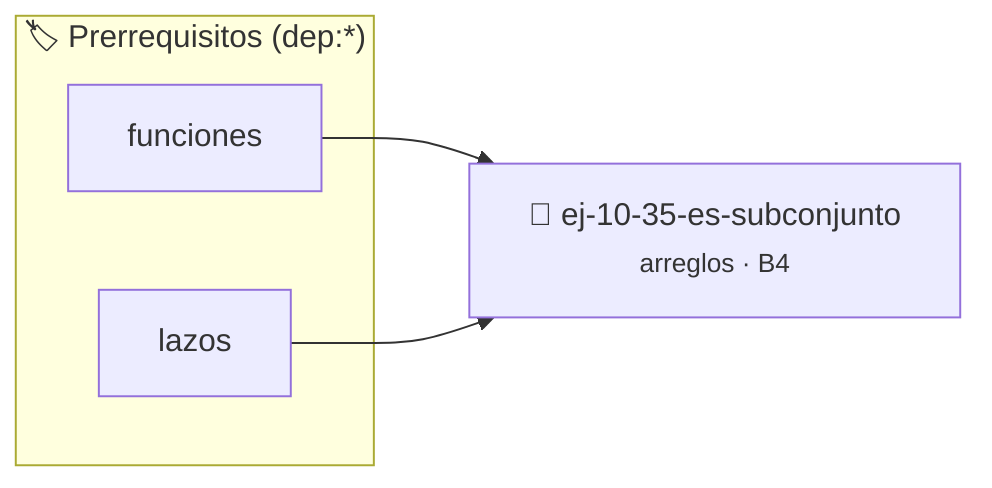

# ¿Es subconjunto?
> **ID:** `ej-10-35-es-subconjunto` · **Unidad:** 2 (Tipos Compuestos y Direccionamiento)
 · **Tema:** `arreglos` / `vectores`
 · **Bloom:** B4 (Analizar) · **Dificultad:** Avanzada
 · **Carga:** ~35 min · **Tipo:** Practica Guiada
>
> **🏷️ Prerrequisitos temáticos (tags):** `dep:funciones`, `dep:lazos`
>
> **Etiquetas conceptuales:** `vectores`, `arreglos`, `subconjunto`, `memoria`


::: {admonition} 📦 Paquete de Verificación Local (Ripley)
:class: tip

Para compilar, resolver y autoevaluar tu entrega con pruebas unitarias en tu máquina:

- [📥 **Descargar paquete `ej-10-35-es-subconjunto.ripkg`**](../../paquetes/ej-10-35-es-subconjunto.ripkg)

Ejecución con el asistente de cátedra:
```bash
ripley run ej-10-35-es-subconjunto.ripkg
```
:::


### 🗺️ Itinerario Pedagógico




## 📖 Consigna

Implementar una función que determine si un arreglo `A` es un subconjunto de
otro arreglo `B`. Esto significa que todos los elementos de `A` deben estar
presentes en `B`.


:::{tip} Ayuda (pseudocódigo)
:class: dropdown
```{code-block} pseudocode
:linenos:
FUNCION es_subconjunto(A, nA, B, nB)
VARIABLES:
    i, j (enteros)
INICIO
    ORDENAR(A, nA)
    ORDENAR(B, nB)
    i = 0, j = 0
    MIENTRAS i < nA Y j < nB HACER
        SI A[i] > B[j] ENTONCES
            j = j + 1
        SINO SI A[i] == B[j] ENTONCES
            i = i + 1, j = j + 1
        SINO // A[i] < B[j]
            RETORNAR FALSO
        FIN SI
    FIN MIENTRAS

    RETORNAR (i == nA)
FIN FUNCION

```

:::

### 📋 Contrato de las Funciones

```c
/*
 * Procesa el flujo principal de ¿Es subconjunto?
 * Precondiciones: val representa el parámetro de entrada del flujo.
 * Postcondiciones: Retorna el resultado correspondiente o 0 si val <= 0.
 */
int proc_10_35_es_subconjunto(int val);

```

### 🧪 Ejemplos de Ejecución

::::{tab-set}
:::{tab-item} Valor positivo
```text
Entrada: 5
Salida / Retorno: 10
```
:::
:::{tab-item} Valor cero o negativo
```text
Entrada: 0
Salida / Retorno: 0
```
:::
::::

### ⚠️ Precondiciones y Casos Borde

1. **Valores fuera de rango:** Verificar siempre que los datos de entrada cumplan con los rangos admisibles antes de operar.
6. **Casos vacíos o neutros:** Contemplar adecuadamente entradas con longitud cero o valores neutros según corresponda.

### 🎯 Criterios de Aceptación

- [ ] El código compila limpiamente bajo estándar C11 sin warnings con flags estrictos (`-Wall -Wextra -Werror`).
- [ ] Se satisfacen todas las pruebas unitarias y casos de prueba provistos.
- [ ] Las funciones validan exhaustivamente sus precondiciones y gestionan casos borde de forma robusta.

:::{hint} Consideraciones Didácticas
- **Proceso (con ordenamiento):**
- Ordenar ambos arreglos, `A` y `B`.
- Usar dos punteros, `i` para `A` y `j` para `B`.
- Recorrer ambos arreglos. Si `A[i] == B[j]`, se encontró una coincidencia, avanzar ambos. Si `A[i] > B[j]`, avanzar `j`. Si `A[i] < B[j]`, significa que `A[i]` no está en `B`, por lo que no es subconjunto.
- Validar punteros `NULL` recibidos como parámetro para evitar fallos de segmentación.
- Implementar una versión utilizando aritmética de punteros en lugar de indexación directa.
:::


## 📋 Prototipos y Cabecera (`ej-10-35-es-subconjunto.h`)

```{code-block} c
#ifndef EJERCICIO_EJ_10_35_ES_SUBCONJUNTO_H
#define EJERCICIO_EJ_10_35_ES_SUBCONJUNTO_H

#include <stddef.h>
#include <stdbool.h>
#include <stdint.h>

/* Procesa el flujo principal de ¿Es subconjunto? */
int proc_10_35_es_subconjunto(int val);

#endif /* EJERCICIO_EJ_10_35_ES_SUBCONJUNTO_H */
```


## ⚙️ Especificación de Funciones

| Función | Retorno | Parámetros | Descripción |
| :--- | :--- | :--- | :--- |

| `proc_10_35_es_subconjunto` | `int` | `int val` | Procesa el flujo principal de ¿Es subconjunto? |


## 💡 Pistas Progresivas

````{tab-set}

```{tab-item} Pista 1
**Proceso (con ordenamiento):**
```

```{tab-item} Pista 2
Ordenar ambos arreglos, `A` y `B`.
```

```{tab-item} Pista 3
Usar dos punteros, `i` para `A` y `j` para `B`.
```

```{tab-item} Pista 4
Recorrer ambos arreglos. Si `A[i] == B[j]`, se encontró una coincidencia, avanzar ambos. Si `A[i] > B[j]`, avanzar `j`. Si `A[i] < B[j]`, significa que `A[i]` no está en `B`, por lo que no es subconjunto.
```

```{tab-item} Pista 5
[Plus Ultra] Validar punteros `NULL` recibidos como parámetro para evitar fallos de segmentación.
```

```{tab-item} Pista 6
[Plus Ultra] Implementar una versión utilizando aritmética de punteros en lugar de indexación directa.
```

````


## 🧪 Casos de Prueba

| Prueba Unitaria | Función Objetivo | Verificación |
| :--- | :--- | :--- |

| **test_proc_10_35_es_subconjunto_positivo** | `proc_10_35_es_subconjunto` | `int res = proc_10_35_es_subconjunto(5); assert(res == 10 || res >= 0);` |

| **test_proc_10_35_es_subconjunto_cero** | `proc_10_35_es_subconjunto` | `int res = proc_10_35_es_subconjunto(0); assert(res == 0);` |


## ✓ Solución Modelo de Cátedra

```{dropdown} 🔍 Revelar solución canónica en C
:open: false

```{code-block} c
/*
 * Ejercicio: ¿Es subconjunto?
 * Cátedra Programación I - UNRN
 */

#include <stdio.h>


int proc_10_35_es_subconjunto(int val)
{
    if (val <= 0) return 0;
    return val * 2;
}

int main(void)
{
    /* TODO: Implementación de ¿Es subconjunto? */
    return 0;
}
```
```
