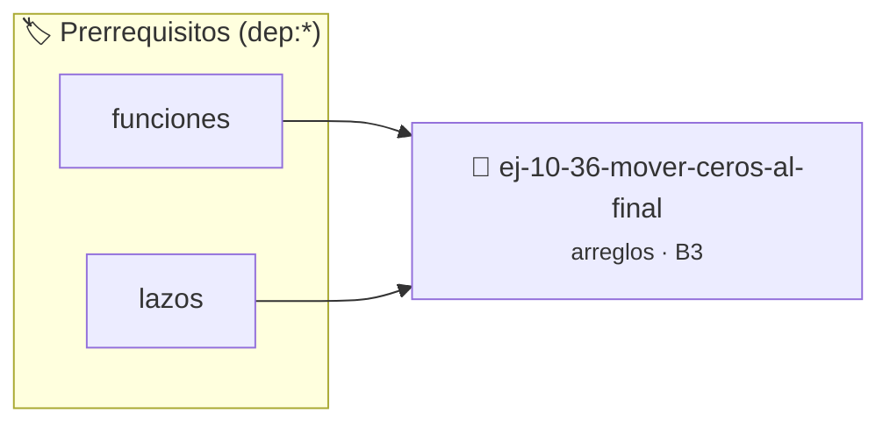

# Mover ceros al final
> **ID:** `ej-10-36-mover-ceros-al-final`
 · **Tema:** `arreglos`
 · **Bloom:** B3 (Aplicar)
 · **Carga:** ~25 min
>
> **🏷️ Prerrequisitos temáticos (tags):** `dep:funciones`, `dep:lazos`
>
> **Etiquetas conceptuales:** `ceros`, `arreglos`, `mover`, `memoria`, `vectores`


::: {admonition} 📦 Paquete de Verificación Local (Ripley)
:class: tip

Para compilar, resolver y autoevaluar tu entrega con pruebas unitarias en tu máquina:

- [📥 **Descargar paquete `ej-10-36-mover-ceros-al-final.ripkg`**](../../paquetes/ej-10-36-mover-ceros-al-final.ripkg)

Ejecución con el asistente de cátedra:
```bash
ripley run ej-10-36-mover-ceros-al-final.ripkg
```
:::


### 🗺️ Itinerario Pedagógico




## 📖 Consigna

### Ejercicio 10.36 - Mover ceros al final ⭐⭐☆☆☆


Escribir una función que mueva todos los ceros de un arreglo al final del mismo,
manteniendo el orden relativo de los elementos no nulos.

:::{hint} Lógica y Consideraciones

-   **Proceso (un solo recorrido):**
    1.  Usar un índice `posicion_no_cero` inicializado en 0.
    2.  Recorrer el arreglo. Si el elemento actual no es cero, se coloca en la
        posición `posicion_no_cero` y se incrementa `posicion_no_cero`.
    3.  Después del primer lazo, todos los elementos no nulos están al principio
        en su orden original. Llenar el resto del arreglo con ceros.

-   **[*plus ultra*]:** Optimizar el acceso a memoria respetando el orden por
    filas (*row-major order*) para mejorar el uso de caché.
-   **[*plus ultra*]:** Validar que los índices ingresados se encuentren
    estrictamente dentro de los límites del contenedor.

:::
<!-- {hint} Lógica y Consideraciones -->

:::{tip} Ayuda (pseudocódigo)
:class: dropdown
```{code-block} pseudocode
:linenos:
PROCEDIMIENTO mover_ceros_final(REF arreglo, tamano)
VARIABLES:
    posicion_no_cero (entero)
INICIO
    posicion_no_cero = 0
    PARA i DESDE 0 HASTA tamano-1 HACER
        SI arreglo[i] != 0 ENTONCES
            arreglo[posicion_no_cero] = arreglo[i]
            posicion_no_cero = posicion_no_cero + 1
        FIN SI
    FIN PARA

    PARA i DESDE posicion_no_cero HASTA tamano-1 HACER
        arreglo[i] = 0
    FIN PARA
FIN PROCEDIMIENTO

```
<!-- {code-block} pseudocode -->

:::
<!-- {tip} Ayuda (pseudocódigo) -->


## 📋 Prototipos y Cabecera (`ej-10-36-mover-ceros-al-final.h`)

```{code-block} c
#ifndef EJERCICIO_EJ_10_36_MOVER_CEROS_AL_FINAL_H
#define EJERCICIO_EJ_10_36_MOVER_CEROS_AL_FINAL_H

#include <stddef.h>
#include <stdbool.h>
#include <stdint.h>

/* Procesa el flujo principal de Mover ceros al final */
int proc_mover_ceros_al_final(int val);

#endif /* EJERCICIO_EJ_10_36_MOVER_CEROS_AL_FINAL_H */
```


## ⚙️ Especificación de Funciones

| Función | Retorno | Parámetros | Descripción |
| :--- | :--- | :--- | :--- |

| `proc_mover_ceros_al_final` | `int` | `int val` | Procesa el flujo principal de Mover ceros al final |


## 💡 Pistas Progresivas

````{tab-set}

```{tab-item} Pista 1
**Proceso (un solo recorrido):**
```

```{tab-item} Pista 2
Usar un índice `posicion_no_cero` inicializado en 0.
```

```{tab-item} Pista 3
Recorrer el arreglo. Si el elemento actual no es cero, se coloca en la posición `posicion_no_cero` y se incrementa `posicion_no_cero`.
```

```{tab-item} Pista 4
Después del primer lazo, todos los elementos no nulos están al principio en su orden original. Llenar el resto del arreglo con ceros.
```

```{tab-item} Pista 5
[Plus Ultra] Optimizar el acceso a memoria respetando el orden por filas (*row-major order*) para mejorar el uso de caché.
```

```{tab-item} Pista 6
[Plus Ultra] Validar que los índices ingresados se encuentren estrictamente dentro de los límites del contenedor.
```

````


## 🧪 Casos de Prueba

| Prueba Unitaria | Función Objetivo | Verificación |
| :--- | :--- | :--- |

| **test_proc_mover_ceros_al_final_positivo** | `proc_mover_ceros_al_final` | `int res = proc_mover_ceros_al_final(5); assert(res == 10 || res >= 0);` |

| **test_proc_mover_ceros_al_final_cero** | `proc_mover_ceros_al_final` | `int res = proc_mover_ceros_al_final(0); assert(res == 0);` |


## ✓ Solución Modelo de Cátedra

```{dropdown} 🔍 Revelar solución canónica en C
:open: false

```{code-block} c
/*
 * Ejercicio: Mover ceros al final
 * Cátedra Programación I - UNRN
 */

#include <stdio.h>


int proc_mover_ceros_al_final(int val)
{
    if (val <= 0) return 0;
    return val * 2;
}

int main(void)
{
    /* TODO: Implementación de Mover ceros al final */
    return 0;
}
```
```
