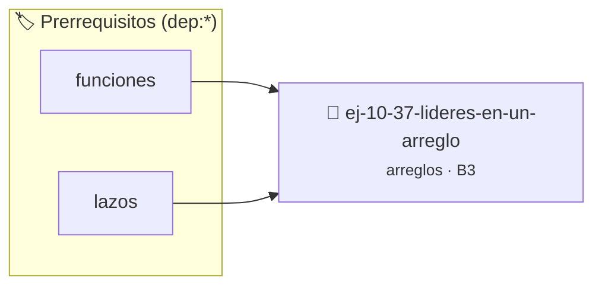

# Líderes en un arreglo
> **ID:** `ej-10-37-lideres-en-un-arreglo`
 · **Tema:** `arreglos`
 · **Bloom:** B3 (Aplicar)
 · **Carga:** ~25 min
>
> **🏷️ Prerrequisitos temáticos (tags):** `dep:funciones`, `dep:lazos`
>
> **Etiquetas conceptuales:** `arreglo`, `lideres`, `arreglos`, `memoria`, `vectores`


::: {admonition} 📦 Paquete de Verificación Local (Ripley)
:class: tip

Para compilar, resolver y autoevaluar tu entrega con pruebas unitarias en tu máquina:

- [📥 **Descargar paquete `ej-10-37-lideres-en-un-arreglo.ripkg`**](../../paquetes/ej-10-37-lideres-en-un-arreglo.ripkg)

Ejecución con el asistente de cátedra:
```bash
ripley run ej-10-37-lideres-en-un-arreglo.ripkg
```
:::


### 🗺️ Itinerario Pedagógico




## 📖 Consigna

### Ejercicio 10.37 - Líderes en un arreglo ⭐⭐⭐☆☆


Encontrar todos los "líderes" en un arreglo. Un elemento es un líder si es mayor
que todos los elementos que se encuentran a su derecha. El elemento más a la
derecha siempre es un líder.

:::{hint} Lógica y Consideraciones

-   **Proceso (recorrido inverso):** La forma más eficiente es recorrer el
    arreglo de derecha a izquierda.
    1.  El último elemento siempre es un líder. Guardarlo como `maximo_derecha`.
    2.  Iterar desde el penúltimo elemento hacia el principio.
    3.  Si el elemento actual es mayor que `maximo_derecha`, es un nuevo líder.
        Imprimirlo y actualizar `maximo_derecha`.

-   **[*plus ultra*]:** Optimizar el acceso a memoria respetando el orden por
    filas (*row-major order*) para mejorar el uso de caché.
-   **[*plus ultra*]:** Validar que los índices ingresados se encuentren
    estrictamente dentro de los límites del contenedor.

:::
<!-- {hint} Lógica y Consideraciones -->

:::{tip} Ayuda (pseudocódigo)
:class: dropdown
```{code-block} pseudocode
:linenos:
PROCEDIMIENTO encontrar_lideres(arreglo, tamano)
VARIABLES:
    maximo_derecha (entero)
INICIO
    maximo_derecha = arreglo[tamano-1]
    ESCRIBIR maximo_derecha

    PARA i DESDE tamano-2 HASTA 0 CON PASO -1 HACER
        SI arreglo[i] > maximo_derecha ENTONCES
            maximo_derecha = arreglo[i]
            ESCRIBIR maximo_derecha
        FIN SI
    FIN PARA
FIN PROCEDIMIENTO

```
<!-- {code-block} pseudocode -->

:::
<!-- {tip} Ayuda (pseudocódigo) -->


## 📋 Prototipos y Cabecera (`ej-10-37-lideres-en-un-arreglo.h`)

```{code-block} c
#ifndef EJERCICIO_EJ_10_37_LIDERES_EN_UN_ARREGLO_H
#define EJERCICIO_EJ_10_37_LIDERES_EN_UN_ARREGLO_H

#include <stddef.h>
#include <stdbool.h>
#include <stdint.h>

/* Procesa el flujo principal de Líderes en un arreglo */
int proc_ideres_en_un_arreglo(int val);

#endif /* EJERCICIO_EJ_10_37_LIDERES_EN_UN_ARREGLO_H */
```


## ⚙️ Especificación de Funciones

| Función | Retorno | Parámetros | Descripción |
| :--- | :--- | :--- | :--- |

| `proc_ideres_en_un_arreglo` | `int` | `int val` | Procesa el flujo principal de Líderes en un arreglo |


## 💡 Pistas Progresivas

````{tab-set}

```{tab-item} Pista 1
**Proceso (recorrido inverso):** La forma más eficiente es recorrer el arreglo de derecha a izquierda.
```

```{tab-item} Pista 2
El último elemento siempre es un líder. Guardarlo como `maximo_derecha`.
```

```{tab-item} Pista 3
Iterar desde el penúltimo elemento hacia el principio.
```

```{tab-item} Pista 4
Si el elemento actual es mayor que `maximo_derecha`, es un nuevo líder. Imprimirlo y actualizar `maximo_derecha`.
```

```{tab-item} Pista 5
[Plus Ultra] Optimizar el acceso a memoria respetando el orden por filas (*row-major order*) para mejorar el uso de caché.
```

```{tab-item} Pista 6
[Plus Ultra] Validar que los índices ingresados se encuentren estrictamente dentro de los límites del contenedor.
```

````


## 🧪 Casos de Prueba

| Prueba Unitaria | Función Objetivo | Verificación |
| :--- | :--- | :--- |

| **test_proc_ideres_en_un_arreglo_positivo** | `proc_ideres_en_un_arreglo` | `int res = proc_ideres_en_un_arreglo(5); assert(res == 10 || res >= 0);` |

| **test_proc_ideres_en_un_arreglo_cero** | `proc_ideres_en_un_arreglo` | `int res = proc_ideres_en_un_arreglo(0); assert(res == 0);` |


## ✓ Solución Modelo de Cátedra

```{dropdown} 🔍 Revelar solución canónica en C
:open: false

```{code-block} c
/*
 * Ejercicio: Líderes en un arreglo
 * Cátedra Programación I - UNRN
 */

#include <stdio.h>


int proc_ideres_en_un_arreglo(int val)
{
    if (val <= 0) return 0;
    return val * 2;
}

int main(void)
{
    /* TODO: Implementación de Líderes en un arreglo */
    return 0;
}
```
```
