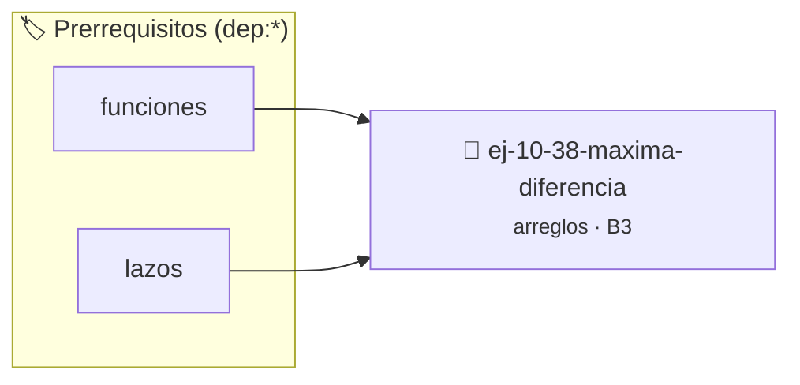

# Máxima diferencia
> **ID:** `ej-10-38-maxima-diferencia`
 · **Tema:** `arreglos`
 · **Bloom:** B3 (Aplicar)
 · **Carga:** ~25 min
>
> **🏷️ Prerrequisitos temáticos (tags):** `dep:funciones`, `dep:lazos`
>
> **Etiquetas conceptuales:** `arreglos`, `diferencia`, `memoria`, `maxima`, `vectores`


::: {admonition} 📦 Paquete de Verificación Local (Ripley)
:class: tip

Para compilar, resolver y autoevaluar tu entrega con pruebas unitarias en tu máquina:

- [📥 **Descargar paquete `ej-10-38-maxima-diferencia.ripkg`**](../../paquetes/ej-10-38-maxima-diferencia.ripkg)

Ejecución con el asistente de cátedra:
```bash
ripley run ej-10-38-maxima-diferencia.ripkg
```
:::


### 🗺️ Itinerario Pedagógico




## 📖 Consigna

### Ejercicio 10.38 - Máxima diferencia ⭐⭐☆☆☆


Encontrar la máxima diferencia `arr[j] - arr[i]` en un arreglo, con la condición
de que el índice `j` sea mayor que el índice `i`.

:::{hint} Lógica y Consideraciones

-   **Proceso (un solo recorrido):**
    1.  Mantener dos variables: `max_diferencia` y `min_elemento`.
    2.  Inicializar `max_diferencia` a un valor muy bajo y `min_elemento` con el
        primer elemento.
    3.  Recorrer el arreglo desde el segundo elemento. En cada paso:
        a. Actualizar `max_diferencia` si `elemento_actual - min_elemento` es
        mayor.
        b. Actualizar `min_elemento` si `elemento_actual` es menor.

-   **[*plus ultra*]:** Optimizar el acceso a memoria respetando el orden por
    filas (*row-major order*) para mejorar el uso de caché.
-   **[*plus ultra*]:** Validar que los índices ingresados se encuentren
    estrictamente dentro de los límites del contenedor.

:::
<!-- {hint} Lógica y Consideraciones -->

:::{tip} Ayuda (pseudocódigo)
:class: dropdown
```{code-block} pseudocode
:linenos:
FUNCION max_diferencia(arreglo, tamano)
VARIABLES:
    max_diferencia, min_elemento
INICIO
    min_elemento = arreglo[0]
    max_diferencia = arreglo[1] - arreglo[0]

    PARA i DESDE 1 HASTA tamano-1 HACER
        SI (arreglo[i] - min_elemento) > max_diferencia ENTONCES
            max_diferencia = arreglo[i] - min_elemento
        FIN SI
        SI arreglo[i] < min_elemento ENTONCES
            min_elemento = arreglo[i]
        FIN SI
    FIN PARA
    RETORNAR max_diferencia
FIN FUNCION

```
<!-- {code-block} pseudocode -->

:::
<!-- {tip} Ayuda (pseudocódigo) -->


## 📋 Prototipos y Cabecera (`ej-10-38-maxima-diferencia.h`)

```{code-block} c
#ifndef EJERCICIO_EJ_10_38_MAXIMA_DIFERENCIA_H
#define EJERCICIO_EJ_10_38_MAXIMA_DIFERENCIA_H

#include <stddef.h>
#include <stdbool.h>
#include <stdint.h>

/* Procesa el flujo principal de Máxima diferencia */
int proc_38_maxima_diferencia(int val);

#endif /* EJERCICIO_EJ_10_38_MAXIMA_DIFERENCIA_H */
```


## ⚙️ Especificación de Funciones

| Función | Retorno | Parámetros | Descripción |
| :--- | :--- | :--- | :--- |

| `proc_38_maxima_diferencia` | `int` | `int val` | Procesa el flujo principal de Máxima diferencia |


## 💡 Pistas Progresivas

````{tab-set}

```{tab-item} Pista 1
**Proceso (un solo recorrido):**
```

```{tab-item} Pista 2
Mantener dos variables: `max_diferencia` y `min_elemento`.
```

```{tab-item} Pista 3
Inicializar `max_diferencia` a un valor muy bajo y `min_elemento` con el primer elemento.
```

```{tab-item} Pista 4
Recorrer el arreglo desde el segundo elemento. En cada paso: a. Actualizar `max_diferencia` si `elemento_actual - min_elemento` es mayor. b. Actualizar `min_elemento` si `elemento_actual` es menor.
```

```{tab-item} Pista 5
[Plus Ultra] Optimizar el acceso a memoria respetando el orden por filas (*row-major order*) para mejorar el uso de caché.
```

```{tab-item} Pista 6
[Plus Ultra] Validar que los índices ingresados se encuentren estrictamente dentro de los límites del contenedor.
```

````


## 🧪 Casos de Prueba

| Prueba Unitaria | Función Objetivo | Verificación |
| :--- | :--- | :--- |

| **test_proc_38_maxima_diferencia_positivo** | `proc_38_maxima_diferencia` | `int res = proc_38_maxima_diferencia(5); assert(res == 10 || res >= 0);` |

| **test_proc_38_maxima_diferencia_cero** | `proc_38_maxima_diferencia` | `int res = proc_38_maxima_diferencia(0); assert(res == 0);` |


## ✓ Solución Modelo de Cátedra

```{dropdown} 🔍 Revelar solución canónica en C
:open: false

```{code-block} c
/*
 * Ejercicio: Máxima diferencia
 * Cátedra Programación I - UNRN
 */

#include <stdio.h>


int proc_38_maxima_diferencia(int val)
{
    if (val <= 0) return 0;
    return val * 2;
}

int main(void)
{
    /* TODO: Implementación de Máxima diferencia */
    return 0;
}
```
```
