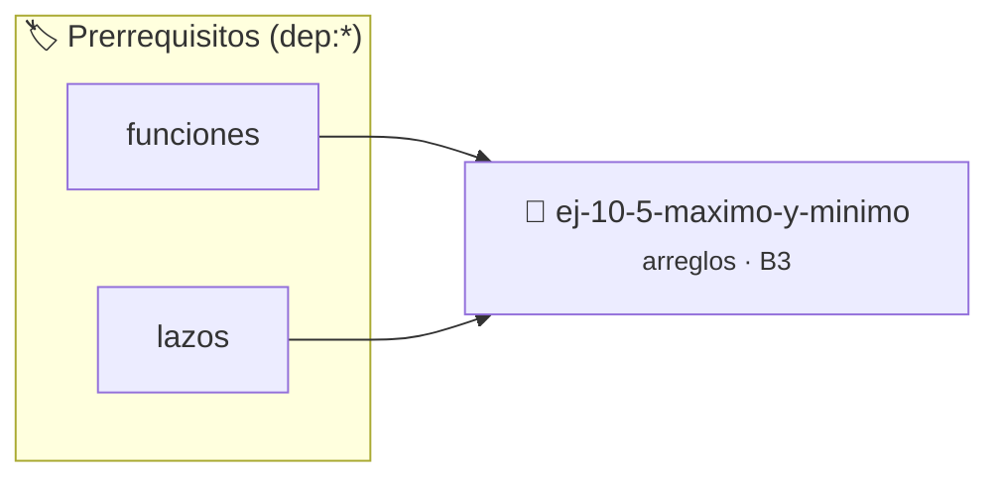

# Máximo y mínimo
> **ID:** `ej-10-5-maximo-y-minimo` · **Unidad:** 2 (Tipos Compuestos y Direccionamiento)
 · **Tema:** `arreglos` / `maximo`
 · **Bloom:** B3 (Aplicar) · **Dificultad:** Intermedia
 · **Carga:** ~25 min · **Tipo:** Practica Guiada
>
> **🏷️ Prerrequisitos temáticos (tags):** `dep:funciones`, `dep:lazos`
>
> **Etiquetas conceptuales:** `maximo`, `arreglos`, `memoria`, `vectores`, `minimo`


::: {admonition} 📦 Paquete de Verificación Local (Ripley)
:class: tip

Para compilar, resolver y autoevaluar tu entrega con pruebas unitarias en tu máquina:

- [📥 **Descargar paquete `ej-10-5-maximo-y-minimo.ripkg`**](../../paquetes/ej-10-5-maximo-y-minimo.ripkg)

Ejecución con el asistente de cátedra:
```bash
ripley run ej-10-5-maximo-y-minimo.ripkg
```
:::


### 🗺️ Itinerario Pedagógico




## 📖 Consigna

Encontrar los valores más grande (máximo) y más pequeño (mínimo) dentro de un
arreglo de números.


:::{tip} Ayuda (pseudocódigo)
:class: dropdown
```{code-block} pseudocode
:linenos:
PROCEDIMIENTO encontrar_max_min(arreglo, tamano, REF maximo, REF minimo)
INICIO
    SI tamano == 0 ENTONCES TERMINAR // Arreglo vacío

    maximo = arreglo[0]
    minimo = arreglo[0]

    PARA i DESDE 1 HASTA tamano-1 HACER
        SI arreglo[i] > maximo ENTONCES
            maximo = arreglo[i]
        FIN SI
        SI arreglo[i] < minimo ENTONCES
            minimo = arreglo[i]
        FIN SI
    FIN PARA
FIN PROCEDIMIENTO

```

:::

### 📋 Contrato de las Funciones

```c
/*
 * Procesa el flujo principal de Máximo y mínimo
 * Precondiciones: val representa el parámetro de entrada del flujo.
 * Postcondiciones: Retorna el resultado correspondiente o 0 si val <= 0.
 */
int proc_10_5_maximo_y_minimo(int val);

```

### 🧪 Ejemplos de Ejecución

::::{tab-set}
:::{tab-item} Valor positivo
```text
Entrada: 5
Salida / Retorno: 10
```
:::
:::{tab-item} Valor cero o negativo
```text
Entrada: 0
Salida / Retorno: 0
```
:::
::::

### ⚠️ Precondiciones y Casos Borde

1. **Valores fuera de rango:** Verificar siempre que los datos de entrada cumplan con los rangos admisibles antes de operar.
6. **Casos vacíos o neutros:** Contemplar adecuadamente entradas con longitud cero o valores neutros según corresponda.

### 🎯 Criterios de Aceptación

- [ ] El código compila limpiamente bajo estándar C11 sin warnings con flags estrictos (`-Wall -Wextra -Werror`).
- [ ] Se satisfacen todas las pruebas unitarias y casos de prueba provistos.
- [ ] Las funciones validan exhaustivamente sus precondiciones y gestionan casos borde de forma robusta.

:::{hint} Consideraciones Didácticas
- **Entrada:** Un arreglo y su tamaño.
- **Proceso:**
- Inicializar dos variables, `maximo` y `minimo`, con el valor del primer elemento del arreglo (`arreglo[0]`).
- Recorrer el arreglo con un lazo `for` comenzando desde el segundo elemento (`i=1`).
- En cada iteración, comparar el elemento actual `arreglo[i]` con `maximo`. Si `arreglo[i]` es mayor, actualizar `maximo`.
- Hacer lo mismo para `minimo`, actualizándolo si `arreglo[i]` es menor.
- **Salida:** Devolver los valores de `maximo` y `minimo` (por ejemplo, usando punteros).
- Validar punteros `NULL` recibidos como parámetro para evitar fallos de segmentación.
- Implementar una versión utilizando aritmética de punteros en lugar de indexación directa.
:::


## 📋 Prototipos y Cabecera (`ej-10-5-maximo-y-minimo.h`)

```{code-block} c
#ifndef EJERCICIO_EJ_10_5_MAXIMO_Y_MINIMO_H
#define EJERCICIO_EJ_10_5_MAXIMO_Y_MINIMO_H

#include <stddef.h>
#include <stdbool.h>
#include <stdint.h>

/* Procesa el flujo principal de Máximo y mínimo */
int proc_10_5_maximo_y_minimo(int val);

#endif /* EJERCICIO_EJ_10_5_MAXIMO_Y_MINIMO_H */
```


## ⚙️ Especificación de Funciones

| Función | Retorno | Parámetros | Descripción |
| :--- | :--- | :--- | :--- |

| `proc_10_5_maximo_y_minimo` | `int` | `int val` | Procesa el flujo principal de Máximo y mínimo |


## 💡 Pistas Progresivas

````{tab-set}

```{tab-item} Pista 1
**Entrada:** Un arreglo y su tamaño.
```

```{tab-item} Pista 2
**Proceso:**
```

```{tab-item} Pista 3
Inicializar dos variables, `maximo` y `minimo`, con el valor del primer elemento del arreglo (`arreglo[0]`).
```

```{tab-item} Pista 4
Recorrer el arreglo con un lazo `for` comenzando desde el segundo elemento (`i=1`).
```

```{tab-item} Pista 5
En cada iteración, comparar el elemento actual `arreglo[i]` con `maximo`. Si `arreglo[i]` es mayor, actualizar `maximo`.
```

```{tab-item} Pista 6
Hacer lo mismo para `minimo`, actualizándolo si `arreglo[i]` es menor.
```

```{tab-item} Pista 7
**Salida:** Devolver los valores de `maximo` y `minimo` (por ejemplo, usando punteros).
```

```{tab-item} Pista 8
[Plus Ultra] Validar punteros `NULL` recibidos como parámetro para evitar fallos de segmentación.
```

```{tab-item} Pista 9
[Plus Ultra] Implementar una versión utilizando aritmética de punteros en lugar de indexación directa.
```

````


## 🧪 Casos de Prueba

| Prueba Unitaria | Función Objetivo | Verificación |
| :--- | :--- | :--- |

| **test_proc_10_5_maximo_y_minimo_positivo** | `proc_10_5_maximo_y_minimo` | `int res = proc_10_5_maximo_y_minimo(5); assert(res == 10 || res >= 0);` |

| **test_proc_10_5_maximo_y_minimo_cero** | `proc_10_5_maximo_y_minimo` | `int res = proc_10_5_maximo_y_minimo(0); assert(res == 0);` |


## ✓ Solución Modelo de Cátedra

```{dropdown} 🔍 Revelar solución canónica en C
:open: false

```{code-block} c
/*
 * Ejercicio: Máximo y mínimo
 * Cátedra Programación I - UNRN
 */

#include <stdio.h>


int proc_10_5_maximo_y_minimo(int val)
{
    if (val <= 0) return 0;
    return val * 2;
}

int main(void)
{
    /* TODO: Implementación de Máximo y mínimo */
    return 0;
}
```
```
