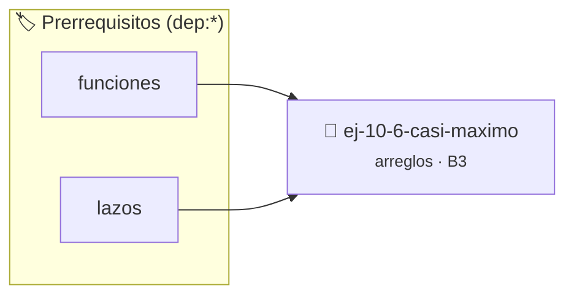

# Casi máximo
> **ID:** `ej-10-6-casi-maximo` · **Unidad:** 2 (Tipos Compuestos y Direccionamiento)
 · **Tema:** `arreglos` / `vectores`
 · **Bloom:** B3 (Aplicar) · **Dificultad:** Intermedia
 · **Carga:** ~25 min · **Tipo:** Practica Guiada
>
> **🏷️ Prerrequisitos temáticos (tags):** `dep:funciones`, `dep:lazos`
>
> **Etiquetas conceptuales:** `vectores`, `arreglos`, `maximo`, `memoria`


::: {admonition} 📦 Paquete de Verificación Local (Ripley)
:class: tip

Para compilar, resolver y autoevaluar tu entrega con pruebas unitarias en tu máquina:

- [📥 **Descargar paquete `ej-10-6-casi-maximo.ripkg`**](../../paquetes/ej-10-6-casi-maximo.ripkg)

Ejecución con el asistente de cátedra:
```bash
ripley run ej-10-6-casi-maximo.ripkg
```
:::


### 🗺️ Itinerario Pedagógico




## 📖 Consigna

### Ejercicio 10.6 - Casi máximo ⭐⭐☆☆☆


Encontrar el segundo elemento más grande en un arreglo. Este ejercicio requiere
un seguimiento más cuidadoso que simplemente encontrar el máximo.

:::{hint} Lógica y Consideraciones

-   **Entrada:** Un arreglo y su tamaño.
-   **Variables:** Se necesitan dos variables: `maximo` y `segundo_maximo`.
    Inicializarlas con el menor valor posible o con los dos primeros elementos
    del arreglo de forma ordenada.
-   **Proceso:**
    1.  Recorrer el arreglo.
    2.  Si el elemento actual `x` es mayor que `maximo`:
        a. `segundo_maximo` toma el valor de `maximo`.
        b. `maximo` toma el valor de `x`.
    3.  Si no, si `x` es mayor que `segundo_maximo` y diferente de `maximo`, se
        actualiza `segundo_maximo` a `x`.

-   **[*plus ultra*]:** Optimizar el acceso a memoria respetando el orden por
    filas (*row-major order*) para mejorar el uso de caché.
-   **[*plus ultra*]:** Validar que los índices ingresados se encuentren
    estrictamente dentro de los límites del contenedor.

:::
<!-- {hint} Lógica y Consideraciones -->

:::{tip} Ayuda (pseudocódigo)
:class: dropdown
```{code-block} pseudocode
:linenos:
FUNCION encontrar_segundo_maximo(arreglo, tamano)
VARIABLES:
    maximo, segundo_maximo
INICIO
    // Inicializar con los dos primeros elementos o valores muy bajos
    maximo = MINIMO_VALOR_POSIBLE
    segundo_maximo = MINIMO_VALOR_POSIBLE

    PARA cada elemento x EN arreglo HACER
        SI x > maximo ENTONCES
            segundo_maximo = maximo
            maximo = x
        SINO SI x > segundo_maximo Y x < maximo ENTONCES
            segundo_maximo = x
        FIN SI
    FIN PARA
    RETORNAR segundo_maximo
FIN FUNCION

```
<!-- {code-block} pseudocode -->

:::
<!-- {tip} Ayuda (pseudocódigo) -->


## 📋 Prototipos y Cabecera (`ej-10-6-casi-maximo.h`)

```{code-block} c
#ifndef EJERCICIO_EJ_10_6_CASI_MAXIMO_H
#define EJERCICIO_EJ_10_6_CASI_MAXIMO_H

#include <stddef.h>
#include <stdbool.h>
#include <stdint.h>

/* Procesa el flujo principal de Casi máximo */
int ejecutar_ej_10_6_casi_maximo(int val);

#endif /* EJERCICIO_EJ_10_6_CASI_MAXIMO_H */
```


## ⚙️ Especificación de Funciones

| Función | Retorno | Parámetros | Descripción |
| :--- | :--- | :--- | :--- |

| `ejecutar_ej_10_6_casi_maximo` | `int` | `int val` | Procesa el flujo principal de Casi máximo |


## 💡 Pistas Progresivas

````{tab-set}

```{tab-item} Pista 1
**Entrada:** Un arreglo y su tamaño.
```

```{tab-item} Pista 2
**Variables:** Se necesitan dos variables: `maximo` y `segundo_maximo`. Inicializarlas con el menor valor posible o con los dos primeros elementos del arreglo de forma ordenada.
```

```{tab-item} Pista 3
**Proceso:**
```

```{tab-item} Pista 4
Recorrer el arreglo.
```

```{tab-item} Pista 5
Si el elemento actual `x` es mayor que `maximo`: a. `segundo_maximo` toma el valor de `maximo`. b. `maximo` toma el valor de `x`.
```

```{tab-item} Pista 6
Si no, si `x` es mayor que `segundo_maximo` y diferente de `maximo`, se actualiza `segundo_maximo` a `x`.
```

```{tab-item} Pista 7
[Plus Ultra] Optimizar el acceso a memoria respetando el orden por filas (*row-major order*) para mejorar el uso de caché.
```

```{tab-item} Pista 8
[Plus Ultra] Validar que los índices ingresados se encuentren estrictamente dentro de los límites del contenedor.
```

````


## 🧪 Casos de Prueba

| Prueba Unitaria | Función Objetivo | Verificación |
| :--- | :--- | :--- |

| **test_ejecutar_ej_10_6_casi_maximo_positivo** | `ejecutar_ej_10_6_casi_maximo` | `int res = ejecutar_ej_10_6_casi_maximo(5); assert(res == 10 || res >= 0);` |

| **test_ejecutar_ej_10_6_casi_maximo_cero** | `ejecutar_ej_10_6_casi_maximo` | `int res = ejecutar_ej_10_6_casi_maximo(0); assert(res == 0);` |


## ✓ Solución Modelo de Cátedra

```{dropdown} 🔍 Revelar solución canónica en C
:open: false

```{code-block} c
/*
 * Ejercicio: Casi máximo
 * Cátedra Programación I - UNRN
 */

#include <stdio.h>


int ejecutar_ej_10_6_casi_maximo(int val)
{
    if (val <= 0) return 0;
    return val * 2;
}

int main(void)
{
    /* TODO: Implementación de Casi máximo */
    return 0;
}
```
```
