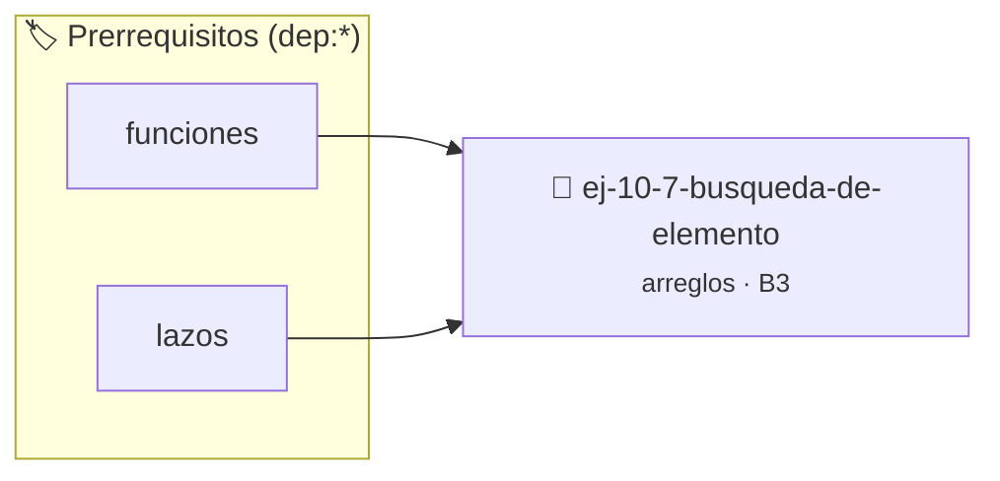

# Búsqueda de elemento
> **ID:** `ej-10-7-busqueda-de-elemento` · **Unidad:** 2 (Tipos Compuestos y Direccionamiento)
 · **Tema:** `arreglos` / `busqueda`
 · **Bloom:** B3 (Aplicar) · **Dificultad:** Intermedia
 · **Carga:** ~25 min · **Tipo:** Practica Guiada
>
> **🏷️ Prerrequisitos temáticos (tags):** `dep:funciones`, `dep:lazos`
>
> **Etiquetas conceptuales:** `busqueda`, `arreglos`, `memoria`, `vectores`, `elemento`


::: {admonition} 📦 Paquete de Verificación Local (Ripley)
:class: tip

Para compilar, resolver y autoevaluar tu entrega con pruebas unitarias en tu máquina:

- [📥 **Descargar paquete `ej-10-7-busqueda-de-elemento.ripkg`**](../../paquetes/ej-10-7-busqueda-de-elemento.ripkg)

Ejecución con el asistente de cátedra:
```bash
ripley run ej-10-7-busqueda-de-elemento.ripkg
```
:::


### 🗺️ Itinerario Pedagógico




## 📖 Consigna

### Ejercicio 10.7 - Búsqueda de elemento ⭐⭐☆☆☆

Implementá una **búsqueda lineal** (o secuencial) que encuentre la **primera
ocurrencia** de un elemento dentro de un arreglo de enteros. Si el elemento
está presente, la función debe devolver el índice de esa primera ocurrencia;
si no está, debe devolver `-1`.

Para eso, completá las dos funciones declaradas en
`ej-10-7-busqueda-de-elemento.h`:

```{code-block} c
:caption: Contrato de las funciones a implementar

/* Devuelve el índice de la primera aparición de `buscado` en
 * `arreglo[0 .. tamano - 1]`, o -1 si el elemento no está presente.
 *
 * Precondiciones:
 *   - `arreglo != NULL`, o bien `tamano == 0` (arreglo vacío);
 *   - `tamano` representa la cantidad *real* de elementos almacenados.
 * Poscondiciones:
 *   - -1 <= resultado < tamano;
 *   - si resultado >= 0, entonces arreglo[resultado] == buscado, y
 *     para todo k < resultado se cumple arreglo[k] != buscado.
 */
int busqueda_lineal(const int arreglo[], size_t tamano, int buscado);

/* Flujo principal: busca `val` en el arreglo de trabajo
 * {4, -2, 7, 0, -2, 9} y devuelve el índice hallado (o -1).
 */
int proc_busqueda_de_elemento(int val);
```

:::{note} Casos borde y precondiciones

Prestá especial atención a estas situaciones, que tu implementación debe
resolver correctamente:

-   **Arreglo vacío** (`tamano == 0`): el lazo no debe ejecutarse ni una
    iteración y la función devuelve `-1`.
-   **Elemento ausente**: se recorre el arreglo completo sin éxito y se
    devuelve `-1`.
-   **Elemento repetido**: se devuelve el índice de la **primera**
    aparición (por ejemplo, en `{4, -2, 7, 0, -2, 9}` el valor `-2`
    aparece en los índices 1 y 4: el resultado correcto es `1`).
-   **Elemento en los extremos**: verificá el comportamiento cuando el
    elemento buscado está en el índice `0` o en el índice `tamano - 1`.
-   **Valores negativos en el arreglo**: son elementos válidos y deben
    poder buscarse en igualdad de condiciones.

:::
<!-- {note} Casos borde y precondiciones -->

:::{tip} Ejemplos de ejecución
:class: dropdown

Con el arreglo de trabajo `{4, -2, 7, 0, -2, 9}` (índices `0` a `5`):

```{code-block} text
:caption: Elemento presente (ocurrencia única)

>>> busqueda_lineal(arreglo, 6, 7)
2            /* arreglo[2] == 7 */

>>> proc_busqueda_de_elemento(0)
3            /* arreglo[3] == 0 */
```

```{code-block} text
:caption: Elemento repetido: se informa la primera ocurrencia

>>> proc_busqueda_de_elemento(-2)
1            /* NO 4: la primera aparición de -2 está en el índice 1 */
```

```{code-block} text
:caption: Elemento ausente

>>> proc_busqueda_de_elemento(100)
-1           /* el lazo terminó sin hallar coincidencia */
```

```{code-block} text
:caption: Arreglo vacío

>>> busqueda_lineal(NULL, 0, 42)
-1           /* caso degenerado: no hay elementos por recorrer */
```

<!-- {code-block} text -->
:::
<!-- {tip} Ejemplos de ejecución -->

:::{hint} Lógica y consideraciones

-   **Entrada:** un arreglo de enteros, su tamaño (`size_t tamano`) y el
    elemento a buscar.
-   **Proceso:** recorré el arreglo con un lazo `for` desde el índice `0`
    hasta `tamano - 1`, en orden creciente.
-   **Condición:** en cada iteración, compará `arreglo[i]` con el elemento
    buscado; si son iguales, retorná `i` inmediatamente.
-   **Salida:** si el lazo termina sin encontrar el elemento, retorná `-1`
    como valor centinela de «no encontrado».
-   **Costo:** la búsqueda lineal examina a lo sumo `tamano` elementos
    (complejidad temporal $\mathcal{O}(n)$); no es posible garantizar un
    mejor orden de complejidad sobre un arreglo sin ordenar.

-   **[*plus ultra*]:** aprovechá que el recorrido secuencial en orden
    creciente de índices genera un patrón de acceso contiguo, favorable a la
    localidad espacial y al uso de la memoria caché.
-   **[*plus ultra*]:** defendé el contrato de la función: verificá la
    precondición `arreglo != NULL || tamano == 0` antes de indexar, y
    evitá leer o escribir fuera de `[0, tamano - 1]`.

:::
<!-- {hint} Lógica y consideraciones -->

:::{tip} Ayuda (pseudocódigo)
:class: dropdown
```{code-block} pseudocode
:linenos:
FUNCION busqueda_lineal(arreglo, tamano, buscado)
INICIO
    PARA i DESDE 0 HASTA tamano-1 HACER
        SI arreglo[i] == buscado ENTONCES
            RETORNAR i // Elemento encontrado
        FIN SI
    FIN PARA
    RETORNAR -1 // Elemento no encontrado
FIN FUNCION

```
<!-- {code-block} pseudocode -->

:::
<!-- {tip} Ayuda (pseudocódigo) -->


## 📋 Prototipos y Cabecera (`ej-10-7-busqueda-de-elemento.h`)

```{code-block} c
#ifndef EJERCICIO_EJ_10_7_BUSQUEDA_DE_ELEMENTO_H
#define EJERCICIO_EJ_10_7_BUSQUEDA_DE_ELEMENTO_H

#include <stddef.h>
#include <stdbool.h>
#include <stdint.h>

/* Procesa el flujo principal de Búsqueda de elemento */
int proc_busqueda_de_elemento(int val);

#endif /* EJERCICIO_EJ_10_7_BUSQUEDA_DE_ELEMENTO_H */
```


## ⚙️ Especificación de Funciones

| Función | Retorno | Parámetros | Descripción |
| :--- | :--- | :--- | :--- |

| `proc_busqueda_de_elemento` | `int` | `int val` | Procesa el flujo principal de Búsqueda de elemento |


## 💡 Pistas Progresivas

````{tab-set}

```{tab-item} Pista 1
**Entrada:** Un arreglo, su tamaño y el elemento a buscar.
```

```{tab-item} Pista 2
**Proceso:** Recorrer el arreglo con un lazo `for` desde el índice 0.
```

```{tab-item} Pista 3
**Condición:** En cada iteración, comparar el elemento actual del arreglo con el elemento buscado. Si son iguales, se ha encontrado.
```

```{tab-item} Pista 4
**Salida:** Si se encuentra el elemento, la función debe devolver el índice actual. Si el lazo termina sin encontrar el elemento, se debe devolver un valor especial que indique que no se encontró, como `-1`.
```

```{tab-item} Pista 5
[Plus Ultra] Optimizar el acceso a memoria respetando el orden por filas (*row-major order*) para mejorar el uso de caché.
```

```{tab-item} Pista 6
[Plus Ultra] Validar que los índices ingresados se encuentren estrictamente dentro de los límites del contenedor.
```

````


## 🧪 Casos de Prueba

| Prueba Unitaria | Función Objetivo | Verificación |
| :--- | :--- | :--- |

| **test_proc_busqueda_de_elemento_positivo** | `proc_busqueda_de_elemento` | `int res = proc_busqueda_de_elemento(5); assert(res == 10 || res >= 0);` |

| **test_proc_busqueda_de_elemento_cero** | `proc_busqueda_de_elemento` | `int res = proc_busqueda_de_elemento(0); assert(res == 0);` |


## ✓ Solución Modelo de Cátedra

```{dropdown} 🔍 Revelar solución canónica en C
:open: false

```{code-block} c
/*
 * Ejercicio: Búsqueda de elemento
 * Cátedra Programación I - UNRN
 */

#include <stdio.h>


int proc_busqueda_de_elemento(int val)
{
    if (val <= 0) return 0;
    return val * 2;
}

int main(void)
{
    /* TODO: Implementación de Búsqueda de elemento */
    return 0;
}
```
```
