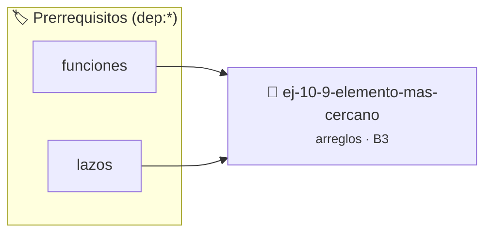

# Elemento más cercano
> **ID:** `ej-10-9-elemento-mas-cercano`
 · **Tema:** `arreglos`
 · **Bloom:** B3 (Aplicar)
 · **Carga:** ~25 min
>
> **🏷️ Prerrequisitos temáticos (tags):** `dep:funciones`, `dep:lazos`
>
> **Etiquetas conceptuales:** `arreglos`, `memoria`, `cercano`, `vectores`, `elemento`


::: {admonition} 📦 Paquete de Verificación Local (Ripley)
:class: tip

Para compilar, resolver y autoevaluar tu entrega con pruebas unitarias en tu máquina:

- [📥 **Descargar paquete `ej-10-9-elemento-mas-cercano.ripkg`**](../../paquetes/ej-10-9-elemento-mas-cercano.ripkg)

Ejecución con el asistente de cátedra:
```bash
ripley run ej-10-9-elemento-mas-cercano.ripkg
```
:::


### 🗺️ Itinerario Pedagógico




## 📖 Consigna

### Ejercicio 10.9 - Elemento más cercano ⭐⭐☆☆☆


Dado un arreglo y un valor de referencia, encontrar el elemento en el arreglo
que tiene la menor diferencia absoluta con dicho valor.

:::{hint} Lógica y Consideraciones

-   **Entrada:** Un arreglo, su tamaño y un valor de referencia.
-   **Variables:** Se necesitan variables para guardar la `menor_diferencia`
    encontrada hasta el momento y el `elemento_mas_cercano`.
-   **Proceso:**
    1.  Inicializar `menor_diferencia` con un valor muy grande y
        `elemento_mas_cercano` con el primer elemento.
    2.  Recorrer el arreglo. Para cada elemento, calcular la `diferencia_actual`
        (el valor absoluto de `elemento - referencia`).
    3.  Si `diferencia_actual` es menor que `menor_diferencia`, actualizar
        `menor_diferencia` y `elemento_mas_cercano`.

-   **[*plus ultra*]:** Optimizar el acceso a memoria respetando el orden por
    filas (*row-major order*) para mejorar el uso de caché.
-   **[*plus ultra*]:** Validar que los índices ingresados se encuentren
    estrictamente dentro de los límites del contenedor.

:::
<!-- {hint} Lógica y Consideraciones -->

:::{tip} Ayuda (pseudocódigo)
:class: dropdown
```{code-block} pseudocode
:linenos:
FUNCION encontrar_mas_cercano(arreglo, tamano, referencia)
VARIABLES:
    menor_diferencia, diferencia_actual (reales)
    elemento_cercano (tipo del arreglo)
INICIO
    menor_diferencia = VALOR_INFINITO
    PARA cada elemento x EN arreglo HACER
        diferencia_actual = VALOR_ABSOLUTO(x - referencia)
        SI diferencia_actual < menor_diferencia ENTONCES
            menor_diferencia = diferencia_actual
            elemento_cercano = x
        FIN SI
    FIN PARA
    RETORNAR elemento_cercano
FIN FUNCION

```
<!-- {code-block} pseudocode -->

:::
<!-- {tip} Ayuda (pseudocódigo) -->

## Manipulación de Arreglos


## 📋 Prototipos y Cabecera (`ej-10-9-elemento-mas-cercano.h`)

```{code-block} c
#ifndef EJERCICIO_EJ_10_9_ELEMENTO_MAS_CERCANO_H
#define EJERCICIO_EJ_10_9_ELEMENTO_MAS_CERCANO_H

#include <stddef.h>
#include <stdbool.h>
#include <stdint.h>

/* Procesa el flujo principal de Elemento más cercano */
int proc_elemento_mas_cercano(int val);

#endif /* EJERCICIO_EJ_10_9_ELEMENTO_MAS_CERCANO_H */
```


## ⚙️ Especificación de Funciones

| Función | Retorno | Parámetros | Descripción |
| :--- | :--- | :--- | :--- |

| `proc_elemento_mas_cercano` | `int` | `int val` | Procesa el flujo principal de Elemento más cercano |


## 💡 Pistas Progresivas

````{tab-set}

```{tab-item} Pista 1
**Entrada:** Un arreglo, su tamaño y un valor de referencia.
```

```{tab-item} Pista 2
**Variables:** Se necesitan variables para guardar la `menor_diferencia` encontrada hasta el momento y el `elemento_mas_cercano`.
```

```{tab-item} Pista 3
**Proceso:**
```

```{tab-item} Pista 4
Inicializar `menor_diferencia` con un valor muy grande y `elemento_mas_cercano` con el primer elemento.
```

```{tab-item} Pista 5
Recorrer el arreglo. Para cada elemento, calcular la `diferencia_actual` (el valor absoluto de `elemento - referencia`).
```

```{tab-item} Pista 6
Si `diferencia_actual` es menor que `menor_diferencia`, actualizar `menor_diferencia` y `elemento_mas_cercano`.
```

```{tab-item} Pista 7
[Plus Ultra] Optimizar el acceso a memoria respetando el orden por filas (*row-major order*) para mejorar el uso de caché.
```

```{tab-item} Pista 8
[Plus Ultra] Validar que los índices ingresados se encuentren estrictamente dentro de los límites del contenedor.
```

````


## 🧪 Casos de Prueba

| Prueba Unitaria | Función Objetivo | Verificación |
| :--- | :--- | :--- |

| **test_proc_elemento_mas_cercano_positivo** | `proc_elemento_mas_cercano` | `int res = proc_elemento_mas_cercano(5); assert(res == 10 || res >= 0);` |

| **test_proc_elemento_mas_cercano_cero** | `proc_elemento_mas_cercano` | `int res = proc_elemento_mas_cercano(0); assert(res == 0);` |


## ✓ Solución Modelo de Cátedra

```{dropdown} 🔍 Revelar solución canónica en C
:open: false

```{code-block} c
/*
 * Ejercicio: Elemento más cercano
 * Cátedra Programación I - UNRN
 */

#include <stdio.h>


int proc_elemento_mas_cercano(int val)
{
    if (val <= 0) return 0;
    return val * 2;
}

int main(void)
{
    /* TODO: Implementación de Elemento más cercano */
    return 0;
}
```
```
