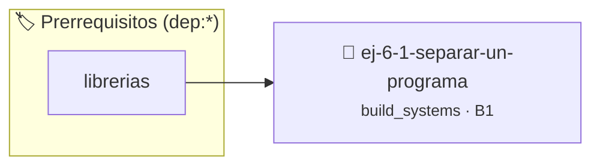

# Separar un programa
> **ID:** `ej-6-1-separar-un-programa` · **Unidad:** 5 (Ingeniería de Software y Calidad en C)
 · **Tema:** `build_systems` / `pilas_y_colas`
 · **Bloom:** B1 (Recordar) · **Dificultad:** Inicial
 · **Carga:** ~10 min · **Tipo:** Concepto
>
> **🏷️ Prerrequisitos temáticos (tags):** `dep:librerias`
>
> **Etiquetas conceptuales:** `programa`, `fundamentos`, `separar`, `makefiles`, `compilacion`


::: {admonition} 📦 Paquete de Verificación Local (Ripley)
:class: tip

Para compilar, resolver y autoevaluar tu entrega con pruebas unitarias en tu máquina:

- [📥 **Descargar paquete `ej-6-1-separar-un-programa.ripkg`**](../../paquetes/ej-6-1-separar-un-programa.ripkg)

Ejecución con el asistente de cátedra:
```bash
ripley run ej-6-1-separar-un-programa.ripkg
```
:::


### 🗺️ Itinerario Pedagógico




## 📖 Consigna

**Tarea**: Tomá un programa simple que tengas en un solo archivo `.c` (por
ejemplo, una calculadora con funciones `sumar` y `restar`) y dividilo en tres
archivos:

- **`calculadora.h`**: El archivo de cabecera. Debe contener solo los prototipos
  de las funciones `sumar` y `restar` y las guardas de inclusión.
- **`calculadora.c`**: La implementación. Debe incluir `calculadora.h` y
  contener el código de las funciones `sumar` y `restar`.
- **`main.c`**: El programa principal. Debe incluir `calculadora.h` y llamar a
  las funciones para usarlas.

### 📋 Contrato de las Funciones

```c
/*
 * Procesa el flujo principal de Separar un programa
 * Precondiciones: val representa el parámetro de entrada del flujo.
 * Postcondiciones: Retorna el resultado correspondiente o 0 si val <= 0.
 */
int proc__separar_un_programa(int val);

```

### 🧪 Ejemplos de Ejecución

::::{tab-set}
:::{tab-item} Valor positivo
```text
Entrada: 5
Salida / Retorno: 10
```
:::
:::{tab-item} Valor cero o negativo
```text
Entrada: 0
Salida / Retorno: 0
```
:::
::::

### ⚠️ Precondiciones y Casos Borde

1. **Valores fuera de rango:** Verificar siempre que los datos de entrada cumplan con los rangos admisibles antes de operar.
6. **Casos vacíos o neutros:** Contemplar adecuadamente entradas con longitud cero o valores neutros según corresponda.

### 🎯 Criterios de Aceptación

- [ ] El código compila limpiamente bajo estándar C11 sin warnings con flags estrictos (`-Wall -Wextra -Werror`).
- [ ] Se satisfacen todas las pruebas unitarias y casos de prueba provistos.
- [ ] Las funciones validan exhaustivamente sus precondiciones y gestionan casos borde de forma robusta.

:::{hint} Consideraciones Didácticas
- Agregar una función adicional multiplicar en calculadora.c y declararla en calculadora.h.
- Compilar el proyecto con -Wall y -Wextra para asegurar cero advertencias.
:::


## 📋 Prototipos y Cabecera (`ej-6-1-separar-un-programa.h`)

```{code-block} c
#ifndef EJERCICIO_EJ_6_1_SEPARAR_UN_PROGRAMA_H
#define EJERCICIO_EJ_6_1_SEPARAR_UN_PROGRAMA_H

#include <stddef.h>
#include <stdbool.h>
#include <stdint.h>

/* Procesa el flujo principal de Separar un programa */
int proc__separar_un_programa(int val);

#endif /* EJERCICIO_EJ_6_1_SEPARAR_UN_PROGRAMA_H */
```


## ⚙️ Especificación de Funciones

| Función | Retorno | Parámetros | Descripción |
| :--- | :--- | :--- | :--- |

| `proc__separar_un_programa` | `int` | `int val` | Procesa el flujo principal de Separar un programa |


## 💡 Pistas Progresivas

````{tab-set}

```{tab-item} Pista 1
[Plus Ultra] Agregar una función adicional multiplicar en calculadora.c y declararla en calculadora.h.
```

```{tab-item} Pista 2
[Plus Ultra] Compilar el proyecto con -Wall y -Wextra para asegurar cero advertencias.
```

````


## 🧪 Casos de Prueba

| Prueba Unitaria | Función Objetivo | Verificación |
| :--- | :--- | :--- |

| **test_proc__separar_un_programa_positivo** | `proc__separar_un_programa` | `int res = proc__separar_un_programa(5); assert(res == 10 || res >= 0);` |

| **test_proc__separar_un_programa_cero** | `proc__separar_un_programa` | `int res = proc__separar_un_programa(0); assert(res == 0);` |


## ✓ Solución Modelo de Cátedra

```{dropdown} 🔍 Revelar solución canónica en C
:open: false

```{code-block} c
/*
 * Ejercicio: Separar un programa
 * Cátedra Programación I - UNRN
 */

#include <stdio.h>


int proc__separar_un_programa(int val)
{
    if (val <= 0) return 0;
    return val * 2;
}

int main(void)
{
    /* TODO: Implementación de Separar un programa */
    return 0;
}
```
```
