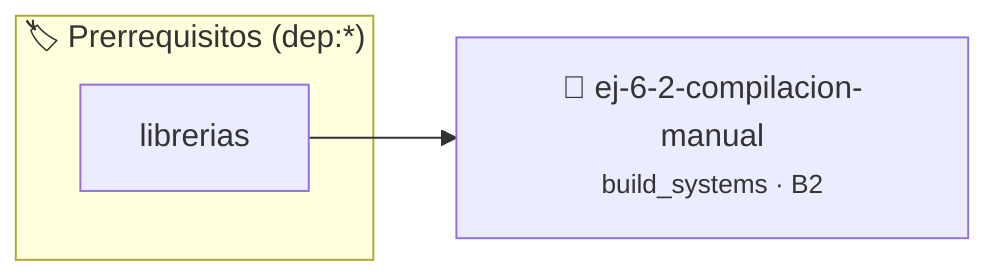

# Compilación manual
> **ID:** `ej-6-2-compilacion-manual` · **Unidad:** 5 (Ingeniería de Software y Calidad en C)
 · **Tema:** `build_systems` / `pilas_y_colas`
 · **Bloom:** B2 (Comprender) · **Dificultad:** Inicial
 · **Carga:** ~15 min · **Tipo:** Practica Guiada
>
> **🏷️ Prerrequisitos temáticos (tags):** `dep:librerias`
>
> **Etiquetas conceptuales:** `makefiles`, `manual`, `compilacion`, `fundamentos`


::: {admonition} 📦 Paquete de Verificación Local (Ripley)
:class: tip

Para compilar, resolver y autoevaluar tu entrega con pruebas unitarias en tu máquina:

- [📥 **Descargar paquete `ej-6-2-compilacion-manual.ripkg`**](../../paquetes/ej-6-2-compilacion-manual.ripkg)

Ejecución con el asistente de cátedra:
```bash
ripley run ej-6-2-compilacion-manual.ripkg
```
:::


### 🗺️ Itinerario Pedagógico




## 📖 Consigna

**Tarea**: Usando la terminal, compilá y enlazá los archivos del ejercicio
anterior sin usar un Makefile.


## Automatización con Makefile

### 📋 Contrato de las Funciones

```c
/*
 * Procesa el flujo principal de Compilación manual
 * Precondiciones: val representa el parámetro de entrada del flujo.
 * Postcondiciones: Retorna el resultado correspondiente o 0 si val <= 0.
 */
int proc_2_compilacion_manual(int val);

```

### 🧪 Ejemplos de Ejecución

::::{tab-set}
:::{tab-item} Valor positivo
```text
Entrada: 5
Salida / Retorno: 10
```
:::
:::{tab-item} Valor cero o negativo
```text
Entrada: 0
Salida / Retorno: 0
```
:::
::::

### ⚠️ Precondiciones y Casos Borde

1. **Valores fuera de rango:** Verificar siempre que los datos de entrada cumplan con los rangos admisibles antes de operar.
6. **Casos vacíos o neutros:** Contemplar adecuadamente entradas con longitud cero o valores neutros según corresponda.

### 🎯 Criterios de Aceptación

- [ ] El código compila limpiamente bajo estándar C11 sin warnings con flags estrictos (`-Wall -Wextra -Werror`).
- [ ] Se satisfacen todas las pruebas unitarias y casos de prueba provistos.
- [ ] Las funciones validan exhaustivamente sus precondiciones y gestionan casos borde de forma robusta.

:::{hint} Consideraciones Didácticas
- **Compilar los archivos objeto (`.o`)**: Se usa la opción `-c` de `gcc` para compilar cada archivo fuente por separado. ```bash gcc -c main.c -o main.o gcc -c calculadora.c -o calculadora.o ```
- Enlazar los objetos: Se combinan los archivos objeto para crear el ejecutable final. ```bash gcc main.o calculadora.o -o mi_calculadora ``` errores de E/S con `ferror` y `feof`. archivo en todos los caminos de ejecución.
- Crear un script de bash build.sh que ejecute los pasos de compilación y enlace de forma secuencial.
- Probar qué ocurre si se modifica solo uno de los archivos .c y se recompila solo su .o.
:::


## 📋 Prototipos y Cabecera (`ej-6-2-compilacion-manual.h`)

```{code-block} c
#ifndef EJERCICIO_EJ_6_2_COMPILACION_MANUAL_H
#define EJERCICIO_EJ_6_2_COMPILACION_MANUAL_H

#include <stddef.h>
#include <stdbool.h>
#include <stdint.h>

/* Procesa el flujo principal de Compilación manual */
int proc_2_compilacion_manual(int val);

#endif /* EJERCICIO_EJ_6_2_COMPILACION_MANUAL_H */
```


## ⚙️ Especificación de Funciones

| Función | Retorno | Parámetros | Descripción |
| :--- | :--- | :--- | :--- |

| `proc_2_compilacion_manual` | `int` | `int val` | Procesa el flujo principal de Compilación manual |


## 💡 Pistas Progresivas

````{tab-set}

```{tab-item} Pista 1
**Compilar los archivos objeto (`.o`)**: Se usa la opción `-c` de `gcc` para compilar cada archivo fuente por separado. ```bash gcc -c main.c -o main.o gcc -c calculadora.c -o calculadora.o ```
```

```{tab-item} Pista 2
Enlazar los objetos: Se combinan los archivos objeto para crear el ejecutable final. ```bash gcc main.o calculadora.o -o mi_calculadora ``` errores de E/S con `ferror` y `feof`. archivo en todos los caminos de ejecución.
```

```{tab-item} Pista 3
[Plus Ultra] Crear un script de bash build.sh que ejecute los pasos de compilación y enlace de forma secuencial.
```

```{tab-item} Pista 4
[Plus Ultra] Probar qué ocurre si se modifica solo uno de los archivos .c y se recompila solo su .o.
```

````


## 🧪 Casos de Prueba

| Prueba Unitaria | Función Objetivo | Verificación |
| :--- | :--- | :--- |

| **test_proc_2_compilacion_manual_positivo** | `proc_2_compilacion_manual` | `int res = proc_2_compilacion_manual(5); assert(res == 10 || res >= 0);` |

| **test_proc_2_compilacion_manual_cero** | `proc_2_compilacion_manual` | `int res = proc_2_compilacion_manual(0); assert(res == 0);` |


## ✓ Solución Modelo de Cátedra

```{dropdown} 🔍 Revelar solución canónica en C
:open: false

```{code-block} c
/*
 * Ejercicio: Compilación manual
 * Cátedra Programación I - UNRN
 */

#include <stdio.h>


int proc_2_compilacion_manual(int val)
{
    if (val <= 0) return 0;
    return val * 2;
}

int main(void)
{
    /* TODO: Implementación de Compilación manual */
    return 0;
}
```
```
