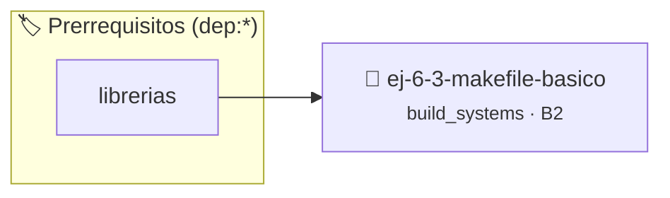

# Makefile básico
> **ID:** `ej-6-3-makefile-basico` · **Unidad:** 5 (Ingeniería de Software y Calidad en C)
 · **Tema:** `build_systems` / `pilas_y_colas`
 · **Bloom:** B2 (Comprender) · **Dificultad:** Inicial
 · **Carga:** ~15 min · **Tipo:** Practica Guiada
>
> **🏷️ Prerrequisitos temáticos (tags):** `dep:librerias`
>
> **Etiquetas conceptuales:** `fundamentos`, `basico`, `makefiles`, `makefile`, `compilacion`


::: {admonition} 📦 Paquete de Verificación Local (Ripley)
:class: tip

Para compilar, resolver y autoevaluar tu entrega con pruebas unitarias en tu máquina:

- [📥 **Descargar paquete `ej-6-3-makefile-basico.ripkg`**](../../paquetes/ej-6-3-makefile-basico.ripkg)

Ejecución con el asistente de cátedra:
```bash
ripley run ej-6-3-makefile-basico.ripkg
```
:::


### 🗺️ Itinerario Pedagógico




## 📖 Consigna

### Ejercicio 6.3 - Makefile básico ⭐☆☆☆☆

**Tarea**: Crear un `Makefile` para el proyecto del ejercicio anterior. El
Makefile debe tener los siguientes objetivos (`targets`):

- **`all`**: El objetivo por defecto, que debe compilar y enlazar todo el
  programa para crear el ejecutable `mi_calculadora`.
- **`clean`**: Un objetivo "phony" que elimina todos los archivos generados por
  la compilación (`.o` y el ejecutable).


:::{hint} Lógica y Consideraciones
    desbordamientos de búfer validando la capacidad máxima.
    líneas de manera robusta.

-   **[*plus ultra*]:** Agregar un target run que dependa de all y ejecute automáticamente el binario compilado.
-   **[*plus ultra*]:** Configurar CFLAGS con las opciones -Wall -Wextra -std=c99.

:::
<!-- {hint} Lógica y Consideraciones -->

:::{tip} Estructura del Makefile

```{code-block} makefile
:linenos:
# Variable para el compilador
CC = gcc
# Flags de compilación
CFLAGS = -Wall -Wextra -g

# Archivos objeto necesarios
OBJS = main.o calculadora.o

# Nombre del ejecutable final
TARGET = mi_calculadora

all: $(TARGET)

$(TARGET): $(OBJS)
	$(CC) $(CFLAGS) -o $(TARGET) $(OBJS)

main.o: main.c calculadora.h
	$(CC) $(CFLAGS) -c main.c

calculadora.o: calculadora.c calculadora.h
	$(CC) $(CFLAGS) -c calculadora.c

.PHONY: clean
clean:
	rm -f $(TARGET) $(OBJS)

```
<!-- {code-block} makefile -->

:::
<!-- {tip} Estructura del Makefile -->

## Compilación Condicional


## 📋 Prototipos y Cabecera (`ej-6-3-makefile-basico.h`)

```{code-block} c
#ifndef EJERCICIO_EJ_6_3_MAKEFILE_BASICO_H
#define EJERCICIO_EJ_6_3_MAKEFILE_BASICO_H

#include <stddef.h>
#include <stdbool.h>
#include <stdint.h>

/* Procesa el flujo principal de Makefile básico */
int proc__6_3_makefile_basico(int val);

#endif /* EJERCICIO_EJ_6_3_MAKEFILE_BASICO_H */
```


## ⚙️ Especificación de Funciones

| Función | Retorno | Parámetros | Descripción |
| :--- | :--- | :--- | :--- |

| `proc__6_3_makefile_basico` | `int` | `int val` | Procesa el flujo principal de Makefile básico |


## 💡 Pistas Progresivas

````{tab-set}

```{tab-item} Pista 1
[Plus Ultra] Agregar un target run que dependa de all y ejecute automáticamente el binario compilado.
```

```{tab-item} Pista 2
[Plus Ultra] Configurar CFLAGS con las opciones -Wall -Wextra -std=c99.
```

````


## 🧪 Casos de Prueba

| Prueba Unitaria | Función Objetivo | Verificación |
| :--- | :--- | :--- |

| **test_proc__6_3_makefile_basico_positivo** | `proc__6_3_makefile_basico` | `int res = proc__6_3_makefile_basico(5); assert(res == 10 || res >= 0);` |

| **test_proc__6_3_makefile_basico_cero** | `proc__6_3_makefile_basico` | `int res = proc__6_3_makefile_basico(0); assert(res == 0);` |


## ✓ Solución Modelo de Cátedra

```{dropdown} 🔍 Revelar solución canónica en C
:open: false

```{code-block} c
/*
 * Ejercicio: Makefile básico
 * Cátedra Programación I - UNRN
 */

#include <stdio.h>


int proc__6_3_makefile_basico(int val)
{
    if (val <= 0) return 0;
    return val * 2;
}

int main(void)
{
    /* TODO: Implementación de Makefile básico */
    return 0;
}
```
```
