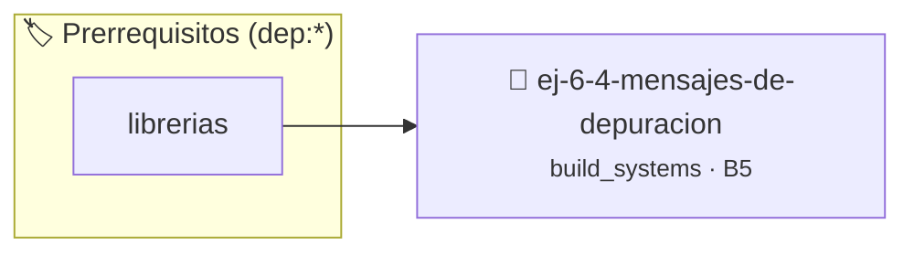

# Mensajes de depuración
> **ID:** `ej-6-4-mensajes-de-depuracion` · **Unidad:** 5 (Ingeniería de Software y Calidad en C)
 · **Tema:** `build_systems` / `pilas_y_colas`
 · **Bloom:** B5 (Evaluar / Crear) · **Dificultad:** Desafio
 · **Carga:** ~45 min · **Tipo:** Desafio
>
> **🏷️ Prerrequisitos temáticos (tags):** `dep:librerias`
>
> **Etiquetas conceptuales:** `mensajes`, `fundamentos`, `makefiles`, `depuracion`, `compilacion`


::: {admonition} 📦 Paquete de Verificación Local (Ripley)
:class: tip

Para compilar, resolver y autoevaluar tu entrega con pruebas unitarias en tu máquina:

- [📥 **Descargar paquete `ej-6-4-mensajes-de-depuracion.ripkg`**](../../paquetes/ej-6-4-mensajes-de-depuracion.ripkg)

Ejecución con el asistente de cátedra:
```bash
ripley run ej-6-4-mensajes-de-depuracion.ripkg
```
:::


### 🗺️ Itinerario Pedagógico




## 📖 Consigna

### Ejercicio 6.4 - Mensajes de depuración ⭐⭐☆☆☆

**Tarea**: Modificá tu proyecto para incluir mensajes de depuración que solo se
impriman cuando se compile en "modo debug".

:::{hint} Lógica y Consideraciones
1.  **En el código**: Encerrá tus `printf` de depuración dentro de bloques de
    preprocesador:
    ```c
    #ifdef DEBUG
    printf("[DEBUG] La función sumar fue llamada con a=%d, b=%d\n", a, b);
    #endif
    ```
2.  **En el Makefile**: Modificá la regla de compilación para que se pueda pasar
    una bandera al compilador. La opción `-D` de `gcc` permite definir una macro
    desde la línea de comandos.
    ```makefile
    # Añadir una variable para las macros
    CPPFLAGS =
    # Modificar la regla de compilación
    %.o: %.c
    	$(CC) $(CFLAGS) $(CPPFLAGS) -c $< -o $@
    ```
3.  **Uso**: Ahora podés compilar normalmente (`make`) o en modo debug (`make
    CPPFLAGS=-DDEBUG`).
    errores de E/S con `ferror` y `feof`.
    archivo en todos los caminos de ejecución.

-   **[*plus ultra*]:** Agregar múltiples niveles de depuración (ej. DEBUG=1, DEBUG=2) utilizando directivas #if DEBUG >= 1.
-   **[*plus ultra*]:** Probar la compilación tanto en modo normal como en modo depuración.

:::
<!-- {hint} Lógica y Consideraciones -->
## Ejercicio 6.5 - Compilación Básica ⭐☆☆☆☆

Compilá un programa simple desde línea de comandos.

**Orientación:**

:::{hint} Lógica y Consideraciones
    definición interna oculta en el archivo `.c`.
    para copiar la estructura de forma segura.

-   **[*plus ultra*]:** Compilar con el flag -o especificando un nombre descriptivo para el binario resultante.
-   **[*plus ultra*]:** Ejecutar el programa y verificar su código de salida con echo $? en la terminal.

:::
<!-- {hint} Lógica y Consideraciones -->

``` bash
gcc -o programa programa.c
./programa
```
<!-- bash -->
- `-o` especifica nombre del ejecutable
- Sin `-o`, crea `a.out` por defecto

---
## Ejercicio 6.6 - Warnings Habilitados ⭐☆☆☆☆

Compilá con warnings completos y corregí los problemas.

**Orientación:**

:::{hint} Lógica y Consideraciones
    desbordamientos de búfer validando la capacidad máxima.
    líneas de manera robusta.

-   **[*plus ultra*]:** Agregar los flags -Werror -Wpedantic y verificar que el código compile limpiamente sin advertencias.
-   **[*plus ultra*]:** Identificar y corregir advertencias comunes como variables no utilizadas o conversiones implícitas.

:::
<!-- {hint} Lógica y Consideraciones -->

``` bash
gcc -Wall -Wextra -std=c99 -pedantic programa.c -o programa
```
<!-- bash -->
- `-Wall`: warnings comunes
- `-Wextra`: warnings adicionales
- `-std=c99`: estándar C99
- `-pedantic`: estricto con estándar

---
## Ejercicio 6.7 - Dos Archivos Separados ⭐⭐☆☆☆

Separáun programa en main.c y funciones.c.

**funciones.h:**

:::{hint} Lógica y Consideraciones
    errores de E/S con `ferror` y `feof`.
    archivo en todos los caminos de ejecución.

-   **[*plus ultra*]:** Estructurar los archivos en subdirectorios src/ e include/ y compilar con -Iinclude.
-   **[*plus ultra*]:** Añadir una tercera función en un módulo adicional utilidades.c y enlazar todos los objetos.

:::
<!-- {hint} Lógica y Consideraciones -->

``` c
#ifndef FUNCIONES_H
#define FUNCIONES_H
int sumar(int a, int b);
#endif
```
<!-- c -->

**funciones.c:**
``` c
#include "funciones.h"
int sumar(int a, int b)
{
    return a + b;
}
```
<!-- c -->

**main.c:**
``` c
#include "funciones.h"
#include <stdio.h>
int main()
{
    printf("%d\n", sumar(3, 4));
}
```
<!-- c -->

**Compilación:**
``` bash
gcc -c funciones.c    # Genera funciones.o
gcc -c main.c         # Genera main.o
gcc funciones.o main.o -o programa
```
<!-- bash -->

---
## Ejercicio 6.8 - Include Guards ⭐⭐☆☆☆

Explicá por qué se necesitan include guards y implementalos.

**Orientación:**

:::{hint} Lógica y Consideraciones
    valores fuera de rango o tipos inválidos.
    un lazo hasta que el usuario elija finalizar.

-   **[*plus ultra*]:** Explicar mediante un comentario qué problema de compilación ocurre si se omite la guarda de inclusión.
-   **[*plus ultra*]:** Probar qué sucede al incluir dos veces el mismo header en main.c.

:::
<!-- {hint} Lógica y Consideraciones -->

``` c
#ifndef MI_HEADER_H
#define MI_HEADER_H
// Contenido del header
#endif // MI_HEADER_H
```
<!-- c -->
- Previene inclusión múltiple
- Evita errores de redefinición

---
## Ejercicio 6.9 - Makefile Básico ⭐⭐⭐☆☆

Creá Makefile para compilar proyecto de ejercicio 3.

**Makefile:**

:::{hint} Lógica y Consideraciones
    errores de E/S con `ferror` y `feof`.
    archivo en todos los caminos de ejecución.

-   **[*plus ultra*]:** Usar variables automáticas ($@, $<) en las reglas del Makefile para simplificar los comandos.
-   **[*plus ultra*]:** Declarar el target clean como .PHONY.

:::
<!-- {hint} Lógica y Consideraciones -->

```{code-block} makefile
:linenos:
CC = gcc
CFLAGS = -Wall -Wextra -std=c99

programa: main.o funciones.o
	$(CC) main.o funciones.o -o programa

main.o: main.c funciones.h
	$(CC) $(CFLAGS) -c main.c

funciones.o: funciones.c funciones.h
	$(CC) $(CFLAGS) -c funciones.c

clean:
	rm -f *.o programa

```
<!-- {code-block} makefile -->

**Uso:**
``` bash
make           # Compila
make clean     # Limpia
```
<!-- bash -->

---
## Ejercicio 6.10 - Biblioteca Matemática ⭐⭐⭐☆☆

Creá biblioteca con funciones matemáticas: factorial, potencia, fibonacci.

**Estructura:**

:::{hint} Lógica y Consideraciones
    desbordamientos de búfer validando la capacidad máxima.
    líneas de manera robusta.

-   **[*plus ultra*]:** Compilar enlazando con la biblioteca matemática estándar usando el flag -lm.
-   **[*plus ultra*]:** Crear un Makefile que compile y ejecute los ejemplos matemáticos automáticamente.

:::
<!-- {hint} Lógica y Consideraciones -->

```
proyecto/
├── matematica.h
├── matematica.c
├── test.c
└── Makefile
```

**Orientación:**
- `matematica.h`: declaraciones
- `matematica.c`: implementaciones
- `test.c`: programa que usa la biblioteca

---
## Ejercicio 6.11 - Flags de Optimización ⭐⭐⭐☆☆

Compilá con diferentes niveles de optimización y medí diferencia.

**Orientación:**

:::{hint} Lógica y Consideraciones
    valores fuera de rango o tipos inválidos.
    un lazo hasta que el usuario elija finalizar.

-   **[*plus ultra*]:** Comparar el tiempo de ejecución del programa compilado con -O0 frente a -O2 o -O3.
-   **[*plus ultra*]:** Inspeccionar el tamaño del binario resultante con cada nivel de optimización.

:::
<!-- {hint} Lógica y Consideraciones -->

``` bash
gcc -O0 programa.c -o prog_O0  # Sin optimización
gcc -O1 programa.c -o prog_O1  # Básica
gcc -O2 programa.c -o prog_O2  # Recomendada
gcc -O3 programa.c -o prog_O3  # Agresiva
```
<!-- bash -->
- Medí tiempo de ejecución: `time ./prog_O2`
- `-O0` útil para debugging
- `-O2` balance entre velocidad y tamaño
- `-O3` máxima optimización

---
## Ejercicio 6.12 - Compilación Condicional ⭐⭐⭐☆☆

Usá directivas de preprocesador para debug opcional.

**Orientación:**

:::{hint} Lógica y Consideraciones
    definición interna oculta en el archivo `.c`.
    para copiar la estructura de forma segura.

-   **[*plus ultra*]:** Definir macros de preprocesador mediante el flag -D (ej. -DVERSION="1.0.0").
-   **[*plus ultra*]:** Crear targets separados en el Makefile para compilar con distintas configuraciones.

:::
<!-- {hint} Lógica y Consideraciones -->

``` c
#ifdef DEBUG
printf("Debug: valor = %d\n", valor);
#endif
```
<!-- c -->

**Compilación:**
``` bash
gcc -DDEBUG programa.c -o programa  # Con debug
gcc programa.c -o programa           # Sin debug
```
<!-- bash -->

---
## Ejercicio 6.13 - Módulo de Utilidades ⭐⭐⭐⭐☆

Creá módulo `utils` con funciones de uso general: intercambio, mínimo, máximo.

**Estructura:**

:::{hint} Lógica y Consideraciones
    desbordamientos de búfer validando la capacidad máxima.
    líneas de manera robusta.

-   **[*plus ultra*]:** Crear una suite de pruebas en test_utilidades.c que verifique cada función con assert().
-   **[*plus ultra*]:** Agregar un target test en el Makefile que compile y corra las pruebas automáticamente.

:::
<!-- {hint} Lógica y Consideraciones -->

```{code-block} c
:linenos:
// utils.h
#ifndef UTILS_H
#define UTILS_H
void intercambiar(int *a, int *b);
int minimo(int a, int b);
int maximo(int a, int b);
#endif
// utils.c
#include "utils.h"
// Implementaciones...
// main.c
#include "utils.h"
// Uso...
```
<!-- {code-block} c -->

---
## Ejercicio 6.14 - Makefile con Variables ⭐⭐⭐⭐☆

Mejorá Makefile usando variables y patrones.

**Makefile:**

:::{hint} Lógica y Consideraciones
    errores de E/S con `ferror` y `feof`.
    archivo en todos los caminos de ejecución.

-   **[*plus ultra*]:** Organizar el Makefile con variables CC, CFLAGS, LDFLAGS y OBJS.
-   **[*plus ultra*]:** Permitir sobrescribir variables desde la línea de comandos (ej. make CC=clang).

:::
<!-- {hint} Lógica y Consideraciones -->

```{code-block} makefile
:linenos:
CC = gcc
CFLAGS = -Wall -Wextra -std=c99 -O2
LDFLAGS = -lm

SRCS = main.c utils.c matematica.c
OBJS = $(SRCS:.c=.o)
TARGET = programa

$(TARGET): $(OBJS)
	$(CC) $(OBJS) $(LDFLAGS) -o $(TARGET)

%.o: %.c
	$(CC) $(CFLAGS) -c $< -o $@

clean:
	rm -f $(OBJS) $(TARGET)

.PHONY: clean

```
<!-- {code-block} makefile -->

---
## Ejercicio 6.15 - Dependencias Automáticas ⭐⭐⭐⭐☆

Generá dependencias automáticamente con gcc.

**Orientación:**

:::{hint} Lógica y Consideraciones
    errores de E/S con `ferror` y `feof`.
    archivo en todos los caminos de ejecución.

-   **[*plus ultra*]:** Usar los flags de gcc -MMD -MP para generar archivos de dependencias .d automáticamente.
-   **[*plus ultra*]:** Incluir los archivos .d en el Makefile mediante la directiva -include.

:::
<!-- {hint} Lógica y Consideraciones -->

``` makefile
DEPS = $(OBJS:.o=.d)

-include $(DEPS)

%.o: %.c
	$(CC) $(CFLAGS) -MMD -MP -c $< -o $@
```
<!-- makefile -->
- `-MMD`: genera archivo .d con dependencias
- `-MP`: crea targets phony para headers

---
## Ejercicio 6.16 - Biblioteca Estática ⭐⭐⭐⭐⭐

Creá biblioteca estática (.a) y usala en programa.

**Orientación:**

:::{hint} Lógica y Consideraciones
    definición interna oculta en el archivo `.c`.
    para copiar la estructura de forma segura.

-   **[*plus ultra*]:** Crear una biblioteca estática (.a) utilizando la herramienta ar rcs.
-   **[*plus ultra*]:** Enlazar el ejecutable principal contra la biblioteca estática creada.

:::
<!-- {hint} Lógica y Consideraciones -->

```{code-block} bash
:linenos:
# Compilar objetos
gcc -c modulo1.c modulo2.c

# Crear biblioteca estática
ar rcs libmibiblioteca.a modulo1.o modulo2.o

# Usar biblioteca
gcc main.c -L. -lmibiblioteca -o programa

```
<!-- {code-block} bash -->
- `ar`: archiver, crea bibliotecas
- `-L.`: buscar bibliotecas en directorio actual
- `-lmibiblioteca`: enlazar con libmibiblioteca.a

---
## Ejercicio 6.17 - Biblioteca Compartida ⭐⭐⭐⭐⭐

Creá biblioteca compartida (.so) y usala.

**Orientación:**

:::{hint} Lógica y Consideraciones
    definición interna oculta en el archivo `.c`.
    para copiar la estructura de forma segura.

-   **[*plus ultra*]:** Crear una biblioteca compartida (.so) compilando con -fPIC y enlazando con -shared.
-   **[*plus ultra*]:** Ejecutar el programa configurando LD_LIBRARY_PATH.

:::
<!-- {hint} Lógica y Consideraciones -->

```{code-block} bash
:linenos:
# Compilar con PIC (Position Independent Code)
gcc -fPIC -c modulo.c

# Crear biblioteca compartida
gcc -shared modulo.o -o libmodulo.so

# Compilar programa
gcc main.c -L. -lmodulo -o programa

# Ejecutar (necesita encontrar .so)
export LD_LIBRARY_PATH=.:$LD_LIBRARY_PATH
./programa

```
<!-- {code-block} bash -->

---
## Ejercicio 6.18 - Proyecto Multi-Directorio ⭐⭐⭐⭐⭐

Organizá proyecto en directorios: src/, include/, obj/, bin/.

**Estructura:**

:::{hint} Lógica y Consideraciones
    desbordamientos de búfer validando la capacidad máxima.
    líneas de manera robusta.

-   **[*plus ultra*]:** Organizar el proyecto con estructura src/, include/, obj/, bin/.
-   **[*plus ultra*]:** Crear un Makefile que cree automáticamente los directorios obj/ y bin/ si no existen.

:::
<!-- {hint} Lógica y Consideraciones -->

```
proyecto/
├── src/
│   ├── main.c
│   └── modulo.c
├── include/
│   └── modulo.h
├── obj/        (generado)
├── bin/        (generado)
└── Makefile
```

**Makefile:**
```{code-block} makefile
:linenos:
SRCDIR = src
INCDIR = include
OBJDIR = obj
BINDIR = bin

CFLAGS = -I$(INCDIR) -Wall -Wextra

SRCS = $(wildcard $(SRCDIR)/*.c)
OBJS = $(patsubst $(SRCDIR)/%.c,$(OBJDIR)/%.o,$(SRCS))

$(BINDIR)/programa: $(OBJS) | $(BINDIR)
	$(CC) $^ -o $@

$(OBJDIR)/%.o: $(SRCDIR)/%.c | $(OBJDIR)
	$(CC) $(CFLAGS) -c $< -o $@

$(OBJDIR) $(BINDIR):
	mkdir -p $@

```
<!-- {code-block} makefile -->

---
## Ejercicio 6.19 - Targets Adicionales ⭐⭐⭐⭐☆

Agregá targets útiles: run, test, install, uninstall.

**Makefile:**

:::{hint} Lógica y Consideraciones
    errores de E/S con `ferror` y `feof`.
    archivo en todos los caminos de ejecución.

-   **[*plus ultra*]:** Agregar targets adicionales como help, info y format en el Makefile.
-   **[*plus ultra*]:** Asegurar que todos los targets auxiliares estén listados en .PHONY.

:::
<!-- {hint} Lógica y Consideraciones -->

```{code-block} makefile
:linenos:
run: $(TARGET)
	./$(TARGET)

test: $(TARGET)
	./$(TARGET) test_input.txt

install: $(TARGET)
	install -m 755 $(TARGET) /usr/local/bin/

uninstall:
	rm -f /usr/local/bin/$(TARGET)

.PHONY: run test install uninstall

```
<!-- {code-block} makefile -->

---
## Ejercicio 6.20 - Compilación Debug/Release ⭐⭐⭐⭐⭐

Makefile con modo debug y release.

**Makefile:**

:::{hint} Lógica y Consideraciones
    errores de E/S con `ferror` y `feof`.
    archivo en todos los caminos de ejecución.

-   **[*plus ultra*]:** Definir reglas separadas en el Makefile para compilar en modo Debug (-g -O0) y Release (-O2 -DNDEBUG).
-   **[*plus ultra*]:** Colocar los binarios de cada perfil en carpetas de salida separadas (bin/debug/ y bin/release/).

:::
<!-- {hint} Lógica y Consideraciones -->

```{code-block} makefile
:linenos:
MODE ?= release

ifeq ($(MODE),debug)
    CFLAGS += -g -O0 -DDEBUG
    TARGET = programa_debug
else
    CFLAGS += -O2 -DNDEBUG
    TARGET = programa
endif

all: $(TARGET)
	@echo "Compiled in $(MODE) mode"

# Uso:
# make              # Release
# make MODE=debug   # Debug

```
<!-- {code-block} makefile -->

---
## Ejercicio 6.21 - Análisis Estático ⭐⭐⭐⭐☆

Integrá herramientas de análisis en Makefile.

**Makefile:**

:::{hint} Lógica y Consideraciones
    errores de E/S con `ferror` y `feof`.
    archivo en todos los caminos de ejecución.

-   **[*plus ultra*]:** Ejecutar herramientas de análisis como cppcheck o clang-tidy sobre los archivos fuente.
-   **[*plus ultra*]:** Integrar un target check o lint en el Makefile para correr el análisis estático.

:::
<!-- {hint} Lógica y Consideraciones -->

```{code-block} makefile
:linenos:
check: $(SRCS)
	cppcheck --enable=all $(SRCS)

format: $(SRCS)
	clang-format -i $(SRCS)

valgrind: $(TARGET)
	valgrind --leak-check=full ./$(TARGET)

.PHONY: check format valgrind

```
<!-- {code-block} makefile -->

---
## Ejercicio 6.22 - Cross-Compilation ⭐⭐⭐⭐⭐

Configurá cross-compilation para diferentes arquitecturas.

**Makefile:**

:::{hint} Lógica y Consideraciones
    errores de E/S con `ferror` y `feof`.
    archivo en todos los caminos de ejecución.

-   **[*plus ultra*]:** Configurar el Makefile para soportar compilación cruzada especificando el prefijo CROSS_COMPILE.
-   **[*plus ultra*]:** Verificar que la arquitectura de destino sea configurable mediante una variable.

:::
<!-- {hint} Lógica y Consideraciones -->

```{code-block} makefile
:linenos:
# Compilación nativa
CC_NATIVE = gcc
TARGET_NATIVE = programa

# Cross-compilation para ARM
CC_ARM = arm-linux-gnueabi-gcc
TARGET_ARM = programa_arm

arm: CC = $(CC_ARM)
arm: TARGET = $(TARGET_ARM)
arm: $(TARGET)

native: CC = $(CC_NATIVE)
native: TARGET = $(TARGET_NATIVE)
native: $(TARGET)

```
<!-- {code-block} makefile -->

---
## Ejercicio 6.23 - Sistema de Build Completo ⭐⭐⭐⭐⭐

Proyecto completo con múltiples bibliotecas y tests.

**Estructura:**

:::{hint} Lógica y Consideraciones
    desbordamientos de búfer validando la capacidad máxima.
    líneas de manera robusta.

-   **[*plus ultra*]:** Diseñar un Makefile modular y completo que incluya compilación, tests, documentación y empaquetado.
-   **[*plus ultra*]:** Asegurar que make clean limpie absolutamente todos los artefactos intermedios generados.

:::
<!-- {hint} Lógica y Consideraciones -->

```
proyecto/
├── lib/
│   ├── util/
│   │   ├── util.h
│   │   └── util.c
│   └── math/
│       ├── math.h
│       └── math.c
├── src/
│   └── main.c
├── tests/
│   ├── test_util.c
│   └── test_math.c
└── Makefile
```

**Orientación:**
- Compilar bibliotecas separadamente
- Enlazar con main
- Target para tests
- Target para todo (all)

---
## Ejercicio 6.24 - CMake Básico ⭐⭐⭐⭐⭐

Convertí proyecto a usar CMake en lugar de Makefile.

**CMakeLists.txt:**

:::{hint} Lógica y Consideraciones
    garantizar la liberación total de recursos en caso de error.
    leaks*) mediante Valgrind o AddressSanitizer.

-   **[*plus ultra*]:** Crear un archivo CMakeLists.txt básico que defina el proyecto, ejecutables y bibliotecas.
-   **[*plus ultra*]:** Generar y compilar el proyecto en un directorio build/ separado.

:::
<!-- {hint} Lógica y Consideraciones -->

```{code-block} cmake
:linenos:
cmake_minimum_required(VERSION 3.10)
project(MiProyecto C)

set(CMAKE_C_STANDARD 99)
set(CMAKE_C_FLAGS "${CMAKE_C_FLAGS} -Wall -Wextra")

include_directories(include)

add_executable(programa
    src/main.c
    src/modulo.c
)

target_link_libraries(programa m)

# Tests
enable_testing()
add_executable(tests tests/test_main.c)
add_test(NAME tests COMMAND tests)

```
<!-- {code-block} cmake -->

**Uso:**
``` bash
mkdir build
cd build
cmake ..
make
./programa
```
<!-- bash -->

---

## Notas Finales

:::{tip} Proceso de Compilación

**Etapas:**
1. **Preprocesamiento:** Expande #include, #define
   - `gcc -E programa.c` para ver resultado
2. **Compilación:** C → Assembly
   - `gcc -S programa.c` genera programa.s
3. **Ensamblado:** Assembly → Código objeto
   - `gcc -c programa.c` genera programa.o
4. **Enlazado:** Objetos + bibliotecas → Ejecutable
   - `gcc programa.o -o programa`

**Flags útiles:**
- `-E`: Solo preprocesar
- `-S`: Generar assembly
- `-c`: Compilar sin enlazar
- `-o`: Especificar nombre de salida
- `-I`: Agregar directorio de includes
- `-L`: Agregar directorio de bibliotecas
- `-l`: Enlazar con biblioteca

:::
<!-- {tip} Proceso de Compilación -->

:::{note} Sintaxis de Makefile

**Regla básica:**
``` makefile
target: dependencias
	comando
```
<!-- makefile -->
- **target:** Archivo a generar
- **dependencias:** Archivos necesarios
- **comando:** Qué ejecutar (debe empezar con TAB)

**Variables:**
``` makefile
CC = gcc
CFLAGS = -Wall

$(CC) $(CFLAGS) programa.c
```
<!-- makefile -->

**Variables automáticas:**
- `$@`: Target
- `$<`: Primera dependencia
- `$^`: Todas las dependencias
- `$*`: Stem (parte que coincide con %)

**Patrones:**
``` makefile
%.o: %.c
	$(CC) -c $< -o $@
```
<!-- makefile -->

:::
<!-- {note} Sintaxis de Makefile -->

:::{warning} Errores Comunes

1. **Olvidar include guard:**
   ```c
   // Sin guard, múltiples inclusiones causan error
   #ifndef HEADER_H
   #define HEADER_H
   // ...
   #endif
   ```

2. **Orden de enlazado:**
   ```bash
   # MAL
   gcc -lm programa.c
   
   # BIEN
   gcc programa.c -lm
   ```
   - Bibliotecas después de los archivos que las usan

3. **Espacios en lugar de TAB en Makefile:**
   ```makefile
   target:
       comando  # MAL: espacios
   	comando  # BIEN: TAB
   ```

4. **Incluir .c en vez de .h:**
   ```c
   #include "modulo.c" // MAL
   #include "modulo.h" // BIEN
   ```

:::
<!-- {warning} Errores Comunes -->

:::{tip} Mejores Prácticas

1. **Headers:**
   - Siempre usar include guards
   - Solo declaraciones en .h
   - Documentar funciones públicas

2. **Separación:**
   - Un .c por módulo lógico
   - Header correspondiente para cada .c
   - main.c mínimo, lógica en módulos

3. **Makefile:**
   - Variables para CC, CFLAGS
   - Target `clean` siempre
   - `.PHONY` para targets sin archivo
   - Dependencias correctas

4. **Compilación:**
   - Siempre `-Wall -Wextra`
   - `-g` para debugging
   - `-O2` para release
   - `-std=c99` o superior

:::
<!-- {tip} Mejores Prácticas -->

:::{note} Herramientas Útiles

**Análisis:**
- `cppcheck`: Análisis estático
- `valgrind`: Detección de memory leaks
- `gdb`: Debugger
- `clang-format`: Formateo automático

**Build Systems:**
- `make`: Clásico, universal
- `cmake`: Moderno, cross-platform
- `autotools`: GNU standard (configure, make, make install)
- `ninja`: Muy rápido

**Comandos útiles:**
```{code-block} bash
:linenos:
# Ver símbolos en objeto
nm programa.o

# Ver bibliotecas dinámicas necesarias
ldd programa

# Ver tamaño de secciones
size programa

# Desensamblar
objdump -d programa.o

```
<!-- {code-block} bash -->

:::
<!-- {note} Herramientas Útiles -->

Estas consignas cubren compilación desde comandos básicos hasta proyectos
complejos multi-archivo con automatización profesional.


## 📋 Prototipos y Cabecera (`ej-6-4-mensajes-de-depuracion.h`)

```{code-block} c
#ifndef EJERCICIO_EJ_6_4_MENSAJES_DE_DEPURACION_H
#define EJERCICIO_EJ_6_4_MENSAJES_DE_DEPURACION_H

#include <stddef.h>
#include <stdbool.h>
#include <stdint.h>

/* Procesa el flujo principal de Mensajes de depuración */
int proc_nsajes_de_depuracion(int val);

#endif /* EJERCICIO_EJ_6_4_MENSAJES_DE_DEPURACION_H */
```


## ⚙️ Especificación de Funciones

| Función | Retorno | Parámetros | Descripción |
| :--- | :--- | :--- | :--- |

| `proc_nsajes_de_depuracion` | `int` | `int val` | Procesa el flujo principal de Mensajes de depuración |


## 💡 Pistas Progresivas

````{tab-set}

```{tab-item} Pista 1
En el código: Encerrá tus `printf` de depuración dentro de bloques de preprocesador: ```c #ifdef DEBUG printf("[DEBUG] La función sumar fue llamada con a=%d, b=%d\n", a, b); #endif ```
```

```{tab-item} Pista 2
En el Makefile: Modificá la regla de compilación para que se pueda pasar una bandera al compilador. La opción `-D` de `gcc` permite definir una macro desde la línea de comandos. ```makefile # Añadir una variable para las macros CPPFLAGS = # Modificar la regla de compilación %.o: %.c $(CC) $(CFLAGS) $(CPPFLAGS) -c $< -o $@ ```
```

```{tab-item} Pista 3
Uso: Ahora podés compilar normalmente (`make`) o en modo debug (`make CPPFLAGS=-DDEBUG`). errores de E/S con `ferror` y `feof`. archivo en todos los caminos de ejecución.
```

```{tab-item} Pista 4
[Plus Ultra] Agregar múltiples niveles de depuración (ej. DEBUG=1, DEBUG=2) utilizando directivas #if DEBUG >= 1.
```

```{tab-item} Pista 5
[Plus Ultra] Probar la compilación tanto en modo normal como en modo depuración.
```

```{tab-item} Pista 6
[Plus Ultra] Compilar con el flag -o especificando un nombre descriptivo para el binario resultante.
```

```{tab-item} Pista 7
[Plus Ultra] Ejecutar el programa y verificar su código de salida con echo $? en la terminal.
```

```{tab-item} Pista 8
[Plus Ultra] Agregar los flags -Werror -Wpedantic y verificar que el código compile limpiamente sin advertencias.
```

```{tab-item} Pista 9
[Plus Ultra] Identificar y corregir advertencias comunes como variables no utilizadas o conversiones implícitas.
```

```{tab-item} Pista 10
[Plus Ultra] Estructurar los archivos en subdirectorios src/ e include/ y compilar con -Iinclude.
```

```{tab-item} Pista 11
[Plus Ultra] Añadir una tercera función en un módulo adicional utilidades.c y enlazar todos los objetos.
```

```{tab-item} Pista 12
[Plus Ultra] Explicar mediante un comentario qué problema de compilación ocurre si se omite la guarda de inclusión.
```

```{tab-item} Pista 13
[Plus Ultra] Probar qué sucede al incluir dos veces el mismo header en main.c.
```

```{tab-item} Pista 14
[Plus Ultra] Usar variables automáticas ($@, $<) en las reglas del Makefile para simplificar los comandos.
```

```{tab-item} Pista 15
[Plus Ultra] Declarar el target clean como .PHONY.
```

```{tab-item} Pista 16
[Plus Ultra] Compilar enlazando con la biblioteca matemática estándar usando el flag -lm.
```

```{tab-item} Pista 17
[Plus Ultra] Crear un Makefile que compile y ejecute los ejemplos matemáticos automáticamente.
```

```{tab-item} Pista 18
[Plus Ultra] Comparar el tiempo de ejecución del programa compilado con -O0 frente a -O2 o -O3.
```

```{tab-item} Pista 19
[Plus Ultra] Inspeccionar el tamaño del binario resultante con cada nivel de optimización.
```

```{tab-item} Pista 20
[Plus Ultra] Definir macros de preprocesador mediante el flag -D (ej. -DVERSION="1.0.0").
```

```{tab-item} Pista 21
[Plus Ultra] Crear targets separados en el Makefile para compilar con distintas configuraciones.
```

```{tab-item} Pista 22
[Plus Ultra] Crear una suite de pruebas en test_utilidades.c que verifique cada función con assert().
```

```{tab-item} Pista 23
[Plus Ultra] Agregar un target test en el Makefile que compile y corra las pruebas automáticamente.
```

```{tab-item} Pista 24
[Plus Ultra] Organizar el Makefile con variables CC, CFLAGS, LDFLAGS y OBJS.
```

```{tab-item} Pista 25
[Plus Ultra] Permitir sobrescribir variables desde la línea de comandos (ej. make CC=clang).
```

```{tab-item} Pista 26
[Plus Ultra] Usar los flags de gcc -MMD -MP para generar archivos de dependencias .d automáticamente.
```

```{tab-item} Pista 27
[Plus Ultra] Incluir los archivos .d en el Makefile mediante la directiva -include.
```

```{tab-item} Pista 28
[Plus Ultra] Crear una biblioteca estática (.a) utilizando la herramienta ar rcs.
```

```{tab-item} Pista 29
[Plus Ultra] Enlazar el ejecutable principal contra la biblioteca estática creada.
```

```{tab-item} Pista 30
[Plus Ultra] Crear una biblioteca compartida (.so) compilando con -fPIC y enlazando con -shared.
```

```{tab-item} Pista 31
[Plus Ultra] Ejecutar el programa configurando LD_LIBRARY_PATH.
```

```{tab-item} Pista 32
[Plus Ultra] Organizar el proyecto con estructura src/, include/, obj/, bin/.
```

```{tab-item} Pista 33
[Plus Ultra] Crear un Makefile que cree automáticamente los directorios obj/ y bin/ si no existen.
```

```{tab-item} Pista 34
[Plus Ultra] Agregar targets adicionales como help, info y format en el Makefile.
```

```{tab-item} Pista 35
[Plus Ultra] Asegurar que todos los targets auxiliares estén listados en .PHONY.
```

```{tab-item} Pista 36
[Plus Ultra] Definir reglas separadas en el Makefile para compilar en modo Debug (-g -O0) y Release (-O2 -DNDEBUG).
```

```{tab-item} Pista 37
[Plus Ultra] Colocar los binarios de cada perfil en carpetas de salida separadas (bin/debug/ y bin/release/).
```

```{tab-item} Pista 38
[Plus Ultra] Ejecutar herramientas de análisis como cppcheck o clang-tidy sobre los archivos fuente.
```

```{tab-item} Pista 39
[Plus Ultra] Integrar un target check o lint en el Makefile para correr el análisis estático.
```

```{tab-item} Pista 40
[Plus Ultra] Configurar el Makefile para soportar compilación cruzada especificando el prefijo CROSS_COMPILE.
```

```{tab-item} Pista 41
[Plus Ultra] Verificar que la arquitectura de destino sea configurable mediante una variable.
```

```{tab-item} Pista 42
[Plus Ultra] Diseñar un Makefile modular y completo que incluya compilación, tests, documentación y empaquetado.
```

```{tab-item} Pista 43
[Plus Ultra] Asegurar que make clean limpie absolutamente todos los artefactos intermedios generados.
```

```{tab-item} Pista 44
[Plus Ultra] Crear un archivo CMakeLists.txt básico que defina el proyecto, ejecutables y bibliotecas.
```

```{tab-item} Pista 45
[Plus Ultra] Generar y compilar el proyecto en un directorio build/ separado.
```

```{tab-item} Pista 46
**Preprocesamiento:** Expande #include, #define
```

```{tab-item} Pista 47
`gcc -E programa.c` para ver resultado
```

```{tab-item} Pista 48
**Compilación:** C → Assembly
```

```{tab-item} Pista 49
`gcc -S programa.c` genera programa.s
```

```{tab-item} Pista 50
**Ensamblado:** Assembly → Código objeto
```

```{tab-item} Pista 51
`gcc -c programa.c` genera programa.o
```

```{tab-item} Pista 52
**Enlazado:** Objetos + bibliotecas → Ejecutable
```

```{tab-item} Pista 53
`gcc programa.o -o programa` **Flags útiles:**
```

```{tab-item} Pista 54
`-E`: Solo preprocesar
```

```{tab-item} Pista 55
`-S`: Generar assembly
```

```{tab-item} Pista 56
`-c`: Compilar sin enlazar
```

```{tab-item} Pista 57
`-o`: Especificar nombre de salida
```

```{tab-item} Pista 58
`-I`: Agregar directorio de includes
```

```{tab-item} Pista 59
`-L`: Agregar directorio de bibliotecas
```

```{tab-item} Pista 60
`-l`: Enlazar con biblioteca
```

```{tab-item} Pista 61
**Headers:**
```

```{tab-item} Pista 62
Siempre usar include guards
```

```{tab-item} Pista 63
Solo declaraciones en .h
```

```{tab-item} Pista 64
Documentar funciones públicas
```

```{tab-item} Pista 65
**Separación:**
```

```{tab-item} Pista 66
Un .c por módulo lógico
```

```{tab-item} Pista 67
Header correspondiente para cada .c
```

```{tab-item} Pista 68
main.c mínimo, lógica en módulos
```

```{tab-item} Pista 69
**Makefile:**
```

```{tab-item} Pista 70
Variables para CC, CFLAGS
```

```{tab-item} Pista 71
Target `clean` siempre
```

```{tab-item} Pista 72
`.PHONY` para targets sin archivo
```

```{tab-item} Pista 73
Dependencias correctas
```

```{tab-item} Pista 74
**Compilación:**
```

```{tab-item} Pista 75
Siempre `-Wall -Wextra`
```

```{tab-item} Pista 76
`-g` para debugging
```

```{tab-item} Pista 77
`-O2` para release
```

```{tab-item} Pista 78
`-std=c99` o superior
```

````


## 🧪 Casos de Prueba

| Prueba Unitaria | Función Objetivo | Verificación |
| :--- | :--- | :--- |

| **test_proc_nsajes_de_depuracion_positivo** | `proc_nsajes_de_depuracion` | `int res = proc_nsajes_de_depuracion(5); assert(res == 10 || res >= 0);` |

| **test_proc_nsajes_de_depuracion_cero** | `proc_nsajes_de_depuracion` | `int res = proc_nsajes_de_depuracion(0); assert(res == 0);` |


## ✓ Solución Modelo de Cátedra

```{dropdown} 🔍 Revelar solución canónica en C
:open: false

```{code-block} c
/*
 * Solucion modelo para ej-6-4-mensajes-de-depuracion
 * Catedra Programacion I - UNRN
 */
#include <stdio.h>
#include <stdlib.h>
#include <string.h>
#include <stdbool.h>


int proc_nsajes_de_depuracion(int val)
{
    if (val <= 0) return 0;
    return val * 2;
}

int main(void)
{
    int n = 0;
    if (scanf("%d", &n) == 1)
    {
        printf("OK %d\n", n);
    }
    else
    {
        printf("OK\n");
    }
    return 0;
}
```
```
