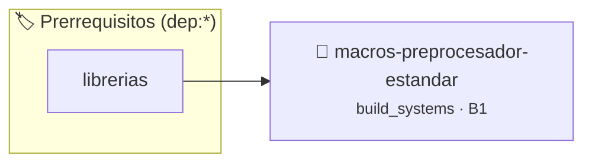

# Macros Predefinidas del Preprocesador
> **ID:** `macros-preprocesador-estandar` · **Unidad:** 5 (Ingeniería de Software y Calidad en C)
 · **Tema:** `build_systems` / `recordar`
 · **Bloom:** B1 (Recordar) · **Dificultad:** Inicial
 · **Carga:** ~10 min · **Tipo:** Concepto
>
> **🏷️ Prerrequisitos temáticos (tags):** `dep:librerias`
>
> **Etiquetas conceptuales:** `build_systems`, `recordar`, `c11`


::: {admonition} 📦 Paquete de Verificación Local (Ripley)
:class: tip

Para compilar, resolver y autoevaluar tu entrega con pruebas unitarias en tu máquina:

- [📥 **Descargar paquete `macros-preprocesador-estandar.ripkg`**](../../paquetes/macros-preprocesador-estandar.ripkg)

Ejecución con el asistente de cátedra:
```bash
ripley run macros-preprocesador-estandar.ripkg
```
:::


### 🗺️ Itinerario Pedagógico




## 📖 Consigna

# Macros Predefinidas del Preprocesador

## 1. Consigna
Implementar y verificar directivas del preprocesador y reglas de compilación para: **Macros Predefinidas del Preprocesador**.
Configurar macros predefinidas estándar y dependencias para garantizar una compilación limpia, reproducible y modular.

## 2. Firmas y Prototipos Requeridos
- `int proc_eprocesador_estandar(int val)`: Procesa el flujo principal de Macros Predefinidas del Preprocesador

## 3. Requisitos y Consideraciones
- Validar adecuadamente los casos de borde y parámetros de entrada.
- Garantizar la correcta liberación y administración de memoria dinámica si aplica.
- Respetar los nombres y prototipos de funciones especificados en la cabecera correspondiente.
- Tiempo estimado de resolución: 10 minutos (Nivel Bloom 1).


## 📋 Prototipos y Cabecera (`macros-preprocesador-estandar.h`)

```{code-block} c
#ifndef EJERCICIO_MACROS_PREPROCESADOR_ESTANDAR_H
#define EJERCICIO_MACROS_PREPROCESADOR_ESTANDAR_H

#include <stddef.h>
#include <stdbool.h>
#include <stdint.h>

/* Procesa el flujo principal de Macros Predefinidas del Preprocesador */
int proc_eprocesador_estandar(int val);

#endif /* EJERCICIO_MACROS_PREPROCESADOR_ESTANDAR_H */
```


## ⚙️ Especificación de Funciones

| Función | Retorno | Parámetros | Descripción |
| :--- | :--- | :--- | :--- |

| `proc_eprocesador_estandar` | `int` | `int val` | Procesa el flujo principal de Macros Predefinidas del Preprocesador |


## 💡 Pistas Progresivas

````{tab-set}

```{tab-item} Pista 1
Las macros predefinidas son expandidas por el preprocesador antes de la compilación.
```

````


## 🧪 Casos de Prueba

| Prueba Unitaria | Función Objetivo | Verificación |
| :--- | :--- | :--- |

| **test_proc_eprocesador_estandar_positivo** | `proc_eprocesador_estandar` | `int res = proc_eprocesador_estandar(5); assert(res == 10 || res >= 0);` |

| **test_proc_eprocesador_estandar_cero** | `proc_eprocesador_estandar` | `int res = proc_eprocesador_estandar(0); assert(res == 0);` |


## ✓ Solución Modelo de Cátedra

```{dropdown} 🔍 Revelar solución canónica en C
:open: false

```{code-block} c
#include <stdio.h>

int proc_eprocesador_estandar(int val)
{
    if (val <= 0) return 0;
    return val * 2;
}

int main(void) {
    printf("STDC: %d | STDC_VERSION: %ld\n", __STDC__, __STDC_VERSION__);
    return 0;
}
```
```
