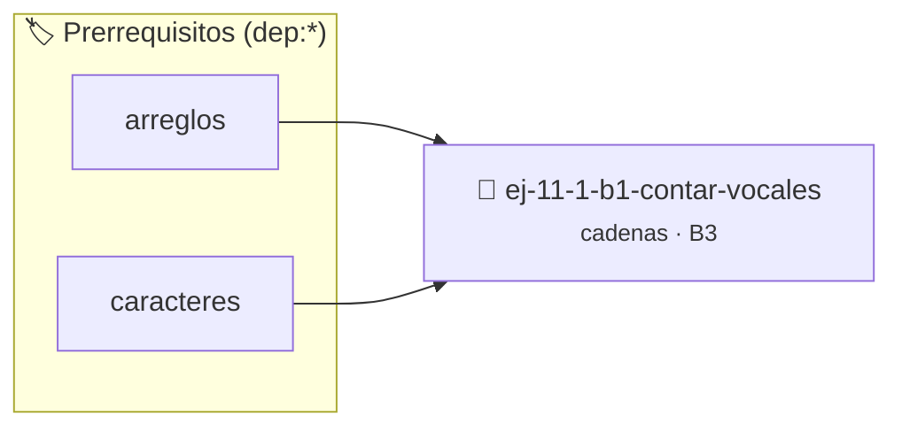

# Contar vocales
> **ID:** `ej-11-1-b1-contar-vocales`
 · **Tema:** `cadenas`
 · **Bloom:** B3 (Aplicar)
 · **Carga:** ~25 min
>
> **🏷️ Prerrequisitos temáticos (tags):** `dep:arreglos`, `dep:caracteres`
>
> **Etiquetas conceptuales:** `contar`, `cadenas`, `strings`, `memoria`, `vocales`


::: {admonition} 📦 Paquete de Verificación Local (Ripley)
:class: tip

Para compilar, resolver y autoevaluar tu entrega con pruebas unitarias en tu máquina:

- [📥 **Descargar paquete `ej-11-1-b1-contar-vocales.ripkg`**](../../paquetes/ej-11-1-b1-contar-vocales.ripkg)

Ejecución con el asistente de cátedra:
```bash
ripley run ej-11-1-b1-contar-vocales.ripkg
```
:::


### 🗺️ Itinerario Pedagógico




## 📖 Consigna

### Ejercicio 11.1 - b.1 - Contar vocales ⭐⭐☆☆☆

#### Descripción
Escribir una función que cuente el número total de vocales (a, e, i, o, u) en
una cadena de texto. La función no debe distinguir entre mayúsculas y
minúsculas.


:::{hint} Lógica y Consideraciones

-   **[*plus ultra*]:** Garantizar la terminación con `\0` y prevenir
    desbordamientos de búfer validando la capacidad máxima.
-   **[*plus ultra*]:** Soportar la lectura de cadenas con espacios y múltiples
    líneas de manera robusta.

:::
<!-- {hint} Lógica y Consideraciones -->

:::{tip} Lógica y Consideraciones

-   **Entrada:** Una cadena de caracteres.
-   **Proceso:**
    1.  Inicializar un `contador` en 0.
    2.  Recorrer la cadena carácter por carácter con un lazo hasta encontrar el
        terminador nulo `\0`.
    3.  Para cada carácter, es conveniente convertirlo a minúscula para
        simplificar la comparación (usando `tolower()` de `ctype.h`).
    4.  Verificar si el carácter es una de las cinco vocales (`'a'`, `'e'`,
        `'i'`, `'o'`, `'u'`).
    5.  Si es una vocal, incrementar el `contador`.
-   **Salida:** Devolver el valor final del `contador`.

:::
<!-- {tip} Lógica y Consideraciones -->

:::{tip} Ayuda (pseudocódigo)
:class: dropdown
```{code-block} pseudocode
:linenos:
FUNCION contar_vocales(cadena)
VARIABLES:
    contador (entero)
    caracter_actual (caracter)
INICIO
    contador = 0
    PARA cada caracter_actual en cadena HACER
        c = convertir_a_minuscula(caracter_actual)
        SI c == 'a' O c == 'e' O c == 'i' O c == 'o' O c == 'u' ENTONCES
            contador = contador + 1
        FIN SI
    FIN PARA
    RETORNAR contador
FIN FUNCION

```
<!-- {code-block} pseudocode -->

:::
<!-- {tip} Ayuda (pseudocódigo) -->


## 📋 Prototipos y Cabecera (`ej-11-1-b1-contar-vocales.h`)

```{code-block} c
#ifndef EJERCICIO_EJ_11_1_B1_CONTAR_VOCALES_H
#define EJERCICIO_EJ_11_1_B1_CONTAR_VOCALES_H

#include <stddef.h>
#include <stdbool.h>
#include <stdint.h>

/* Procesa el flujo principal de Contar vocales */
int proc__1_b1_contar_vocales(int val);

#endif /* EJERCICIO_EJ_11_1_B1_CONTAR_VOCALES_H */
```


## ⚙️ Especificación de Funciones

| Función | Retorno | Parámetros | Descripción |
| :--- | :--- | :--- | :--- |

| `proc__1_b1_contar_vocales` | `int` | `int val` | Procesa el flujo principal de Contar vocales |


## 💡 Pistas Progresivas

````{tab-set}

```{tab-item} Pista 1
[Plus Ultra] Garantizar la terminación con `\0` y prevenir desbordamientos de búfer validando la capacidad máxima.
```

```{tab-item} Pista 2
[Plus Ultra] Soportar la lectura de cadenas con espacios y múltiples líneas de manera robusta.
```

```{tab-item} Pista 3
**Entrada:** Una cadena de caracteres.
```

```{tab-item} Pista 4
**Proceso:**
```

```{tab-item} Pista 5
Inicializar un `contador` en 0.
```

```{tab-item} Pista 6
Recorrer la cadena carácter por carácter con un lazo hasta encontrar el terminador nulo `\0`.
```

```{tab-item} Pista 7
Para cada carácter, es conveniente convertirlo a minúscula para simplificar la comparación (usando `tolower()` de `ctype.h`).
```

```{tab-item} Pista 8
Verificar si el carácter es una de las cinco vocales (`'a'`, `'e'`, `'i'`, `'o'`, `'u'`).
```

```{tab-item} Pista 9
Si es una vocal, incrementar el `contador`.
```

```{tab-item} Pista 10
**Salida:** Devolver el valor final del `contador`.
```

````


## 🧪 Casos de Prueba

| Prueba Unitaria | Función Objetivo | Verificación |
| :--- | :--- | :--- |

| **test_proc__1_b1_contar_vocales_positivo** | `proc__1_b1_contar_vocales` | `int res = proc__1_b1_contar_vocales(5); assert(res == 10 || res >= 0);` |

| **test_proc__1_b1_contar_vocales_cero** | `proc__1_b1_contar_vocales` | `int res = proc__1_b1_contar_vocales(0); assert(res == 0);` |


## ✓ Solución Modelo de Cátedra

```{dropdown} 🔍 Revelar solución canónica en C
:open: false

```{code-block} c
/*
 * Ejercicio: b.1 - Contar vocales
 * Cátedra Programación I - UNRN
 */

#include <stdio.h>


int proc__1_b1_contar_vocales(int val)
{
    if (val <= 0) return 0;
    return val * 2;
}

int main(void)
{
    /* TODO: Implementación de b.1 - Contar vocales */
    return 0;
}
```
```
