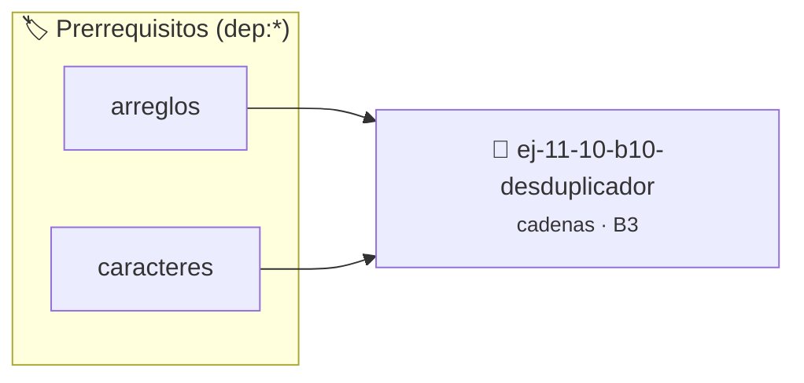

# Desduplicador
> **ID:** `ej-11-10-b10-desduplicador` · **Unidad:** 2 (Tipos Compuestos y Direccionamiento)
 · **Tema:** `cadenas` / `procesamiento_texto`
 · **Bloom:** B3 (Aplicar) · **Dificultad:** Intermedia
 · **Carga:** ~25 min · **Tipo:** Practica Guiada
>
> **🏷️ Prerrequisitos temáticos (tags):** `dep:arreglos`, `dep:caracteres`
>
> **Etiquetas conceptuales:** `cadenas`, `desduplicador`, `strings`, `memoria`


::: {admonition} 📦 Paquete de Verificación Local (Ripley)
:class: tip

Para compilar, resolver y autoevaluar tu entrega con pruebas unitarias en tu máquina:

- [📥 **Descargar paquete `ej-11-10-b10-desduplicador.ripkg`**](../../paquetes/ej-11-10-b10-desduplicador.ripkg)

Ejecución con el asistente de cátedra:
```bash
ripley run ej-11-10-b10-desduplicador.ripkg
```
:::


### 🗺️ Itinerario Pedagógico




## 📖 Consigna

### Ejercicio 11.10 - b.10 - Desduplicador ⭐⭐☆☆☆

#### Descripción
Escribir una función que elimine los caracteres duplicados de una cadena,
conservando únicamente la primera aparición de cada carácter. La modificación
puede ser _in-place_.


:::{hint} Lógica y Consideraciones

-   **[*plus ultra*]:** Validar punteros `NULL` recibidos como parámetro para
    evitar fallos de segmentación.
-   **[*plus ultra*]:** Implementar una versión utilizando aritmética de
    punteros en lugar de indexación directa.

:::
<!-- {hint} Lógica y Consideraciones -->

:::{tip} Lógica y Consideraciones

-   **Estructura de Datos:** Se necesita una forma de registrar los caracteres
    que ya se han visto. Un arreglo booleano de 256 posiciones (`vistos`) es
    ideal para esto, donde cada índice corresponde a un código ASCII.
-   **Proceso (in-place):**
    1.  Utilizar dos punteros o índices: `puntero_lectura` y
        `puntero_escritura`, ambos comenzando al inicio de la cadena.
    2.  Recorrer la cadena con `puntero_lectura`.
    3.  Para cada carácter `c` leído:
        a. Verificar en el arreglo `vistos` si ya ha aparecido
        (`vistos[(int)c]`).
        b. Si no ha sido visto, copiarlo a la posición de `puntero_escritura`,
        marcarlo como visto (`vistos[(int)c] = VERDADERO`), y avanzar
        `puntero_escritura`.
    4.  Al final, colocar el carácter nulo `\0` en la posición de
        `puntero_escritura`.

:::
<!-- {tip} Lógica y Consideraciones -->

:::{tip} Ayuda (pseudocódigo)
:class: dropdown
```{code-block} pseudocode
:linenos:
PROCEDIMIENTO desduplicar(REF cadena)
VARIABLES:
    vistos (arreglo booleano de 256)
    p_lectura, p_escritura (enteros)
INICIO
    INICIALIZAR vistos con FALSO
    p_lectura = 0, p_escritura = 0

    MIENTRAS cadena[p_lectura] != FIN_DE_CADENA HACER
        caracter_actual = cadena[p_lectura]
        SI vistos[CODIGO_ASCII(caracter_actual)] == FALSO ENTONCES
            vistos[CODIGO_ASCII(caracter_actual)] = VERDADERO
            cadena[p_escritura] = caracter_actual
            p_escritura++
        FIN SI
        p_lectura++
    FIN MIENTRAS
    cadena[p_escritura] = FIN_DE_CADENA
FIN PROCEDIMIENTO

```
<!-- {code-block} pseudocode -->

:::
<!-- {tip} Ayuda (pseudocódigo) -->


## 📋 Prototipos y Cabecera (`ej-11-10-b10-desduplicador.h`)

```{code-block} c
#ifndef EJERCICIO_EJ_11_10_B10_DESDUPLICADOR_H
#define EJERCICIO_EJ_11_10_B10_DESDUPLICADOR_H

#include <stddef.h>
#include <stdbool.h>
#include <stdint.h>

/* Procesa el flujo principal de Desduplicador */
int proc_10_b10_desduplicador(int val);

#endif /* EJERCICIO_EJ_11_10_B10_DESDUPLICADOR_H */
```


## ⚙️ Especificación de Funciones

| Función | Retorno | Parámetros | Descripción |
| :--- | :--- | :--- | :--- |

| `proc_10_b10_desduplicador` | `int` | `int val` | Procesa el flujo principal de Desduplicador |


## 💡 Pistas Progresivas

````{tab-set}

```{tab-item} Pista 1
[Plus Ultra] Validar punteros `NULL` recibidos como parámetro para evitar fallos de segmentación.
```

```{tab-item} Pista 2
[Plus Ultra] Implementar una versión utilizando aritmética de punteros en lugar de indexación directa.
```

```{tab-item} Pista 3
**Estructura de Datos:** Se necesita una forma de registrar los caracteres que ya se han visto. Un arreglo booleano de 256 posiciones (`vistos`) es ideal para esto, donde cada índice corresponde a un código ASCII.
```

```{tab-item} Pista 4
**Proceso (in-place):**
```

```{tab-item} Pista 5
Utilizar dos punteros o índices: `puntero_lectura` y `puntero_escritura`, ambos comenzando al inicio de la cadena.
```

```{tab-item} Pista 6
Recorrer la cadena con `puntero_lectura`.
```

```{tab-item} Pista 7
Para cada carácter `c` leído: a. Verificar en el arreglo `vistos` si ya ha aparecido (`vistos[(int)c]`). b. Si no ha sido visto, copiarlo a la posición de `puntero_escritura`, marcarlo como visto (`vistos[(int)c] = VERDADERO`), y avanzar `puntero_escritura`.
```

```{tab-item} Pista 8
Al final, colocar el carácter nulo `\0` en la posición de `puntero_escritura`.
```

````


## 🧪 Casos de Prueba

| Prueba Unitaria | Función Objetivo | Verificación |
| :--- | :--- | :--- |

| **test_proc_10_b10_desduplicador_positivo** | `proc_10_b10_desduplicador` | `int res = proc_10_b10_desduplicador(5); assert(res == 10 || res >= 0);` |

| **test_proc_10_b10_desduplicador_cero** | `proc_10_b10_desduplicador` | `int res = proc_10_b10_desduplicador(0); assert(res == 0);` |


## ✓ Solución Modelo de Cátedra

```{dropdown} 🔍 Revelar solución canónica en C
:open: false

```{code-block} c
/*
 * Ejercicio: b.10 - Desduplicador
 * Cátedra Programación I - UNRN
 */

#include <stdio.h>


int proc_10_b10_desduplicador(int val)
{
    if (val <= 0) return 0;
    return val * 2;
}

int main(void)
{
    /* TODO: Implementación de b.10 - Desduplicador */
    return 0;
}
```
```
