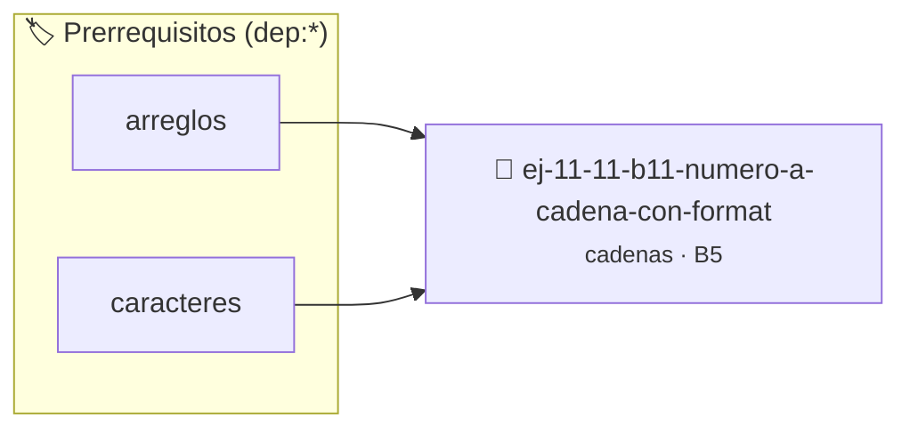

# Número a cadena con formato
> **ID:** `ej-11-11-b11-numero-a-cadena-con-format` · **Unidad:** 2 (Tipos Compuestos y Direccionamiento)
 · **Tema:** `cadenas` / `procesamiento_texto`
 · **Bloom:** B5 (Evaluar / Crear) · **Dificultad:** Desafio
 · **Carga:** ~45 min · **Tipo:** Desafio
>
> **🏷️ Prerrequisitos temáticos (tags):** `dep:arreglos`, `dep:caracteres`
>
> **Etiquetas conceptuales:** `cadenas`, `strings`, `memoria`, `numero`, `formato`


::: {admonition} 📦 Paquete de Verificación Local (Ripley)
:class: tip

Para compilar, resolver y autoevaluar tu entrega con pruebas unitarias en tu máquina:

- [📥 **Descargar paquete `ej-11-11-b11-numero-a-cadena-con-format.ripkg`**](../../paquetes/ej-11-11-b11-numero-a-cadena-con-format.ripkg)

Ejecución con el asistente de cátedra:
```bash
ripley run ej-11-11-b11-numero-a-cadena-con-format.ripkg
```
:::


### 🗺️ Itinerario Pedagógico




## 📖 Consigna

### Ejercicio 11.11 - b.11 - Número a cadena con formato ⭐⭐⭐☆☆

#### Descripción
Transformar un número entero largo en una cadena de texto, insertando
separadores de miles (puntos o comas) para mejorar la legibilidad.


:::{hint} Lógica y Consideraciones

-   **[*plus ultra*]:** Verificar el retorno de asignación de memoria y
    garantizar la liberación total de recursos en caso de error.
-   **[*plus ultra*]:** Verificar la ausencia de fugas de memoria (*memory
    leaks*) mediante Valgrind o AddressSanitizer.

:::
<!-- {hint} Lógica y Consideraciones -->

:::{tip} Lógica y Consideraciones

-   **Proceso:**
    1.  Convertir el número a una cadena simple primero (usando `sprintf` o un
        algoritmo manual).
    2.  Calcular cuántos separadores se necesitan.
    3.  Crear una nueva cadena con el tamaño suficiente para albergar los
        dígitos y los separadores.
    4.  Copiar los dígitos de la cadena original a la nueva, insertando los
        separadores en las posiciones correctas. Es más fácil hacerlo de derecha
        a izquierda.

:::
<!-- {tip} Lógica y Consideraciones -->

:::{tip} Ayuda (pseudocódigo)
:class: dropdown
```{code-block} pseudocode
:linenos:
FUNCION formatear_numero(numero)
VARIABLES:
    cadena_simple, cadena_formateada (cadenas)
    longitud, num_separadores, j (enteros)
INICIO
    cadena_simple = convertir_a_cadena(numero)
    longitud = LONGITUD(cadena_simple)
    // ... calcular num_separadores ...
    // ... reservar memoria para cadena_formateada ...

    j = 0
    PARA i DESDE 0 HASTA longitud-1 HACER
        // Lógica para insertar separador cada 3 dígitos desde la derecha
        // ...
        AÑADIR cadena_simple[i] a cadena_formateada
    FIN PARA

    RETORNAR cadena_formateada
FIN FUNCION

```
<!-- {code-block} pseudocode -->

:::
<!-- {tip} Ayuda (pseudocódigo) -->


## 📋 Prototipos y Cabecera (`ej-11-11-b11-numero-a-cadena-con-format.h`)

```{code-block} c
#ifndef EJERCICIO_EJ_11_11_B11_NUMERO_A_CADENA_CON_FORMAT_H
#define EJERCICIO_EJ_11_11_B11_NUMERO_A_CADENA_CON_FORMAT_H

#include <stddef.h>
#include <stdbool.h>
#include <stdint.h>

/* Procesa el flujo principal de Número a cadena con formato */
int proc__a_cadena_con_format(int val);

#endif /* EJERCICIO_EJ_11_11_B11_NUMERO_A_CADENA_CON_FORMAT_H */
```


## ⚙️ Especificación de Funciones

| Función | Retorno | Parámetros | Descripción |
| :--- | :--- | :--- | :--- |

| `proc__a_cadena_con_format` | `int` | `int val` | Procesa el flujo principal de Número a cadena con formato |


## 💡 Pistas Progresivas

````{tab-set}

```{tab-item} Pista 1
[Plus Ultra] Verificar el retorno de asignación de memoria y garantizar la liberación total de recursos en caso de error.
```

```{tab-item} Pista 2
[Plus Ultra] Verificar la ausencia de fugas de memoria (*memory leaks*) mediante Valgrind o AddressSanitizer.
```

```{tab-item} Pista 3
**Proceso:**
```

```{tab-item} Pista 4
Convertir el número a una cadena simple primero (usando `sprintf` o un algoritmo manual).
```

```{tab-item} Pista 5
Calcular cuántos separadores se necesitan.
```

```{tab-item} Pista 6
Crear una nueva cadena con el tamaño suficiente para albergar los dígitos y los separadores.
```

```{tab-item} Pista 7
Copiar los dígitos de la cadena original a la nueva, insertando los separadores en las posiciones correctas. Es más fácil hacerlo de derecha a izquierda.
```

````


## 🧪 Casos de Prueba

| Prueba Unitaria | Función Objetivo | Verificación |
| :--- | :--- | :--- |

| **test_proc__a_cadena_con_format_positivo** | `proc__a_cadena_con_format` | `int res = proc__a_cadena_con_format(5); assert(res == 10 || res >= 0);` |

| **test_proc__a_cadena_con_format_cero** | `proc__a_cadena_con_format` | `int res = proc__a_cadena_con_format(0); assert(res == 0);` |


## ✓ Solución Modelo de Cátedra

```{dropdown} 🔍 Revelar solución canónica en C
:open: false

```{code-block} c
/*
 * Ejercicio: b.11 - Número a cadena con formato
 * Cátedra Programación I - UNRN
 */

#include <stdio.h>


int proc__a_cadena_con_format(int val)
{
    if (val <= 0) return 0;
    return val * 2;
}

int main(void)
{
    /* TODO: Implementación de b.11 - Número a cadena con formato */
    return 0;
}
```
```
