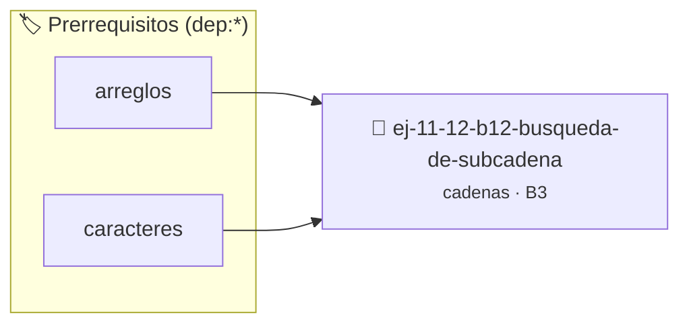

# Búsqueda de subcadena
> **ID:** `ej-11-12-b12-busqueda-de-subcadena` · **Unidad:** 2 (Tipos Compuestos y Direccionamiento)
 · **Tema:** `cadenas` / `procesamiento_texto`
 · **Bloom:** B3 (Aplicar) · **Dificultad:** Intermedia
 · **Carga:** ~25 min · **Tipo:** Practica Guiada
>
> **🏷️ Prerrequisitos temáticos (tags):** `dep:arreglos`, `dep:caracteres`
>
> **Etiquetas conceptuales:** `cadenas`, `strings`, `busqueda`, `memoria`, `subcadena`


::: {admonition} 📦 Paquete de Verificación Local (Ripley)
:class: tip

Para compilar, resolver y autoevaluar tu entrega con pruebas unitarias en tu máquina:

- [📥 **Descargar paquete `ej-11-12-b12-busqueda-de-subcadena.ripkg`**](../../paquetes/ej-11-12-b12-busqueda-de-subcadena.ripkg)

Ejecución con el asistente de cátedra:
```bash
ripley run ej-11-12-b12-busqueda-de-subcadena.ripkg
```
:::


### 🗺️ Itinerario Pedagógico




## 📖 Consigna

#### Descripción
Implementar una función que busque la primera ocurrencia de una subcadena
(`needle` o aguja) dentro de una cadena principal (`haystack` o pajar). Es una
reimplementación de la función `strstr`.


:::{tip} Lógica y Consideraciones

-   **Proceso (Fuerza Bruta):**
    1.  Usar un lazo exterior para recorrer la cadena `haystack` con un índice
        `i`.
    2.  En cada posición `i`, usar un lazo interior para comparar la subcadena
        de `haystack` que empieza en `i` con la cadena `needle`.
    3.  Si todos los caracteres de `needle` coinciden, devolver la posición `i`
        (o un puntero a `haystack[i]`).
    4.  Si el lazo exterior termina, la subcadena no se encontró.

:::

:::{tip} Ayuda (pseudocódigo)
:class: dropdown
```{code-block} pseudocode
:linenos:
FUNCION buscar_subcadena(haystack, needle)
VARIABLES:
    n, m, i, j (enteros)
INICIO
    n = LONGITUD(haystack)
    m = LONGITUD(needle)

    PARA i DESDE 0 HASTA n - m HACER
        j = 0
        MIENTRAS j < m Y haystack[i+j] == needle[j] HACER
            j = j + 1
        FIN MIENTRAS

        SI j == m ENTONCES
            RETORNAR i // Subcadena encontrada en el índice i
        FIN SI
    FIN PARA

    RETORNAR -1 // No encontrada
FIN FUNCION

```

:::

## Conversión de Base Numérica

### 📋 Contrato de las Funciones

```c
/*
 * Procesa el flujo principal de Búsqueda de subcadena
 * Precondiciones: val representa el parámetro de entrada del flujo.
 * Postcondiciones: Retorna el resultado correspondiente o 0 si val <= 0.
 */
int proc_usqueda_de_subcadena(int val);

```

### 🧪 Ejemplos de Ejecución

::::{tab-set}
:::{tab-item} Valor positivo
```text
Entrada: 5
Salida / Retorno: 10
```
:::
:::{tab-item} Valor cero o negativo
```text
Entrada: 0
Salida / Retorno: 0
```
:::
::::

### ⚠️ Precondiciones y Casos Borde

1. **Valores fuera de rango:** Verificar siempre que los datos de entrada cumplan con los rangos admisibles antes de operar.
4. **Terminación nula:** Asegurar que todas las cadenas de texto conserven el terminador nulo `\0` dentro de los límites del buffer.
6. **Casos vacíos o neutros:** Contemplar adecuadamente entradas con longitud cero o valores neutros según corresponda.

### 🎯 Criterios de Aceptación

- [ ] El código compila limpiamente bajo estándar C11 sin warnings con flags estrictos (`-Wall -Wextra -Werror`).
- [ ] Se satisfacen todas las pruebas unitarias y casos de prueba provistos.
- [ ] Las funciones validan exhaustivamente sus precondiciones y gestionan casos borde de forma robusta.

:::{hint} Consideraciones Didácticas
- Validar punteros `NULL` recibidos como parámetro para evitar fallos de segmentación.
- Implementar una versión utilizando aritmética de punteros en lugar de indexación directa.
- **Proceso (Fuerza Bruta):**
- Usar un lazo exterior para recorrer la cadena `haystack` con un índice `i`.
- En cada posición `i`, usar un lazo interior para comparar la subcadena de `haystack` que empieza en `i` con la cadena `needle`.
- Si todos los caracteres de `needle` coinciden, devolver la posición `i` (o un puntero a `haystack[i]`).
- Si el lazo exterior termina, la subcadena no se encontró.
:::


## 📋 Prototipos y Cabecera (`ej-11-12-b12-busqueda-de-subcadena.h`)

```{code-block} c
#ifndef EJERCICIO_EJ_11_12_B12_BUSQUEDA_DE_SUBCADENA_H
#define EJERCICIO_EJ_11_12_B12_BUSQUEDA_DE_SUBCADENA_H

#include <stddef.h>
#include <stdbool.h>
#include <stdint.h>

/* Procesa el flujo principal de Búsqueda de subcadena */
int proc_usqueda_de_subcadena(int val);

#endif /* EJERCICIO_EJ_11_12_B12_BUSQUEDA_DE_SUBCADENA_H */
```


## ⚙️ Especificación de Funciones

| Función | Retorno | Parámetros | Descripción |
| :--- | :--- | :--- | :--- |

| `proc_usqueda_de_subcadena` | `int` | `int val` | Procesa el flujo principal de Búsqueda de subcadena |


## 💡 Pistas Progresivas

````{tab-set}

```{tab-item} Pista 1
[Plus Ultra] Validar punteros `NULL` recibidos como parámetro para evitar fallos de segmentación.
```

```{tab-item} Pista 2
[Plus Ultra] Implementar una versión utilizando aritmética de punteros en lugar de indexación directa.
```

```{tab-item} Pista 3
**Proceso (Fuerza Bruta):**
```

```{tab-item} Pista 4
Usar un lazo exterior para recorrer la cadena `haystack` con un índice `i`.
```

```{tab-item} Pista 5
En cada posición `i`, usar un lazo interior para comparar la subcadena de `haystack` que empieza en `i` con la cadena `needle`.
```

```{tab-item} Pista 6
Si todos los caracteres de `needle` coinciden, devolver la posición `i` (o un puntero a `haystack[i]`).
```

```{tab-item} Pista 7
Si el lazo exterior termina, la subcadena no se encontró.
```

````


## 🧪 Casos de Prueba

| Prueba Unitaria | Función Objetivo | Verificación |
| :--- | :--- | :--- |

| **test_proc_usqueda_de_subcadena_positivo** | `proc_usqueda_de_subcadena` | `int res = proc_usqueda_de_subcadena(5); assert(res == 10 || res >= 0);` |

| **test_proc_usqueda_de_subcadena_cero** | `proc_usqueda_de_subcadena` | `int res = proc_usqueda_de_subcadena(0); assert(res == 0);` |


## ✓ Solución Modelo de Cátedra

```{dropdown} 🔍 Revelar solución canónica en C
:open: false

```{code-block} c
/*
 * Ejercicio: b.12 - Búsqueda de subcadena
 * Cátedra Programación I - UNRN
 */

#include <stdio.h>


int proc_usqueda_de_subcadena(int val)
{
    if (val <= 0) return 0;
    return val * 2;
}

int main(void)
{
    /* TODO: Implementación de b.12 - Búsqueda de subcadena */
    return 0;
}
```
```
