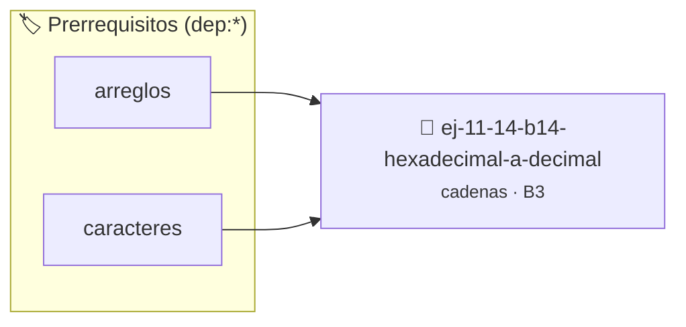

# Hexadecimal a decimal
> **ID:** `ej-11-14-b14-hexadecimal-a-decimal` · **Unidad:** 2 (Tipos Compuestos y Direccionamiento)
 · **Tema:** `cadenas` / `procesamiento_texto`
 · **Bloom:** B3 (Aplicar) · **Dificultad:** Intermedia
 · **Carga:** ~25 min · **Tipo:** Practica Guiada
>
> **🏷️ Prerrequisitos temáticos (tags):** `dep:arreglos`, `dep:caracteres`
>
> **Etiquetas conceptuales:** `cadenas`, `strings`, `memoria`, `decimal`, `hexadecimal`


::: {admonition} 📦 Paquete de Verificación Local (Ripley)
:class: tip

Para compilar, resolver y autoevaluar tu entrega con pruebas unitarias en tu máquina:

- [📥 **Descargar paquete `ej-11-14-b14-hexadecimal-a-decimal.ripkg`**](../../paquetes/ej-11-14-b14-hexadecimal-a-decimal.ripkg)

Ejecución con el asistente de cátedra:
```bash
ripley run ej-11-14-b14-hexadecimal-a-decimal.ripkg
```
:::


### 🗺️ Itinerario Pedagógico




## 📖 Consigna

### Ejercicio 11.14 - b.14 - Hexadecimal a decimal ⭐⭐☆☆☆

#### Descripción
Convertir una cadena que representa un número en formato hexadecimal (dígitos
0-9 y letras A-F, insensibles a mayúsculas) a su valor entero decimal.


:::{hint} Lógica y Consideraciones

-   **[*plus ultra*]:** Garantizar la terminación con `\0` y prevenir
    desbordamientos de búfer validando la capacidad máxima.
-   **[*plus ultra*]:** Soportar la lectura de cadenas con espacios y múltiples
    líneas de manera robusta.

:::
<!-- {hint} Lógica y Consideraciones -->

:::{tip} Lógica y Consideraciones

-   **Proceso:** Similar a la conversión de binario, pero la base es 16.
-   **Conversión de Dígitos:** Se necesita una lógica para convertir los
    caracteres 'A'- 'F' a sus valores numéricos (10-15).

:::
<!-- {tip} Lógica y Consideraciones -->

:::{tip} Ayuda (pseudocódigo)
:class: dropdown
```{code-block} pseudocode
:linenos:
FUNCION hexadecimal_a_decimal(cadena_hex)
VARIABLES:
    decimal (entero)
    valor_digito (entero)
INICIO
    decimal = 0
    PARA cada caracter c en cadena_hex HACER
        SI c >= '0' Y c <= '9' ENTONCES
            valor_digito = c - '0'
        SINO SI c >= 'a' Y c <= 'f' ENTONCES
            valor_digito = c - 'a' + 10
        SINO SI c >= 'A' Y c <= 'F' ENTONCES
            valor_digito = c - 'A' + 10
        FIN SI
        decimal = (decimal * 16) + valor_digito
    FIN PARA
    RETORNAR decimal
FIN FUNCION

```
<!-- {code-block} pseudocode -->

:::
<!-- {tip} Ayuda (pseudocódigo) -->


## 📋 Prototipos y Cabecera (`ej-11-14-b14-hexadecimal-a-decimal.h`)

```{code-block} c
#ifndef EJERCICIO_EJ_11_14_B14_HEXADECIMAL_A_DECIMAL_H
#define EJERCICIO_EJ_11_14_B14_HEXADECIMAL_A_DECIMAL_H

#include <stddef.h>
#include <stdbool.h>
#include <stdint.h>

/* Procesa el flujo principal de Hexadecimal a decimal */
int proc_exadecimal_a_decimal(int val);

#endif /* EJERCICIO_EJ_11_14_B14_HEXADECIMAL_A_DECIMAL_H */
```


## ⚙️ Especificación de Funciones

| Función | Retorno | Parámetros | Descripción |
| :--- | :--- | :--- | :--- |

| `proc_exadecimal_a_decimal` | `int` | `int val` | Procesa el flujo principal de Hexadecimal a decimal |


## 💡 Pistas Progresivas

````{tab-set}

```{tab-item} Pista 1
[Plus Ultra] Garantizar la terminación con `\0` y prevenir desbordamientos de búfer validando la capacidad máxima.
```

```{tab-item} Pista 2
[Plus Ultra] Soportar la lectura de cadenas con espacios y múltiples líneas de manera robusta.
```

```{tab-item} Pista 3
**Proceso:** Similar a la conversión de binario, pero la base es 16.
```

```{tab-item} Pista 4
**Conversión de Dígitos:** Se necesita una lógica para convertir los caracteres 'A'- 'F' a sus valores numéricos (10-15).
```

````


## 🧪 Casos de Prueba

| Prueba Unitaria | Función Objetivo | Verificación |
| :--- | :--- | :--- |

| **test_proc_exadecimal_a_decimal_positivo** | `proc_exadecimal_a_decimal` | `int res = proc_exadecimal_a_decimal(5); assert(res == 10 || res >= 0);` |

| **test_proc_exadecimal_a_decimal_cero** | `proc_exadecimal_a_decimal` | `int res = proc_exadecimal_a_decimal(0); assert(res == 0);` |


## ✓ Solución Modelo de Cátedra

```{dropdown} 🔍 Revelar solución canónica en C
:open: false

```{code-block} c
/*
 * Ejercicio: b.14 - Hexadecimal a decimal
 * Cátedra Programación I - UNRN
 */

#include <stdio.h>


int proc_exadecimal_a_decimal(int val)
{
    if (val <= 0) return 0;
    return val * 2;
}

int main(void)
{
    /* TODO: Implementación de b.14 - Hexadecimal a decimal */
    return 0;
}
```
```
