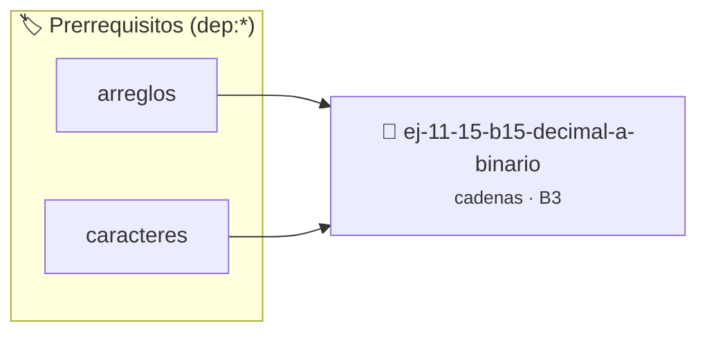

# Decimal a binario
> **ID:** `ej-11-15-b15-decimal-a-binario` · **Unidad:** 2 (Tipos Compuestos y Direccionamiento)
 · **Tema:** `cadenas` / `procesamiento_texto`
 · **Bloom:** B3 (Aplicar) · **Dificultad:** Intermedia
 · **Carga:** ~25 min · **Tipo:** Practica Guiada
>
> **🏷️ Prerrequisitos temáticos (tags):** `dep:arreglos`, `dep:caracteres`
>
> **Etiquetas conceptuales:** `cadenas`, `strings`, `memoria`, `decimal`, `binario`


::: {admonition} 📦 Paquete de Verificación Local (Ripley)
:class: tip

Para compilar, resolver y autoevaluar tu entrega con pruebas unitarias en tu máquina:

- [📥 **Descargar paquete `ej-11-15-b15-decimal-a-binario.ripkg`**](../../paquetes/ej-11-15-b15-decimal-a-binario.ripkg)

Ejecución con el asistente de cátedra:
```bash
ripley run ej-11-15-b15-decimal-a-binario.ripkg
```
:::


### 🗺️ Itinerario Pedagógico




## 📖 Consigna

### Ejercicio 11.15 - b.15 - Decimal a binario ⭐⭐⭐⭐☆

#### Descripción
Convertir un número entero decimal a su representación en una cadena de texto
binaria.


:::{hint} Lógica y Consideraciones

-   **[*plus ultra*]:** Garantizar la terminación con `\0` y prevenir
    desbordamientos de búfer validando la capacidad máxima.
-   **[*plus ultra*]:** Soportar la lectura de cadenas con espacios y múltiples
    líneas de manera robusta.

:::
<!-- {hint} Lógica y Consideraciones -->

:::{tip} Lógica y Consideraciones

-   **Proceso:**
    1.  Usar divisiones sucesivas por 2. El resto de cada división (`n % 2`) es
        el siguiente dígito binario.
    2.  Guardar estos dígitos en un arreglo o cadena.
    3.  Como los dígitos se generan en orden inverso, la cadena resultante debe
        ser invertida al final.

:::
<!-- {tip} Lógica y Consideraciones -->

:::{tip} Ayuda (pseudocódigo)
:class: dropdown
```{code-block} pseudocode
:linenos:
FUNCION decimal_a_binario(n)
VARIABLES:
    cadena_inversa, cadena_final (cadenas)
INICIO
    SI n == 0 RETORNAR "0"

    MIENTRAS n > 0 HACER
        resto = n MOD 2
        AÑADIR caracter(resto) a cadena_inversa
        n = n / 2
    FIN MIENTRAS

    cadena_final = invertir_cadena(cadena_inversa)
    RETORNAR cadena_final
FIN FUNCION

```
<!-- {code-block} pseudocode -->

:::
<!-- {tip} Ayuda (pseudocódigo) -->


## 📋 Prototipos y Cabecera (`ej-11-15-b15-decimal-a-binario.h`)

```{code-block} c
#ifndef EJERCICIO_EJ_11_15_B15_DECIMAL_A_BINARIO_H
#define EJERCICIO_EJ_11_15_B15_DECIMAL_A_BINARIO_H

#include <stddef.h>
#include <stdbool.h>
#include <stdint.h>

/* Procesa el flujo principal de Decimal a binario */
int proc_15_decimal_a_binario(int val);

#endif /* EJERCICIO_EJ_11_15_B15_DECIMAL_A_BINARIO_H */
```


## ⚙️ Especificación de Funciones

| Función | Retorno | Parámetros | Descripción |
| :--- | :--- | :--- | :--- |

| `proc_15_decimal_a_binario` | `int` | `int val` | Procesa el flujo principal de Decimal a binario |


## 💡 Pistas Progresivas

````{tab-set}

```{tab-item} Pista 1
[Plus Ultra] Garantizar la terminación con `\0` y prevenir desbordamientos de búfer validando la capacidad máxima.
```

```{tab-item} Pista 2
[Plus Ultra] Soportar la lectura de cadenas con espacios y múltiples líneas de manera robusta.
```

```{tab-item} Pista 3
**Proceso:**
```

```{tab-item} Pista 4
Usar divisiones sucesivas por 2. El resto de cada división (`n % 2`) es el siguiente dígito binario.
```

```{tab-item} Pista 5
Guardar estos dígitos en un arreglo o cadena.
```

```{tab-item} Pista 6
Como los dígitos se generan en orden inverso, la cadena resultante debe ser invertida al final.
```

````


## 🧪 Casos de Prueba

| Prueba Unitaria | Función Objetivo | Verificación |
| :--- | :--- | :--- |

| **test_proc_15_decimal_a_binario_positivo** | `proc_15_decimal_a_binario` | `int res = proc_15_decimal_a_binario(5); assert(res == 10 || res >= 0);` |

| **test_proc_15_decimal_a_binario_cero** | `proc_15_decimal_a_binario` | `int res = proc_15_decimal_a_binario(0); assert(res == 0);` |


## ✓ Solución Modelo de Cátedra

```{dropdown} 🔍 Revelar solución canónica en C
:open: false

```{code-block} c
/*
 * Ejercicio: b.15 - Decimal a binario
 * Cátedra Programación I - UNRN
 */

#include <stdio.h>


int proc_15_decimal_a_binario(int val)
{
    if (val <= 0) return 0;
    return val * 2;
}

int main(void)
{
    /* TODO: Implementación de b.15 - Decimal a binario */
    return 0;
}
```
```
