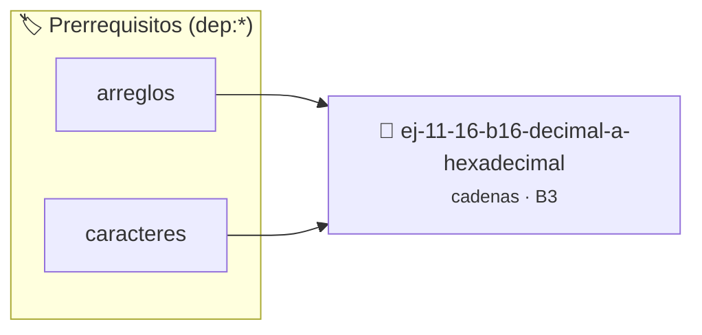

# Decimal a hexadecimal
> **ID:** `ej-11-16-b16-decimal-a-hexadecimal`
 · **Tema:** `cadenas`
 · **Bloom:** B3 (Aplicar)
 · **Carga:** ~25 min
>
> **🏷️ Prerrequisitos temáticos (tags):** `dep:arreglos`, `dep:caracteres`
>
> **Etiquetas conceptuales:** `cadenas`, `strings`, `memoria`, `decimal`, `hexadecimal`


::: {admonition} 📦 Paquete de Verificación Local (Ripley)
:class: tip

Para compilar, resolver y autoevaluar tu entrega con pruebas unitarias en tu máquina:

- [📥 **Descargar paquete `ej-11-16-b16-decimal-a-hexadecimal.ripkg`**](../../paquetes/ej-11-16-b16-decimal-a-hexadecimal.ripkg)

Ejecución con el asistente de cátedra:
```bash
ripley run ej-11-16-b16-decimal-a-hexadecimal.ripkg
```
:::


### 🗺️ Itinerario Pedagógico




## 📖 Consigna

### Ejercicio 11.16 - b.16 - Decimal a hexadecimal ⭐⭐☆☆☆

#### Descripción
Convertir un número entero decimal a su representación en una cadena de texto
hexadecimal.


:::{hint} Lógica y Consideraciones

-   **[*plus ultra*]:** Garantizar la terminación con `\0` y prevenir
    desbordamientos de búfer validando la capacidad máxima.
-   **[*plus ultra*]:** Soportar la lectura de cadenas con espacios y múltiples
    líneas de manera robusta.

:::
<!-- {hint} Lógica y Consideraciones -->

:::{tip} Lógica y Consideraciones

-   **Proceso:** Similar a la conversión a binario, pero usando 16 como base.
-   **Conversión de Dígitos:** Los restos entre 10 y 15 deben ser mapeados a los
    caracteres 'A' a 'F'.

:::
<!-- {tip} Lógica y Consideraciones -->

:::{tip} Ayuda (pseudocódigo)
:class: dropdown
```{code-block} pseudocode
:linenos:
FUNCION decimal_a_hexadecimal(n)
VARIABLES:
    cadena_inversa, cadena_final (cadenas)
    mapa_hex = "0123456789ABCDEF"
INICIO
    SI n == 0 RETORNAR "0"

    MIENTRAS n > 0 HACER
        resto = n MOD 16
        AÑADIR mapa_hex[resto] a cadena_inversa
        n = n / 16
    FIN MIENTRAS

    cadena_final = invertir_cadena(cadena_inversa)
    RETORNAR cadena_final
FIN FUNCION

```
<!-- {code-block} pseudocode -->

:::
<!-- {tip} Ayuda (pseudocódigo) -->

## Más Ejercicios de Cadenas


## 📋 Prototipos y Cabecera (`ej-11-16-b16-decimal-a-hexadecimal.h`)

```{code-block} c
#ifndef EJERCICIO_EJ_11_16_B16_DECIMAL_A_HEXADECIMAL_H
#define EJERCICIO_EJ_11_16_B16_DECIMAL_A_HEXADECIMAL_H

#include <stddef.h>
#include <stdbool.h>
#include <stdint.h>

/* Procesa el flujo principal de Decimal a hexadecimal */
int proc_ecimal_a_hexadecimal(int val);

#endif /* EJERCICIO_EJ_11_16_B16_DECIMAL_A_HEXADECIMAL_H */
```


## ⚙️ Especificación de Funciones

| Función | Retorno | Parámetros | Descripción |
| :--- | :--- | :--- | :--- |

| `proc_ecimal_a_hexadecimal` | `int` | `int val` | Procesa el flujo principal de Decimal a hexadecimal |


## 💡 Pistas Progresivas

````{tab-set}

```{tab-item} Pista 1
[Plus Ultra] Garantizar la terminación con `\0` y prevenir desbordamientos de búfer validando la capacidad máxima.
```

```{tab-item} Pista 2
[Plus Ultra] Soportar la lectura de cadenas con espacios y múltiples líneas de manera robusta.
```

```{tab-item} Pista 3
**Proceso:** Similar a la conversión a binario, pero usando 16 como base.
```

```{tab-item} Pista 4
**Conversión de Dígitos:** Los restos entre 10 y 15 deben ser mapeados a los caracteres 'A' a 'F'.
```

````


## 🧪 Casos de Prueba

| Prueba Unitaria | Función Objetivo | Verificación |
| :--- | :--- | :--- |

| **test_proc_ecimal_a_hexadecimal_positivo** | `proc_ecimal_a_hexadecimal` | `int res = proc_ecimal_a_hexadecimal(5); assert(res == 10 || res >= 0);` |

| **test_proc_ecimal_a_hexadecimal_cero** | `proc_ecimal_a_hexadecimal` | `int res = proc_ecimal_a_hexadecimal(0); assert(res == 0);` |


## ✓ Solución Modelo de Cátedra

```{dropdown} 🔍 Revelar solución canónica en C
:open: false

```{code-block} c
/*
 * Ejercicio: b.16 - Decimal a hexadecimal
 * Cátedra Programación I - UNRN
 */

#include <stdio.h>


int proc_ecimal_a_hexadecimal(int val)
{
    if (val <= 0) return 0;
    return val * 2;
}

int main(void)
{
    /* TODO: Implementación de b.16 - Decimal a hexadecimal */
    return 0;
}
```
```
