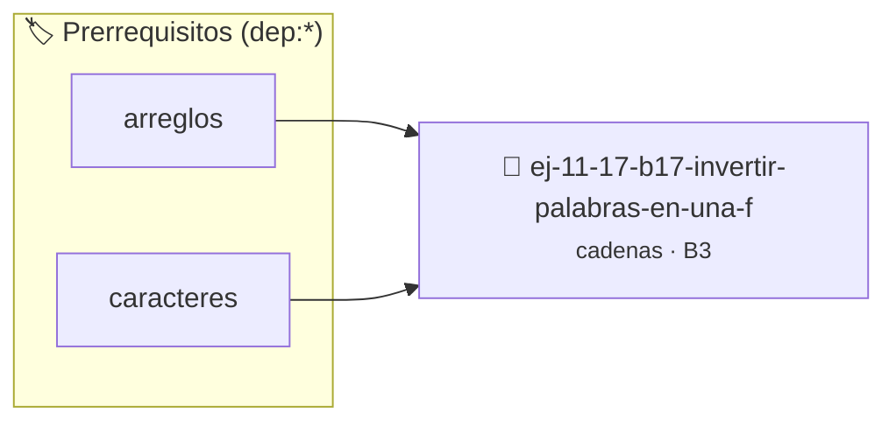

# Invertir palabras en una frase
> **ID:** `ej-11-17-b17-invertir-palabras-en-una-f` · **Unidad:** 2 (Tipos Compuestos y Direccionamiento)
 · **Tema:** `cadenas` / `procesamiento_texto`
 · **Bloom:** B3 (Aplicar) · **Dificultad:** Intermedia
 · **Carga:** ~25 min · **Tipo:** Practica Guiada
>
> **🏷️ Prerrequisitos temáticos (tags):** `dep:arreglos`, `dep:caracteres`
>
> **Etiquetas conceptuales:** `cadenas`, `invertir`, `strings`, `memoria`, `palabras`


::: {admonition} 📦 Paquete de Verificación Local (Ripley)
:class: tip

Para compilar, resolver y autoevaluar tu entrega con pruebas unitarias en tu máquina:

- [📥 **Descargar paquete `ej-11-17-b17-invertir-palabras-en-una-f.ripkg`**](../../paquetes/ej-11-17-b17-invertir-palabras-en-una-f.ripkg)

Ejecución con el asistente de cátedra:
```bash
ripley run ej-11-17-b17-invertir-palabras-en-una-f.ripkg
```
:::


### 🗺️ Itinerario Pedagógico




## 📖 Consigna

#### Descripción
Escribir una función que tome una frase y la modifique de tal manera que cada
palabra individual quede invertida, pero el orden de las palabras en la frase se
mantenga intacto.


:::{tip} Lógica y Consideraciones

-   **Entrada:** Una cadena de caracteres que representa una frase.
-   **Proceso:**
    1.  Recorrer la cadena para identificar los límites de cada palabra. Las
        palabras suelen estar separadas por espacios o signos de puntuación.
    2.  Para cada palabra encontrada, se necesita una función auxiliar que pueda
        invertir una subcadena. Esta función tomaría punteros o índices al
        inicio y al final de la palabra.
    3.  La función de inversión de subcadena usaría la técnica de dos punteros
        (uno al inicio y otro al final de la palabra) que se mueven hacia el
        centro, intercambiando caracteres en cada paso.

:::

:::{tip} Ayuda (pseudocódigo)
:class: dropdown
```{code-block} pseudocode
:linenos:
PROCEDIMIENTO invertir_subcadena(REF cadena, inicio, fin)
    MIENTRAS inicio < fin HACER
        INTERCAMBIAR(cadena[inicio], cadena[fin])
        inicio++, fin--
    FIN MIENTRAS
FIN PROCEDIMIENTO

PROCEDIMIENTO invertir_palabras(REF frase)
VARIABLES:
    inicio_palabra, i (enteros)
INICIO
    inicio_palabra = 0
    PARA i DESDE 0 HASTA LONGITUD(frase) HACER
        SI frase[i] == ' ' O frase[i] == FIN_DE_CADENA ENTONCES
            // Se encontró el final de una palabra
            invertir_subcadena(frase, inicio_palabra, i - 1)
            inicio_palabra = i + 1
        FIN SI
    FIN PARA
FIN PROCEDIMIENTO

```

:::

### 📋 Contrato de las Funciones

```c
/*
 * Procesa el flujo principal de Invertir palabras en una frase
 * Precondiciones: val representa el parámetro de entrada del flujo.
 * Postcondiciones: Retorna el resultado correspondiente o 0 si val <= 0.
 */
int proc_ir_palabras_en_una_f(int val);

```

### 🧪 Ejemplos de Ejecución

::::{tab-set}
:::{tab-item} Valor positivo
```text
Entrada: 5
Salida / Retorno: 10
```
:::
:::{tab-item} Valor cero o negativo
```text
Entrada: 0
Salida / Retorno: 0
```
:::
::::

### ⚠️ Precondiciones y Casos Borde

1. **Valores fuera de rango:** Verificar siempre que los datos de entrada cumplan con los rangos admisibles antes de operar.
4. **Terminación nula:** Asegurar que todas las cadenas de texto conserven el terminador nulo `\0` dentro de los límites del buffer.
6. **Casos vacíos o neutros:** Contemplar adecuadamente entradas con longitud cero o valores neutros según corresponda.

### 🎯 Criterios de Aceptación

- [ ] El código compila limpiamente bajo estándar C11 sin warnings con flags estrictos (`-Wall -Wextra -Werror`).
- [ ] Se satisfacen todas las pruebas unitarias y casos de prueba provistos.
- [ ] Las funciones validan exhaustivamente sus precondiciones y gestionan casos borde de forma robusta.

:::{hint} Consideraciones Didácticas
- Validar punteros `NULL` recibidos como parámetro para evitar fallos de segmentación.
- Implementar una versión utilizando aritmética de punteros en lugar de indexación directa.
- **Entrada:** Una cadena de caracteres que representa una frase.
- **Proceso:**
- Recorrer la cadena para identificar los límites de cada palabra. Las palabras suelen estar separadas por espacios o signos de puntuación.
- Para cada palabra encontrada, se necesita una función auxiliar que pueda invertir una subcadena. Esta función tomaría punteros o índices al inicio y al final de la palabra.
- La función de inversión de subcadena usaría la técnica de dos punteros (uno al inicio y otro al final de la palabra) que se mueven hacia el centro, intercambiando caracteres en cada paso.
:::


## 📋 Prototipos y Cabecera (`ej-11-17-b17-invertir-palabras-en-una-f.h`)

```{code-block} c
#ifndef EJERCICIO_EJ_11_17_B17_INVERTIR_PALABRAS_EN_UNA_F_H
#define EJERCICIO_EJ_11_17_B17_INVERTIR_PALABRAS_EN_UNA_F_H

#include <stddef.h>
#include <stdbool.h>
#include <stdint.h>

/* Procesa el flujo principal de Invertir palabras en una frase */
int proc_ir_palabras_en_una_f(int val);

#endif /* EJERCICIO_EJ_11_17_B17_INVERTIR_PALABRAS_EN_UNA_F_H */
```


## ⚙️ Especificación de Funciones

| Función | Retorno | Parámetros | Descripción |
| :--- | :--- | :--- | :--- |

| `proc_ir_palabras_en_una_f` | `int` | `int val` | Procesa el flujo principal de Invertir palabras en una frase |


## 💡 Pistas Progresivas

````{tab-set}

```{tab-item} Pista 1
[Plus Ultra] Validar punteros `NULL` recibidos como parámetro para evitar fallos de segmentación.
```

```{tab-item} Pista 2
[Plus Ultra] Implementar una versión utilizando aritmética de punteros en lugar de indexación directa.
```

```{tab-item} Pista 3
**Entrada:** Una cadena de caracteres que representa una frase.
```

```{tab-item} Pista 4
**Proceso:**
```

```{tab-item} Pista 5
Recorrer la cadena para identificar los límites de cada palabra. Las palabras suelen estar separadas por espacios o signos de puntuación.
```

```{tab-item} Pista 6
Para cada palabra encontrada, se necesita una función auxiliar que pueda invertir una subcadena. Esta función tomaría punteros o índices al inicio y al final de la palabra.
```

```{tab-item} Pista 7
La función de inversión de subcadena usaría la técnica de dos punteros (uno al inicio y otro al final de la palabra) que se mueven hacia el centro, intercambiando caracteres en cada paso.
```

````


## 🧪 Casos de Prueba

| Prueba Unitaria | Función Objetivo | Verificación |
| :--- | :--- | :--- |

| **test_proc_ir_palabras_en_una_f_positivo** | `proc_ir_palabras_en_una_f` | `int res = proc_ir_palabras_en_una_f(5); assert(res == 10 || res >= 0);` |

| **test_proc_ir_palabras_en_una_f_cero** | `proc_ir_palabras_en_una_f` | `int res = proc_ir_palabras_en_una_f(0); assert(res == 0);` |


## ✓ Solución Modelo de Cátedra

```{dropdown} 🔍 Revelar solución canónica en C
:open: false

```{code-block} c
/*
 * Ejercicio: b.17 - Invertir palabras en una frase
 * Cátedra Programación I - UNRN
 */

#include <stdio.h>


int proc_ir_palabras_en_una_f(int val)
{
    if (val <= 0) return 0;
    return val * 2;
}

int main(void)
{
    /* TODO: Implementación de b.17 - Invertir palabras en una frase */
    return 0;
}
```
```
