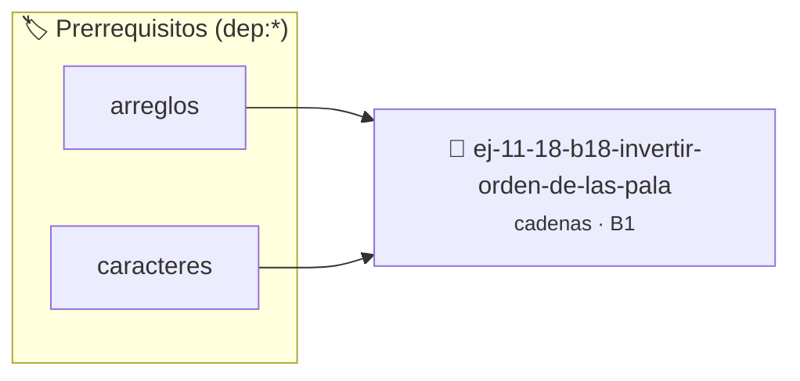

# Invertir orden de las palabras
> **ID:** `ej-11-18-b18-invertir-orden-de-las-pala` · **Unidad:** 2 (Tipos Compuestos y Direccionamiento)
 · **Tema:** `cadenas` / `procesamiento_texto`
 · **Bloom:** B1 (Recordar) · **Dificultad:** Inicial
 · **Carga:** ~10 min · **Tipo:** Concepto
>
> **🏷️ Prerrequisitos temáticos (tags):** `dep:arreglos`, `dep:caracteres`
>
> **Etiquetas conceptuales:** `cadenas`, `invertir`, `orden`, `strings`, `memoria`


::: {admonition} 📦 Paquete de Verificación Local (Ripley)
:class: tip

Para compilar, resolver y autoevaluar tu entrega con pruebas unitarias en tu máquina:

- [📥 **Descargar paquete `ej-11-18-b18-invertir-orden-de-las-pala.ripkg`**](../../paquetes/ej-11-18-b18-invertir-orden-de-las-pala.ripkg)

Ejecución con el asistente de cátedra:
```bash
ripley run ej-11-18-b18-invertir-orden-de-las-pala.ripkg
```
:::


### 🗺️ Itinerario Pedagógico




## 📖 Consigna

#### Descripción
Escribir una función que invierta el orden de las palabras en una frase. Por
ejemplo, "Hola Mundo desde C" se convertiría en "C desde Mundo Hola".


:::{tip} Lógica y Consideraciones

-   **Proceso (dos pasos):**
    1.  Invertir la cadena de caracteres completa. ("Hola Mundo desde C" -> "C
        edsed odnuM aloH").
    2.  Recorrer la nueva cadena e invertir cada palabra individualmente (usando
        la lógica del ejercicio 5.1). ("C" -> "C", "edsed" -> "desde", etc.).

:::

:::{tip} Ayuda (pseudocódigo)
:class: dropdown
```{code-block} pseudocode
:linenos:
PROCEDIMIENTO invertir_orden_palabras(REF frase)
INICIO
    // Paso 1: Invertir toda la frase
    invertir_subcadena(frase, 0, LONGITUD(frase) - 1)

    // Paso 2: Invertir cada palabra individualmente
    invertir_palabras(frase)
FIN PROCEDIMIENTO

```

:::

### 📋 Contrato de las Funciones

```c
/*
 * Procesa el flujo principal de Invertir orden de las palabras
 * Precondiciones: val representa el parámetro de entrada del flujo.
 * Postcondiciones: Retorna el resultado correspondiente o 0 si val <= 0.
 */
int proc_ir_orden_de_las_pala(int val);

```

### 🧪 Ejemplos de Ejecución

::::{tab-set}
:::{tab-item} Valor positivo
```text
Entrada: 5
Salida / Retorno: 10
```
:::
:::{tab-item} Valor cero o negativo
```text
Entrada: 0
Salida / Retorno: 0
```
:::
::::

### ⚠️ Precondiciones y Casos Borde

1. **Valores fuera de rango:** Verificar siempre que los datos de entrada cumplan con los rangos admisibles antes de operar.
4. **Terminación nula:** Asegurar que todas las cadenas de texto conserven el terminador nulo `\0` dentro de los límites del buffer.
6. **Casos vacíos o neutros:** Contemplar adecuadamente entradas con longitud cero o valores neutros según corresponda.

### 🎯 Criterios de Aceptación

- [ ] El código compila limpiamente bajo estándar C11 sin warnings con flags estrictos (`-Wall -Wextra -Werror`).
- [ ] Se satisfacen todas las pruebas unitarias y casos de prueba provistos.
- [ ] Las funciones validan exhaustivamente sus precondiciones y gestionan casos borde de forma robusta.

:::{hint} Consideraciones Didácticas
- Garantizar la terminación con `\0` y prevenir desbordamientos de búfer validando la capacidad máxima.
- Soportar la lectura de cadenas con espacios y múltiples líneas de manera robusta.
- **Proceso (dos pasos):**
- Invertir la cadena de caracteres completa. ("Hola Mundo desde C" -> "C edsed odnuM aloH").
- Recorrer la nueva cadena e invertir cada palabra individualmente (usando la lógica del ejercicio 5.1). ("C" -> "C", "edsed" -> "desde", etc.).
:::


## 📋 Prototipos y Cabecera (`ej-11-18-b18-invertir-orden-de-las-pala.h`)

```{code-block} c
#ifndef EJERCICIO_EJ_11_18_B18_INVERTIR_ORDEN_DE_LAS_PALA_H
#define EJERCICIO_EJ_11_18_B18_INVERTIR_ORDEN_DE_LAS_PALA_H

#include <stddef.h>
#include <stdbool.h>
#include <stdint.h>

/* Procesa el flujo principal de Invertir orden de las palabras */
int proc_ir_orden_de_las_pala(int val);

#endif /* EJERCICIO_EJ_11_18_B18_INVERTIR_ORDEN_DE_LAS_PALA_H */
```


## ⚙️ Especificación de Funciones

| Función | Retorno | Parámetros | Descripción |
| :--- | :--- | :--- | :--- |

| `proc_ir_orden_de_las_pala` | `int` | `int val` | Procesa el flujo principal de Invertir orden de las palabras |


## 💡 Pistas Progresivas

````{tab-set}

```{tab-item} Pista 1
[Plus Ultra] Garantizar la terminación con `\0` y prevenir desbordamientos de búfer validando la capacidad máxima.
```

```{tab-item} Pista 2
[Plus Ultra] Soportar la lectura de cadenas con espacios y múltiples líneas de manera robusta.
```

```{tab-item} Pista 3
**Proceso (dos pasos):**
```

```{tab-item} Pista 4
Invertir la cadena de caracteres completa. ("Hola Mundo desde C" -> "C edsed odnuM aloH").
```

```{tab-item} Pista 5
Recorrer la nueva cadena e invertir cada palabra individualmente (usando la lógica del ejercicio 5.1). ("C" -> "C", "edsed" -> "desde", etc.).
```

````


## 🧪 Casos de Prueba

| Prueba Unitaria | Función Objetivo | Verificación |
| :--- | :--- | :--- |

| **test_proc_ir_orden_de_las_pala_positivo** | `proc_ir_orden_de_las_pala` | `int res = proc_ir_orden_de_las_pala(5); assert(res == 10 || res >= 0);` |

| **test_proc_ir_orden_de_las_pala_cero** | `proc_ir_orden_de_las_pala` | `int res = proc_ir_orden_de_las_pala(0); assert(res == 0);` |


## ✓ Solución Modelo de Cátedra

```{dropdown} 🔍 Revelar solución canónica en C
:open: false

```{code-block} c
/*
 * Ejercicio: b.18 - Invertir orden de las palabras
 * Cátedra Programación I - UNRN
 */

#include <stdio.h>


int proc_ir_orden_de_las_pala(int val)
{
    if (val <= 0) return 0;
    return val * 2;
}

int main(void)
{
    /* TODO: Implementación de b.18 - Invertir orden de las palabras */
    return 0;
}
```
```
