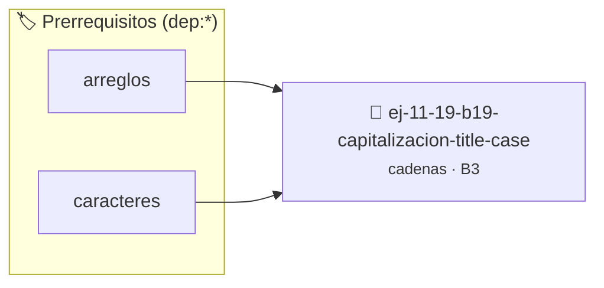

# Capitalización (Title Case)
> **ID:** `ej-11-19-b19-capitalizacion-title-case` · **Unidad:** 2 (Tipos Compuestos y Direccionamiento)
 · **Tema:** `cadenas` / `procesamiento_texto`
 · **Bloom:** B3 (Aplicar) · **Dificultad:** Intermedia
 · **Carga:** ~25 min · **Tipo:** Practica Guiada
>
> **🏷️ Prerrequisitos temáticos (tags):** `dep:arreglos`, `dep:caracteres`
>
> **Etiquetas conceptuales:** `cadenas`, `strings`, `memoria`, `capitalizacion`, `case`


::: {admonition} 📦 Paquete de Verificación Local (Ripley)
:class: tip

Para compilar, resolver y autoevaluar tu entrega con pruebas unitarias en tu máquina:

- [📥 **Descargar paquete `ej-11-19-b19-capitalizacion-title-case.ripkg`**](../../paquetes/ej-11-19-b19-capitalizacion-title-case.ripkg)

Ejecución con el asistente de cátedra:
```bash
ripley run ej-11-19-b19-capitalizacion-title-case.ripkg
```
:::


### 🗺️ Itinerario Pedagógico




## 📖 Consigna

#### Descripción
Implementar una función que convierta una cadena a "Title Case", donde la
primera letra de cada palabra está en mayúscula y el resto de las letras de la
palabra están en minúscula.


:::{tip} Lógica y Consideraciones

-   **Proceso:**
    1.  Convertir toda la cadena a minúsculas para empezar desde un estado base
        consistente.
    2.  Capitalizar el primer carácter de la cadena (si es una letra).
    3.  Recorrer la cadena. Si se encuentra un espacio (u otro delimitador de
        palabra), capitalizar el siguiente carácter si es una letra.

:::

:::{tip} Ayuda (pseudocódigo)
:class: dropdown
```{code-block} pseudocode
:linenos:
PROCEDIMIENTO a_title_case(REF cadena)
INICIO
    convertir_a_minuscula_toda_la_cadena(cadena)
    capitalizar(cadena[0])

    PARA i DESDE 1 HASTA LONGITUD(cadena)-1 HACER
        SI cadena[i-1] == ' ' ENTONCES
            capitalizar(cadena[i])
        FIN SI
    FIN PARA
FIN PROCEDIMIENTO

```

:::

### 📋 Contrato de las Funciones

```c
/*
 * Procesa el flujo principal de Capitalización (Title Case)
 * Precondiciones: val representa el parámetro de entrada del flujo.
 * Postcondiciones: Retorna el resultado correspondiente o 0 si val <= 0.
 */
int proc_alizacion_title_case(int val);

```

### 🧪 Ejemplos de Ejecución

::::{tab-set}
:::{tab-item} Valor positivo
```text
Entrada: 5
Salida / Retorno: 10
```
:::
:::{tab-item} Valor cero o negativo
```text
Entrada: 0
Salida / Retorno: 0
```
:::
::::

### ⚠️ Precondiciones y Casos Borde

1. **Valores fuera de rango:** Verificar siempre que los datos de entrada cumplan con los rangos admisibles antes de operar.
4. **Terminación nula:** Asegurar que todas las cadenas de texto conserven el terminador nulo `\0` dentro de los límites del buffer.
6. **Casos vacíos o neutros:** Contemplar adecuadamente entradas con longitud cero o valores neutros según corresponda.

### 🎯 Criterios de Aceptación

- [ ] El código compila limpiamente bajo estándar C11 sin warnings con flags estrictos (`-Wall -Wextra -Werror`).
- [ ] Se satisfacen todas las pruebas unitarias y casos de prueba provistos.
- [ ] Las funciones validan exhaustivamente sus precondiciones y gestionan casos borde de forma robusta.

:::{hint} Consideraciones Didácticas
- Garantizar la terminación con `\0` y prevenir desbordamientos de búfer validando la capacidad máxima.
- Soportar la lectura de cadenas con espacios y múltiples líneas de manera robusta.
- **Proceso:**
- Convertir toda la cadena a minúsculas para empezar desde un estado base consistente.
- Capitalizar el primer carácter de la cadena (si es una letra).
- Recorrer la cadena. Si se encuentra un espacio (u otro delimitador de palabra), capitalizar el siguiente carácter si es una letra.
:::


## 📋 Prototipos y Cabecera (`ej-11-19-b19-capitalizacion-title-case.h`)

```{code-block} c
#ifndef EJERCICIO_EJ_11_19_B19_CAPITALIZACION_TITLE_CASE_H
#define EJERCICIO_EJ_11_19_B19_CAPITALIZACION_TITLE_CASE_H

#include <stddef.h>
#include <stdbool.h>
#include <stdint.h>

/* Procesa el flujo principal de Capitalización (Title Case) */
int proc_alizacion_title_case(int val);

#endif /* EJERCICIO_EJ_11_19_B19_CAPITALIZACION_TITLE_CASE_H */
```


## ⚙️ Especificación de Funciones

| Función | Retorno | Parámetros | Descripción |
| :--- | :--- | :--- | :--- |

| `proc_alizacion_title_case` | `int` | `int val` | Procesa el flujo principal de Capitalización (Title Case) |


## 💡 Pistas Progresivas

````{tab-set}

```{tab-item} Pista 1
[Plus Ultra] Garantizar la terminación con `\0` y prevenir desbordamientos de búfer validando la capacidad máxima.
```

```{tab-item} Pista 2
[Plus Ultra] Soportar la lectura de cadenas con espacios y múltiples líneas de manera robusta.
```

```{tab-item} Pista 3
**Proceso:**
```

```{tab-item} Pista 4
Convertir toda la cadena a minúsculas para empezar desde un estado base consistente.
```

```{tab-item} Pista 5
Capitalizar el primer carácter de la cadena (si es una letra).
```

```{tab-item} Pista 6
Recorrer la cadena. Si se encuentra un espacio (u otro delimitador de palabra), capitalizar el siguiente carácter si es una letra.
```

````


## 🧪 Casos de Prueba

| Prueba Unitaria | Función Objetivo | Verificación |
| :--- | :--- | :--- |

| **test_proc_alizacion_title_case_positivo** | `proc_alizacion_title_case` | `int res = proc_alizacion_title_case(5); assert(res == 10 || res >= 0);` |

| **test_proc_alizacion_title_case_cero** | `proc_alizacion_title_case` | `int res = proc_alizacion_title_case(0); assert(res == 0);` |


## ✓ Solución Modelo de Cátedra

```{dropdown} 🔍 Revelar solución canónica en C
:open: false

```{code-block} c
/*
 * Ejercicio: b.19 - Capitalización (Title Case)
 * Cátedra Programación I - UNRN
 */

#include <stdio.h>


int proc_alizacion_title_case(int val)
{
    if (val <= 0) return 0;
    return val * 2;
}

int main(void)
{
    /* TODO: Implementación de b.19 - Capitalización (Title Case) */
    return 0;
}
```
```
