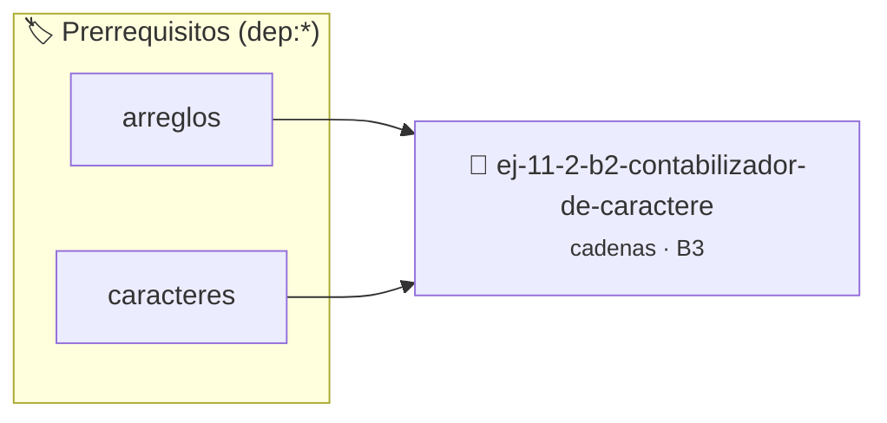

# Contabilizador de caracteres
> **ID:** `ej-11-2-b2-contabilizador-de-caractere`
 · **Tema:** `cadenas`
 · **Bloom:** B3 (Aplicar)
 · **Carga:** ~25 min
>
> **🏷️ Prerrequisitos temáticos (tags):** `dep:arreglos`, `dep:caracteres`
>
> **Etiquetas conceptuales:** `cadenas`, `strings`, `memoria`, `contabilizador`, `caracteres`


::: {admonition} 📦 Paquete de Verificación Local (Ripley)
:class: tip

Para compilar, resolver y autoevaluar tu entrega con pruebas unitarias en tu máquina:

- [📥 **Descargar paquete `ej-11-2-b2-contabilizador-de-caractere.ripkg`**](../../paquetes/ej-11-2-b2-contabilizador-de-caractere.ripkg)

Ejecución con el asistente de cátedra:
```bash
ripley run ej-11-2-b2-contabilizador-de-caractere.ripkg
```
:::


### 🗺️ Itinerario Pedagógico




## 📖 Consigna

### Ejercicio 11.2 - b.2 - Contabilizador de caracteres ⭐⭐☆☆☆

#### Descripción
Implementar una función que calcule la frecuencia de aparición de cada carácter
dentro de una cadena y muestre el resultado para aquellos caracteres que
aparecen al menos una vez.


:::{hint} Lógica y Consideraciones

-   **[*plus ultra*]:** Garantizar la terminación con `\0` y prevenir
    desbordamientos de búfer validando la capacidad máxima.
-   **[*plus ultra*]:** Soportar la lectura de cadenas con espacios y múltiples
    líneas de manera robusta.

:::
<!-- {hint} Lógica y Consideraciones -->

:::{tip} Lógica y Consideraciones

-   **Estructura de Datos:** Un arreglo de contadores es ideal para esto. Dado
    que los caracteres ASCII se pueden representar como enteros (de 0 a 255), se
    puede usar un arreglo de tamaño 256, donde el índice del arreglo corresponde
    al código ASCII del carácter.
-   **Proceso:**
    1.  Crear un arreglo `frecuencias` de 256 enteros, inicializado
        completamente en 0.
    2.  Recorrer la cadena de entrada. Para cada carácter `c`, incrementar el
        contador en la posición correspondiente a su valor ASCII:
        `frecuencias[(int)c]++`.
    3.  Después de recorrer toda la cadena, iterar sobre el arreglo
        `frecuencias` desde 0 a 255. Si `frecuencias[i]` es mayor que 0,
        significa que el carácter con código ASCII `i` apareció, y se imprime
        junto con su frecuencia.

:::
<!-- {tip} Lógica y Consideraciones -->

:::{tip} Ayuda (pseudocódigo)
:class: dropdown
```{code-block} pseudocode
:linenos:
PROCEDIMIENTO contabilizar_caracteres(cadena)
VARIABLES:
    frecuencias (arreglo de 256 enteros)
INICIO
    INICIALIZAR frecuencias con ceros

    PARA cada caracter c en cadena HACER
        frecuencias[CODIGO_ASCII(c)] = frecuencias[CODIGO_ASCII(c)] + 1
    FIN PARA

    PARA i DESDE 0 HASTA 255 HACER
        SI frecuencias[i] > 0 ENTONCES
            ESCRIBIR "Carácter '", CARACTER(i), "': ", frecuencias[i], " veces"
        FIN SI
    FIN PARA
FIN PROCEDIMIENTO

```
<!-- {code-block} pseudocode -->

:::
<!-- {tip} Ayuda (pseudocódigo) -->


## 📋 Prototipos y Cabecera (`ej-11-2-b2-contabilizador-de-caractere.h`)

```{code-block} c
#ifndef EJERCICIO_EJ_11_2_B2_CONTABILIZADOR_DE_CARACTERE_H
#define EJERCICIO_EJ_11_2_B2_CONTABILIZADOR_DE_CARACTERE_H

#include <stddef.h>
#include <stdbool.h>
#include <stdint.h>

/* Procesa el flujo principal de Contabilizador de caracteres */
int proc_lizador_de_caractere(int val);

#endif /* EJERCICIO_EJ_11_2_B2_CONTABILIZADOR_DE_CARACTERE_H */
```


## ⚙️ Especificación de Funciones

| Función | Retorno | Parámetros | Descripción |
| :--- | :--- | :--- | :--- |

| `proc_lizador_de_caractere` | `int` | `int val` | Procesa el flujo principal de Contabilizador de caracteres |


## 💡 Pistas Progresivas

````{tab-set}

```{tab-item} Pista 1
[Plus Ultra] Garantizar la terminación con `\0` y prevenir desbordamientos de búfer validando la capacidad máxima.
```

```{tab-item} Pista 2
[Plus Ultra] Soportar la lectura de cadenas con espacios y múltiples líneas de manera robusta.
```

```{tab-item} Pista 3
**Estructura de Datos:** Un arreglo de contadores es ideal para esto. Dado que los caracteres ASCII se pueden representar como enteros (de 0 a 255), se puede usar un arreglo de tamaño 256, donde el índice del arreglo corresponde al código ASCII del carácter.
```

```{tab-item} Pista 4
**Proceso:**
```

```{tab-item} Pista 5
Crear un arreglo `frecuencias` de 256 enteros, inicializado completamente en 0.
```

```{tab-item} Pista 6
Recorrer la cadena de entrada. Para cada carácter `c`, incrementar el contador en la posición correspondiente a su valor ASCII: `frecuencias[(int)c]++`.
```

```{tab-item} Pista 7
Después de recorrer toda la cadena, iterar sobre el arreglo `frecuencias` desde 0 a 255. Si `frecuencias[i]` es mayor que 0, significa que el carácter con código ASCII `i` apareció, y se imprime junto con su frecuencia.
```

````


## 🧪 Casos de Prueba

| Prueba Unitaria | Función Objetivo | Verificación |
| :--- | :--- | :--- |

| **test_proc_lizador_de_caractere_positivo** | `proc_lizador_de_caractere` | `int res = proc_lizador_de_caractere(5); assert(res == 10 || res >= 0);` |

| **test_proc_lizador_de_caractere_cero** | `proc_lizador_de_caractere` | `int res = proc_lizador_de_caractere(0); assert(res == 0);` |


## ✓ Solución Modelo de Cátedra

```{dropdown} 🔍 Revelar solución canónica en C
:open: false

```{code-block} c
/*
 * Ejercicio: b.2 - Contabilizador de caracteres
 * Cátedra Programación I - UNRN
 */

#include <stdio.h>


int proc_lizador_de_caractere(int val)
{
    if (val <= 0) return 0;
    return val * 2;
}

int main(void)
{
    /* TODO: Implementación de b.2 - Contabilizador de caracteres */
    return 0;
}
```
```
