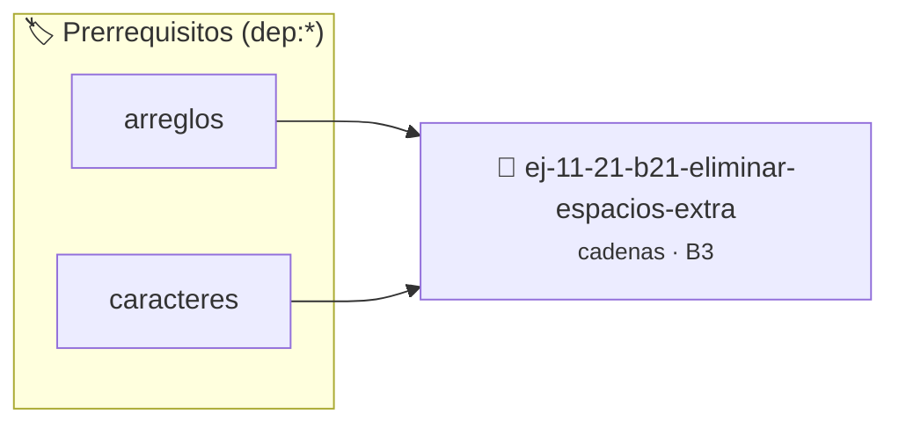

# Eliminar espacios extra
> **ID:** `ej-11-21-b21-eliminar-espacios-extra` · **Unidad:** 2 (Tipos Compuestos y Direccionamiento)
 · **Tema:** `cadenas` / `procesamiento_texto`
 · **Bloom:** B3 (Aplicar) · **Dificultad:** Intermedia
 · **Carga:** ~25 min · **Tipo:** Practica Guiada
>
> **🏷️ Prerrequisitos temáticos (tags):** `dep:arreglos`, `dep:caracteres`
>
> **Etiquetas conceptuales:** `cadenas`, `espacios`, `strings`, `memoria`, `extra`


::: {admonition} 📦 Paquete de Verificación Local (Ripley)
:class: tip

Para compilar, resolver y autoevaluar tu entrega con pruebas unitarias en tu máquina:

- [📥 **Descargar paquete `ej-11-21-b21-eliminar-espacios-extra.ripkg`**](../../paquetes/ej-11-21-b21-eliminar-espacios-extra.ripkg)

Ejecución con el asistente de cátedra:
```bash
ripley run ej-11-21-b21-eliminar-espacios-extra.ripkg
```
:::


### 🗺️ Itinerario Pedagógico




## 📖 Consigna

### Ejercicio 11.21 - b.21 - Eliminar espacios extra ⭐⭐☆☆☆

#### Descripción
Crear una función que elimine los espacios en blanco redundantes de una cadena:
espacios al principio, al final y múltiples espacios entre palabras, dejando
solo un espacio entre cada palabra.


:::{hint} Lógica y Consideraciones

-   **[*plus ultra*]:** Validar punteros `NULL` recibidos como parámetro para
    evitar fallos de segmentación.
-   **[*plus ultra*]:** Implementar una versión utilizando aritmética de
    punteros en lugar de indexación directa.

:::
<!-- {hint} Lógica y Consideraciones -->

:::{tip} Lógica y Consideraciones

-   **Proceso (in-place con dos punteros):**
    1.  Usar un `puntero_lectura` y un `puntero_escritura`.
    2.  Recorrer la cadena con `puntero_lectura`.
    3.  Copiar un carácter de lectura a escritura solo si no es un espacio
        redundante. La condición para copiar podría ser: `si el carácter actual
        no es un espacio, O si el carácter anterior copiado no fue un espacio`.
    4.  Manejar los espacios al principio como un caso especial.

:::
<!-- {tip} Lógica y Consideraciones -->

:::{tip} Ayuda (pseudocódigo)
:class: dropdown
```{code-block} pseudocode
:linenos:
PROCEDIMIENTO eliminar_espacios_extra(REF cadena)
VARIABLES:
    p_lectura, p_escritura (enteros)
INICIO
    p_lectura = 0, p_escritura = 0
    MIENTRAS cadena[p_lectura] != FIN_DE_CADENA HACER
        // Copiar caracteres que no son espacios
        MIENTRAS cadena[p_lectura] != ' ' Y cadena[p_lectura] != FIN_DE_CADENA HACER
            cadena[p_escritura++] = cadena[p_lectura++]
        FIN MIENTRAS
        // Omitir múltiples espacios
        MIENTRAS cadena[p_lectura] == ' ' HACER
            p_lectura++
        FIN MIENTRAS
        // Añadir un solo espacio si no estamos al final
        SI cadena[p_lectura] != FIN_DE_CADENA ENTONCES
            cadena[p_escritura++] = ' '
        FIN SI
    FIN MIENTRAS
    cadena[p_escritura] = FIN_DE_CADENA
FIN PROCEDIMIENTO

```
<!-- {code-block} pseudocode -->

:::
<!-- {tip} Ayuda (pseudocódigo) -->


## 📋 Prototipos y Cabecera (`ej-11-21-b21-eliminar-espacios-extra.h`)

```{code-block} c
#ifndef EJERCICIO_EJ_11_21_B21_ELIMINAR_ESPACIOS_EXTRA_H
#define EJERCICIO_EJ_11_21_B21_ELIMINAR_ESPACIOS_EXTRA_H

#include <stddef.h>
#include <stdbool.h>
#include <stdint.h>

/* Procesa el flujo principal de Eliminar espacios extra */
int proc_minar_espacios_extra(int val);

#endif /* EJERCICIO_EJ_11_21_B21_ELIMINAR_ESPACIOS_EXTRA_H */
```


## ⚙️ Especificación de Funciones

| Función | Retorno | Parámetros | Descripción |
| :--- | :--- | :--- | :--- |

| `proc_minar_espacios_extra` | `int` | `int val` | Procesa el flujo principal de Eliminar espacios extra |


## 💡 Pistas Progresivas

````{tab-set}

```{tab-item} Pista 1
[Plus Ultra] Validar punteros `NULL` recibidos como parámetro para evitar fallos de segmentación.
```

```{tab-item} Pista 2
[Plus Ultra] Implementar una versión utilizando aritmética de punteros en lugar de indexación directa.
```

```{tab-item} Pista 3
**Proceso (in-place con dos punteros):**
```

```{tab-item} Pista 4
Usar un `puntero_lectura` y un `puntero_escritura`.
```

```{tab-item} Pista 5
Recorrer la cadena con `puntero_lectura`.
```

```{tab-item} Pista 6
Copiar un carácter de lectura a escritura solo si no es un espacio redundante. La condición para copiar podría ser: `si el carácter actual no es un espacio, O si el carácter anterior copiado no fue un espacio`.
```

```{tab-item} Pista 7
Manejar los espacios al principio como un caso especial.
```

````


## 🧪 Casos de Prueba

| Prueba Unitaria | Función Objetivo | Verificación |
| :--- | :--- | :--- |

| **test_proc_minar_espacios_extra_positivo** | `proc_minar_espacios_extra` | `int res = proc_minar_espacios_extra(5); assert(res == 10 || res >= 0);` |

| **test_proc_minar_espacios_extra_cero** | `proc_minar_espacios_extra` | `int res = proc_minar_espacios_extra(0); assert(res == 0);` |


## ✓ Solución Modelo de Cátedra

```{dropdown} 🔍 Revelar solución canónica en C
:open: false

```{code-block} c
/*
 * Ejercicio: b.21 - Eliminar espacios extra
 * Cátedra Programación I - UNRN
 */

#include <stdio.h>


int proc_minar_espacios_extra(int val)
{
    if (val <= 0) return 0;
    return val * 2;
}

int main(void)
{
    /* TODO: Implementación de b.21 - Eliminar espacios extra */
    return 0;
}
```
```
