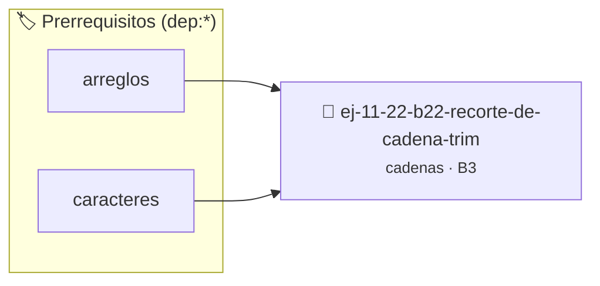

# Recorte de cadena (Trim)
> **ID:** `ej-11-22-b22-recorte-de-cadena-trim` · **Unidad:** 2 (Tipos Compuestos y Direccionamiento)
 · **Tema:** `cadenas` / `procesamiento_texto`
 · **Bloom:** B3 (Aplicar) · **Dificultad:** Intermedia
 · **Carga:** ~25 min · **Tipo:** Practica Guiada
>
> **🏷️ Prerrequisitos temáticos (tags):** `dep:arreglos`, `dep:caracteres`
>
> **Etiquetas conceptuales:** `cadenas`, `strings`, `recorte`, `memoria`, `cadena`


::: {admonition} 📦 Paquete de Verificación Local (Ripley)
:class: tip

Para compilar, resolver y autoevaluar tu entrega con pruebas unitarias en tu máquina:

- [📥 **Descargar paquete `ej-11-22-b22-recorte-de-cadena-trim.ripkg`**](../../paquetes/ej-11-22-b22-recorte-de-cadena-trim.ripkg)

Ejecución con el asistente de cátedra:
```bash
ripley run ej-11-22-b22-recorte-de-cadena-trim.ripkg
```
:::


### 🗺️ Itinerario Pedagógico




## 📖 Consigna

### Ejercicio 11.22 - b.22 - Recorte de cadena (Trim) ⭐⭐⭐☆☆

#### Descripción
Implementar una función `trim` que modifique una cadena para eliminar todos los
espacios en blanco (o cualquier otro carácter de espaciado como tabuladores o
saltos de línea) que se encuentren al principio y al final de la misma.


:::{hint} Lógica y Consideraciones

-   **[*plus ultra*]:** Validar punteros `NULL` recibidos como parámetro para
    evitar fallos de segmentación.
-   **[*plus ultra*]:** Implementar una versión utilizando aritmética de
    punteros en lugar de indexación directa.

:::
<!-- {hint} Lógica y Consideraciones -->

:::{tip} Lógica y Consideraciones

-   **Proceso (dos etapas):**
    1.  **Eliminar espacios del final:** Recorrer la cadena desde el final hacia
        el principio. Mientras se encuentren espacios, reemplazarlos por el
        carácter nulo `\0`.
    2.  **Eliminar espacios del principio:** Encontrar el puntero al primer
        carácter que no sea un espacio. Luego, mover todo el bloque de la cadena
        (incluyendo el terminador nulo) a la posición inicial usando `memmove`.
-   **Funciones de Biblioteca:** `isspace()` de `ctype.h` es útil para detectar
    cualquier tipo de carácter de espaciado.

:::
<!-- {tip} Lógica y Consideraciones -->

:::{tip} Ayuda (pseudocódigo)
:class: dropdown
```{code-block} pseudocode
:linenos:
PROCEDIMIENTO trim(REF cadena)
VARIABLES:
    longitud, i, inicio (enteros)
INICIO
    longitud = LONGITUD(cadena)

    // Recortar final
    i = longitud - 1
    MIENTRAS i >= 0 Y es_espacio(cadena[i]) HACER
        i--
    FIN MIENTRAS
    cadena[i + 1] = FIN_DE_CADENA

    // Recortar inicio
    inicio = 0
    MIENTRAS cadena[inicio] != FIN_DE_CADENA Y es_espacio(cadena[inicio]) HACER
        inicio++
    FIN MIENTRAS

    // Mover la cadena si es necesario
    SI inicio > 0 ENTONCES
        mover_bloque_memoria(cadena, cadena + inicio, LONGITUD(cadena) - inicio + 1)
    FIN SI
FIN PROCEDIMIENTO

```
<!-- {code-block} pseudocode -->

:::
<!-- {tip} Ayuda (pseudocódigo) -->


## 📋 Prototipos y Cabecera (`ej-11-22-b22-recorte-de-cadena-trim.h`)

```{code-block} c
#ifndef EJERCICIO_EJ_11_22_B22_RECORTE_DE_CADENA_TRIM_H
#define EJERCICIO_EJ_11_22_B22_RECORTE_DE_CADENA_TRIM_H

#include <stddef.h>
#include <stdbool.h>
#include <stdint.h>

/* Procesa el flujo principal de Recorte de cadena (Trim) */
int proc_corte_de_cadena_trim(int val);

#endif /* EJERCICIO_EJ_11_22_B22_RECORTE_DE_CADENA_TRIM_H */
```


## ⚙️ Especificación de Funciones

| Función | Retorno | Parámetros | Descripción |
| :--- | :--- | :--- | :--- |

| `proc_corte_de_cadena_trim` | `int` | `int val` | Procesa el flujo principal de Recorte de cadena (Trim) |


## 💡 Pistas Progresivas

````{tab-set}

```{tab-item} Pista 1
[Plus Ultra] Validar punteros `NULL` recibidos como parámetro para evitar fallos de segmentación.
```

```{tab-item} Pista 2
[Plus Ultra] Implementar una versión utilizando aritmética de punteros en lugar de indexación directa.
```

```{tab-item} Pista 3
**Proceso (dos etapas):**
```

```{tab-item} Pista 4
**Eliminar espacios del final:** Recorrer la cadena desde el final hacia el principio. Mientras se encuentren espacios, reemplazarlos por el carácter nulo `\0`.
```

```{tab-item} Pista 5
**Eliminar espacios del principio:** Encontrar el puntero al primer carácter que no sea un espacio. Luego, mover todo el bloque de la cadena (incluyendo el terminador nulo) a la posición inicial usando `memmove`.
```

```{tab-item} Pista 6
**Funciones de Biblioteca:** `isspace()` de `ctype.h` es útil para detectar cualquier tipo de carácter de espaciado.
```

````


## 🧪 Casos de Prueba

| Prueba Unitaria | Función Objetivo | Verificación |
| :--- | :--- | :--- |

| **test_proc_corte_de_cadena_trim_positivo** | `proc_corte_de_cadena_trim` | `int res = proc_corte_de_cadena_trim(5); assert(res == 10 || res >= 0);` |

| **test_proc_corte_de_cadena_trim_cero** | `proc_corte_de_cadena_trim` | `int res = proc_corte_de_cadena_trim(0); assert(res == 0);` |


## ✓ Solución Modelo de Cátedra

```{dropdown} 🔍 Revelar solución canónica en C
:open: false

```{code-block} c
/*
 * Ejercicio: b.22 - Recorte de cadena (Trim)
 * Cátedra Programación I - UNRN
 */

#include <stdio.h>


int proc_corte_de_cadena_trim(int val)
{
    if (val <= 0) return 0;
    return val * 2;
}

int main(void)
{
    /* TODO: Implementación de b.22 - Recorte de cadena (Trim) */
    return 0;
}
```
```
