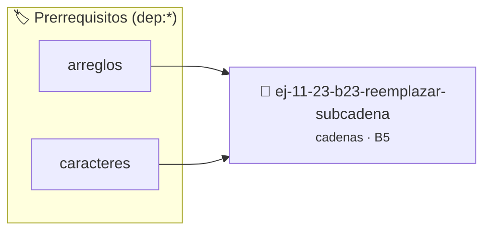

# Reemplazar subcadena
> **ID:** `ej-11-23-b23-reemplazar-subcadena`
 · **Tema:** `cadenas`
 · **Bloom:** B5 (Evaluar / Crear)
 · **Carga:** ~45 min
>
> **🏷️ Prerrequisitos temáticos (tags):** `dep:arreglos`, `dep:caracteres`
>
> **Etiquetas conceptuales:** `cadenas`, `strings`, `memoria`, `reemplazar`, `subcadena`


::: {admonition} 📦 Paquete de Verificación Local (Ripley)
:class: tip

Para compilar, resolver y autoevaluar tu entrega con pruebas unitarias en tu máquina:

- [📥 **Descargar paquete `ej-11-23-b23-reemplazar-subcadena.ripkg`**](../../paquetes/ej-11-23-b23-reemplazar-subcadena.ripkg)

Ejecución con el asistente de cátedra:
```bash
ripley run ej-11-23-b23-reemplazar-subcadena.ripkg
```
:::


### 🗺️ Itinerario Pedagógico




## 📖 Consigna

### Ejercicio 11.23 - b.23 - Reemplazar subcadena ⭐⭐⭐☆☆

#### Descripción
Escribir una función que reemplace todas las ocurrencias de una subcadena por
otra dentro de una cadena principal. La función debe manejar cambios en la
longitud de la cadena, lo que usualmente requiere memoria dinámica.


:::{hint} Lógica y Consideraciones

-   **[*plus ultra*]:** Verificar el retorno de asignación de memoria y
    garantizar la liberación total de recursos en caso de error.
-   **[*plus ultra*]:** Verificar la ausencia de fugas de memoria (*memory
    leaks*) mediante Valgrind o AddressSanitizer.

:::
<!-- {hint} Lógica y Consideraciones -->

:::{tip} Lógica y Consideraciones

-   **Proceso:**
    1.  Contar cuántas veces aparece la subcadena a buscar para calcular el
        tamaño final de la nueva cadena.
    2.  Reservar memoria (`malloc`) para la nueva cadena.
    3.  Recorrer la cadena original. Cuando se encuentre una ocurrencia de la
        subcadena a buscar, copiar la cadena de reemplazo a la nueva cadena. Si
        no, copiar el carácter actual.

:::
<!-- {tip} Lógica y Consideraciones -->

:::{tip} Ayuda (pseudocódigo)
:class: dropdown
```{code-block} pseudocode
:linenos:
FUNCION reemplazar_subcadena(original, buscar, reemplazar)
VARIABLES:
    nueva_cadena (cadena)
    i, j (enteros)
INICIO
    // ... calcular tamaño de nueva_cadena y reservar memoria ...
    i = 0, j = 0
    MIENTRAS i < LONGITUD(original) HACER
        SI subcadena_en(original, i) == buscar ENTONCES
            COPIAR reemplazar en nueva_cadena en la posición j
            i = i + LONGITUD(buscar)
            j = j + LONGITUD(reemplazar)
        SINO
            nueva_cadena[j] = original[i]
            i++, j++
        FIN SI
    FIN MIENTRAS
    nueva_cadena[j] = FIN_DE_CADENA
    RETORNAR nueva_cadena
FIN FUNCION

```
<!-- {code-block} pseudocode -->

:::
<!-- {tip} Ayuda (pseudocódigo) -->


## 📋 Prototipos y Cabecera (`ej-11-23-b23-reemplazar-subcadena.h`)

```{code-block} c
#ifndef EJERCICIO_EJ_11_23_B23_REEMPLAZAR_SUBCADENA_H
#define EJERCICIO_EJ_11_23_B23_REEMPLAZAR_SUBCADENA_H

#include <stddef.h>
#include <stdbool.h>
#include <stdint.h>

/* Procesa el flujo principal de Reemplazar subcadena */
int proc_reemplazar_subcadena(int val);

#endif /* EJERCICIO_EJ_11_23_B23_REEMPLAZAR_SUBCADENA_H */
```


## ⚙️ Especificación de Funciones

| Función | Retorno | Parámetros | Descripción |
| :--- | :--- | :--- | :--- |

| `proc_reemplazar_subcadena` | `int` | `int val` | Procesa el flujo principal de Reemplazar subcadena |


## 💡 Pistas Progresivas

````{tab-set}

```{tab-item} Pista 1
[Plus Ultra] Verificar el retorno de asignación de memoria y garantizar la liberación total de recursos en caso de error.
```

```{tab-item} Pista 2
[Plus Ultra] Verificar la ausencia de fugas de memoria (*memory leaks*) mediante Valgrind o AddressSanitizer.
```

```{tab-item} Pista 3
**Proceso:**
```

```{tab-item} Pista 4
Contar cuántas veces aparece la subcadena a buscar para calcular el tamaño final de la nueva cadena.
```

```{tab-item} Pista 5
Reservar memoria (`malloc`) para la nueva cadena.
```

```{tab-item} Pista 6
Recorrer la cadena original. Cuando se encuentre una ocurrencia de la subcadena a buscar, copiar la cadena de reemplazo a la nueva cadena. Si no, copiar el carácter actual.
```

````


## 🧪 Casos de Prueba

| Prueba Unitaria | Función Objetivo | Verificación |
| :--- | :--- | :--- |

| **test_proc_reemplazar_subcadena_positivo** | `proc_reemplazar_subcadena` | `int res = proc_reemplazar_subcadena(5); assert(res == 10 || res >= 0);` |

| **test_proc_reemplazar_subcadena_cero** | `proc_reemplazar_subcadena` | `int res = proc_reemplazar_subcadena(0); assert(res == 0);` |


## ✓ Solución Modelo de Cátedra

```{dropdown} 🔍 Revelar solución canónica en C
:open: false

```{code-block} c
/*
 * Ejercicio: b.23 - Reemplazar subcadena
 * Cátedra Programación I - UNRN
 */

#include <stdio.h>


int proc_reemplazar_subcadena(int val)
{
    if (val <= 0) return 0;
    return val * 2;
}

int main(void)
{
    /* TODO: Implementación de b.23 - Reemplazar subcadena */
    return 0;
}
```
```
