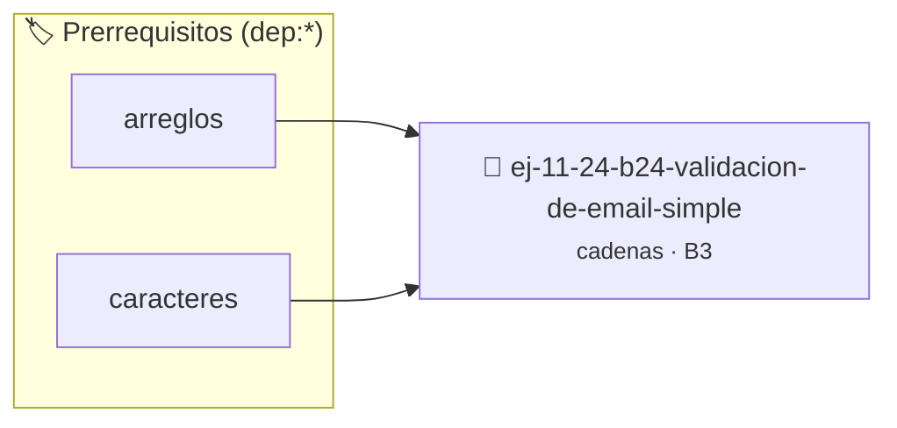

# Validación de email (Simple)
> **ID:** `ej-11-24-b24-validacion-de-email-simple` · **Unidad:** 2 (Tipos Compuestos y Direccionamiento)
 · **Tema:** `cadenas` / `procesamiento_texto`
 · **Bloom:** B3 (Aplicar) · **Dificultad:** Intermedia
 · **Carga:** ~25 min · **Tipo:** Practica Guiada
>
> **🏷️ Prerrequisitos temáticos (tags):** `dep:arreglos`, `dep:caracteres`
>
> **Etiquetas conceptuales:** `cadenas`, `strings`, `email`, `memoria`, `validacion`


::: {admonition} 📦 Paquete de Verificación Local (Ripley)
:class: tip

Para compilar, resolver y autoevaluar tu entrega con pruebas unitarias en tu máquina:

- [📥 **Descargar paquete `ej-11-24-b24-validacion-de-email-simple.ripkg`**](../../paquetes/ej-11-24-b24-validacion-de-email-simple.ripkg)

Ejecución con el asistente de cátedra:
```bash
ripley run ej-11-24-b24-validacion-de-email-simple.ripkg
```
:::


### 🗺️ Itinerario Pedagógico




## 📖 Consigna

#### Descripción
Crear una función que verifique si una cadena tiene un formato de correo
electrónico básico. No busca ser exhaustiva (lo cual es muy complejo), sino
validar una estructura mínima.


:::{tip} Lógica y Consideraciones

-   **Reglas Mínimas:**
    1.  Debe contener exactamente un carácter `@`.
    2.  El `@` no puede ser el primer ni el último carácter.
    3.  Debe contener al menos un `.` después del `@`.
    4.  El `.` no puede estar inmediatamente después del `@`.

:::

:::{tip} Ayuda (pseudocódigo)
:class: dropdown
```{code-block} pseudocode
:linenos:
FUNCION es_email_simple_valido(email)
VARIABLES:
    pos_arroba, pos_ultimo_punto (enteros)
INICIO
    pos_arroba = encontrar_caracter(email, '@')
    SI pos_arroba == NO_ENCONTRADO O pos_arroba == 0 ENTONCES
        RETORNAR FALSO
    FIN SI

    // Verificar que no haya más de un @
    // ...

    pos_ultimo_punto = encontrar_ultima_posicion(email, '.')
    SI pos_ultimo_punto == NO_ENCONTRADO O pos_ultimo_punto < pos_arroba + 2 ENTONCES
        RETORNAR FALSO
    FIN SI

    RETORNAR VERDADERO
FIN FUNCION

```

:::

### 📋 Contrato de las Funciones

```c
/*
 * Procesa el flujo principal de Validación de email (Simple)
 * Precondiciones: val representa el parámetro de entrada del flujo.
 * Postcondiciones: Retorna el resultado correspondiente o 0 si val <= 0.
 */
int proc_cion_de_email_simple(int val);

```

### 🧪 Ejemplos de Ejecución

::::{tab-set}
:::{tab-item} Valor positivo
```text
Entrada: 5
Salida / Retorno: 10
```
:::
:::{tab-item} Valor cero o negativo
```text
Entrada: 0
Salida / Retorno: 0
```
:::
::::

### ⚠️ Precondiciones y Casos Borde

1. **Valores fuera de rango:** Verificar siempre que los datos de entrada cumplan con los rangos admisibles antes de operar.
4. **Terminación nula:** Asegurar que todas las cadenas de texto conserven el terminador nulo `\0` dentro de los límites del buffer.
6. **Casos vacíos o neutros:** Contemplar adecuadamente entradas con longitud cero o valores neutros según corresponda.

### 🎯 Criterios de Aceptación

- [ ] El código compila limpiamente bajo estándar C11 sin warnings con flags estrictos (`-Wall -Wextra -Werror`).
- [ ] Se satisfacen todas las pruebas unitarias y casos de prueba provistos.
- [ ] Las funciones validan exhaustivamente sus precondiciones y gestionan casos borde de forma robusta.

:::{hint} Consideraciones Didácticas
- Garantizar la terminación con `\0` y prevenir desbordamientos de búfer validando la capacidad máxima.
- Soportar la lectura de cadenas con espacios y múltiples líneas de manera robusta.
- **Reglas Mínimas:**
- Debe contener exactamente un carácter `@`.
- El `@` no puede ser el primer ni el último carácter.
- Debe contener al menos un `.` después del `@`.
- El `.` no puede estar inmediatamente después del `@`.
:::


## 📋 Prototipos y Cabecera (`ej-11-24-b24-validacion-de-email-simple.h`)

```{code-block} c
#ifndef EJERCICIO_EJ_11_24_B24_VALIDACION_DE_EMAIL_SIMPLE_H
#define EJERCICIO_EJ_11_24_B24_VALIDACION_DE_EMAIL_SIMPLE_H

#include <stddef.h>
#include <stdbool.h>
#include <stdint.h>

/* Procesa el flujo principal de Validación de email (Simple) */
int proc_cion_de_email_simple(int val);

#endif /* EJERCICIO_EJ_11_24_B24_VALIDACION_DE_EMAIL_SIMPLE_H */
```


## ⚙️ Especificación de Funciones

| Función | Retorno | Parámetros | Descripción |
| :--- | :--- | :--- | :--- |

| `proc_cion_de_email_simple` | `int` | `int val` | Procesa el flujo principal de Validación de email (Simple) |


## 💡 Pistas Progresivas

````{tab-set}

```{tab-item} Pista 1
[Plus Ultra] Garantizar la terminación con `\0` y prevenir desbordamientos de búfer validando la capacidad máxima.
```

```{tab-item} Pista 2
[Plus Ultra] Soportar la lectura de cadenas con espacios y múltiples líneas de manera robusta.
```

```{tab-item} Pista 3
**Reglas Mínimas:**
```

```{tab-item} Pista 4
Debe contener exactamente un carácter `@`.
```

```{tab-item} Pista 5
El `@` no puede ser el primer ni el último carácter.
```

```{tab-item} Pista 6
Debe contener al menos un `.` después del `@`.
```

```{tab-item} Pista 7
El `.` no puede estar inmediatamente después del `@`.
```

````


## 🧪 Casos de Prueba

| Prueba Unitaria | Función Objetivo | Verificación |
| :--- | :--- | :--- |

| **test_proc_cion_de_email_simple_positivo** | `proc_cion_de_email_simple` | `int res = proc_cion_de_email_simple(5); assert(res == 10 || res >= 0);` |

| **test_proc_cion_de_email_simple_cero** | `proc_cion_de_email_simple` | `int res = proc_cion_de_email_simple(0); assert(res == 0);` |


## ✓ Solución Modelo de Cátedra

```{dropdown} 🔍 Revelar solución canónica en C
:open: false

```{code-block} c
/*
 * Ejercicio: b.24 - Validación de email (Simple)
 * Cátedra Programación I - UNRN
 */

#include <stdio.h>


int proc_cion_de_email_simple(int val)
{
    if (val <= 0) return 0;
    return val * 2;
}

int main(void)
{
    /* TODO: Implementación de b.24 - Validación de email (Simple) */
    return 0;
}
```
```
