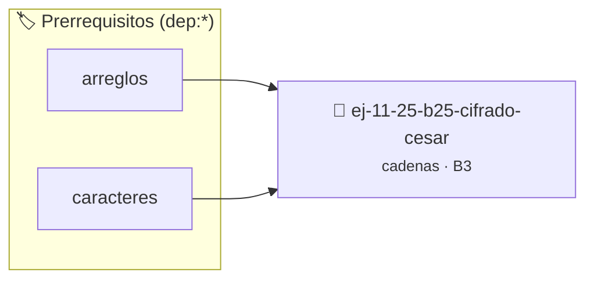

# Cifrado César
> **ID:** `ej-11-25-b25-cifrado-cesar` · **Unidad:** 2 (Tipos Compuestos y Direccionamiento)
 · **Tema:** `cadenas` / `procesamiento_texto`
 · **Bloom:** B3 (Aplicar) · **Dificultad:** Intermedia
 · **Carga:** ~25 min · **Tipo:** Practica Guiada
>
> **🏷️ Prerrequisitos temáticos (tags):** `dep:arreglos`, `dep:caracteres`
>
> **Etiquetas conceptuales:** `cadenas`, `strings`, `cesar`, `memoria`, `cifrado`


::: {admonition} 📦 Paquete de Verificación Local (Ripley)
:class: tip

Para compilar, resolver y autoevaluar tu entrega con pruebas unitarias en tu máquina:

- [📥 **Descargar paquete `ej-11-25-b25-cifrado-cesar.ripkg`**](../../paquetes/ej-11-25-b25-cifrado-cesar.ripkg)

Ejecución con el asistente de cátedra:
```bash
ripley run ej-11-25-b25-cifrado-cesar.ripkg
```
:::


### 🗺️ Itinerario Pedagógico




## 📖 Consigna

#### Descripción
Implementar el Cifrado César, un tipo de cifrado por sustitución en el que cada
letra en el texto original es reemplazada por una letra un número fijo de
posiciones más adelante en el alfabeto, de forma circular.


:::{tip} Lógica y Consideraciones

-   **Proceso:**
    1.  Recorrer la cadena de entrada.
    2.  Para cada carácter, si es una letra, aplicar el desplazamiento.
    3.  El desplazamiento es circular. Si al desplazar 'y' 3 posiciones se pasa
        de 'z', se debe volver al principio del alfabeto. Esto se logra con el
        operador módulo (`%`).
    4.  Ejemplo para una letra minúscula `c`: `'a' + (c - 'a' + desplazamiento)
        % 26`.

:::

:::{tip} Ayuda (pseudocódigo)
:class: dropdown
```{code-block} pseudocode
:linenos:
FUNCION cifrado_cesar(cadena, desplazamiento)
VARIABLES:
    resultado (cadena)
INICIO
    PARA cada caracter c en cadena HACER
        SI es_letra_minuscula(c) ENTONCES
            nuevo_car = 'a' + (c - 'a' + desplazamiento) MOD 26
            AÑADIR nuevo_car a resultado
        SINO SI es_letra_mayuscula(c) ENTONCES
            nuevo_car = 'A' + (c - 'A' + desplazamiento) MOD 26
            AÑADIR nuevo_car a resultado
        SINO
            AÑADIR c a resultado
        FIN SI
    FIN PARA
    RETORNAR resultado
FIN FUNCION

```

:::

### 📋 Contrato de las Funciones

```c
/*
 * Procesa el flujo principal de Cifrado César
 * Precondiciones: val representa el parámetro de entrada del flujo.
 * Postcondiciones: Retorna el resultado correspondiente o 0 si val <= 0.
 */
int proc_25_b25_cifrado_cesar(int val);

```

### 🧪 Ejemplos de Ejecución

::::{tab-set}
:::{tab-item} Valor positivo
```text
Entrada: 5
Salida / Retorno: 10
```
:::
:::{tab-item} Valor cero o negativo
```text
Entrada: 0
Salida / Retorno: 0
```
:::
::::

### ⚠️ Precondiciones y Casos Borde

1. **Valores fuera de rango:** Verificar siempre que los datos de entrada cumplan con los rangos admisibles antes de operar.
4. **Terminación nula:** Asegurar que todas las cadenas de texto conserven el terminador nulo `\0` dentro de los límites del buffer.
6. **Casos vacíos o neutros:** Contemplar adecuadamente entradas con longitud cero o valores neutros según corresponda.

### 🎯 Criterios de Aceptación

- [ ] El código compila limpiamente bajo estándar C11 sin warnings con flags estrictos (`-Wall -Wextra -Werror`).
- [ ] Se satisfacen todas las pruebas unitarias y casos de prueba provistos.
- [ ] Las funciones validan exhaustivamente sus precondiciones y gestionan casos borde de forma robusta.

:::{hint} Consideraciones Didácticas
- Garantizar la terminación con `\0` y prevenir desbordamientos de búfer validando la capacidad máxima.
- Soportar la lectura de cadenas con espacios y múltiples líneas de manera robusta.
- **Proceso:**
- Recorrer la cadena de entrada.
- Para cada carácter, si es una letra, aplicar el desplazamiento.
- El desplazamiento es circular. Si al desplazar 'y' 3 posiciones se pasa de 'z', se debe volver al principio del alfabeto. Esto se logra con el operador módulo (`%`).
- Ejemplo para una letra minúscula `c`: `'a' + (c - 'a' + desplazamiento) % 26`.
:::


## 📋 Prototipos y Cabecera (`ej-11-25-b25-cifrado-cesar.h`)

```{code-block} c
#ifndef EJERCICIO_EJ_11_25_B25_CIFRADO_CESAR_H
#define EJERCICIO_EJ_11_25_B25_CIFRADO_CESAR_H

#include <stddef.h>
#include <stdbool.h>
#include <stdint.h>

/* Procesa el flujo principal de Cifrado César */
int proc_25_b25_cifrado_cesar(int val);

#endif /* EJERCICIO_EJ_11_25_B25_CIFRADO_CESAR_H */
```


## ⚙️ Especificación de Funciones

| Función | Retorno | Parámetros | Descripción |
| :--- | :--- | :--- | :--- |

| `proc_25_b25_cifrado_cesar` | `int` | `int val` | Procesa el flujo principal de Cifrado César |


## 💡 Pistas Progresivas

````{tab-set}

```{tab-item} Pista 1
[Plus Ultra] Garantizar la terminación con `\0` y prevenir desbordamientos de búfer validando la capacidad máxima.
```

```{tab-item} Pista 2
[Plus Ultra] Soportar la lectura de cadenas con espacios y múltiples líneas de manera robusta.
```

```{tab-item} Pista 3
**Proceso:**
```

```{tab-item} Pista 4
Recorrer la cadena de entrada.
```

```{tab-item} Pista 5
Para cada carácter, si es una letra, aplicar el desplazamiento.
```

```{tab-item} Pista 6
El desplazamiento es circular. Si al desplazar 'y' 3 posiciones se pasa de 'z', se debe volver al principio del alfabeto. Esto se logra con el operador módulo (`%`).
```

```{tab-item} Pista 7
Ejemplo para una letra minúscula `c`: `'a' + (c - 'a' + desplazamiento) % 26`.
```

````


## 🧪 Casos de Prueba

| Prueba Unitaria | Función Objetivo | Verificación |
| :--- | :--- | :--- |

| **test_proc_25_b25_cifrado_cesar_positivo** | `proc_25_b25_cifrado_cesar` | `int res = proc_25_b25_cifrado_cesar(5); assert(res == 10 || res >= 0);` |

| **test_proc_25_b25_cifrado_cesar_cero** | `proc_25_b25_cifrado_cesar` | `int res = proc_25_b25_cifrado_cesar(0); assert(res == 0);` |


## ✓ Solución Modelo de Cátedra

```{dropdown} 🔍 Revelar solución canónica en C
:open: false

```{code-block} c
/*
 * Ejercicio: b.25 - Cifrado César
 * Cátedra Programación I - UNRN
 */

#include <stdio.h>


int proc_25_b25_cifrado_cesar(int val)
{
    if (val <= 0) return 0;
    return val * 2;
}

int main(void)
{
    /* TODO: Implementación de b.25 - Cifrado César */
    return 0;
}
```
```
