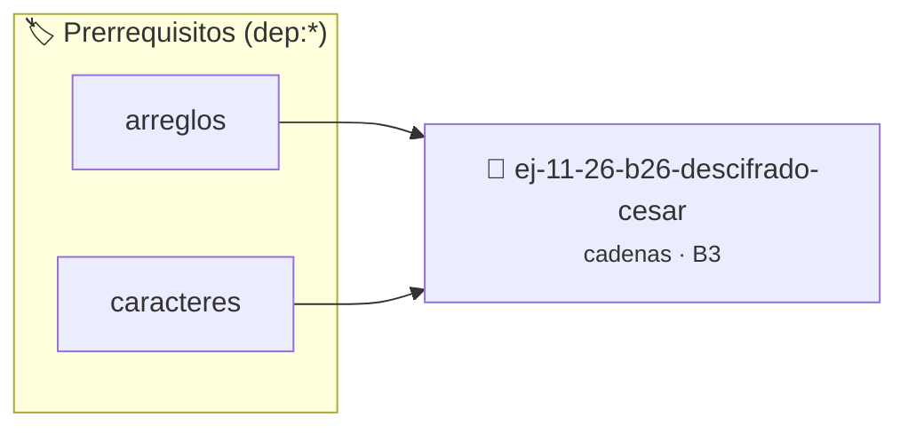

# Descifrado César
> **ID:** `ej-11-26-b26-descifrado-cesar` · **Unidad:** 2 (Tipos Compuestos y Direccionamiento)
 · **Tema:** `cadenas` / `procesamiento_texto`
 · **Bloom:** B3 (Aplicar) · **Dificultad:** Intermedia
 · **Carga:** ~25 min · **Tipo:** Practica Guiada
>
> **🏷️ Prerrequisitos temáticos (tags):** `dep:arreglos`, `dep:caracteres`
>
> **Etiquetas conceptuales:** `cadenas`, `strings`, `descifrado`, `cesar`, `memoria`


::: {admonition} 📦 Paquete de Verificación Local (Ripley)
:class: tip

Para compilar, resolver y autoevaluar tu entrega con pruebas unitarias en tu máquina:

- [📥 **Descargar paquete `ej-11-26-b26-descifrado-cesar.ripkg`**](../../paquetes/ej-11-26-b26-descifrado-cesar.ripkg)

Ejecución con el asistente de cátedra:
```bash
ripley run ej-11-26-b26-descifrado-cesar.ripkg
```
:::


### 🗺️ Itinerario Pedagógico




## 📖 Consigna

### Ejercicio 11.26 - b.26 - Descifrado César ⭐⭐☆☆☆

#### Descripción
Escribir la función complementaria que descifre un mensaje cifrado con el
Cifrado César, conociendo el desplazamiento. Es la operación inversa al
ejercicio anterior.


:::{hint} Lógica y Consideraciones

-   **[*plus ultra*]:** Garantizar la terminación con `\0` y prevenir
    desbordamientos de búfer validando la capacidad máxima.
-   **[*plus ultra*]:** Soportar la lectura de cadenas con espacios y múltiples
    líneas de manera robusta.

:::
<!-- {hint} Lógica y Consideraciones -->

:::{tip} Lógica y Consideraciones

-   **Proceso:** Es idéntico al cifrado, pero en lugar de sumar el
    desplazamiento, se resta. Para manejar el wraparound negativo, la fórmula
    puede ser `'a' + (c - 'a' - desplazamiento + 26) % 26`.

:::
<!-- {tip} Lógica y Consideraciones -->

:::{tip} Ayuda (pseudocódigo)
:class: dropdown
```{code-block} pseudocode
FUNCION descifrado_cesar(cadena, desplazamiento)
INICIO
    // La lógica es la misma que el cifrado, pero con -desplazamiento
    RETORNAR cifrado_cesar(cadena, 26 - desplazamiento)
FIN FUNCION

```
<!-- {code-block} pseudocode -->

:::
<!-- {tip} Ayuda (pseudocódigo) -->


## 📋 Prototipos y Cabecera (`ej-11-26-b26-descifrado-cesar.h`)

```{code-block} c
#ifndef EJERCICIO_EJ_11_26_B26_DESCIFRADO_CESAR_H
#define EJERCICIO_EJ_11_26_B26_DESCIFRADO_CESAR_H

#include <stddef.h>
#include <stdbool.h>
#include <stdint.h>

/* Procesa el flujo principal de Descifrado César */
int proc_b26_descifrado_cesar(int val);

#endif /* EJERCICIO_EJ_11_26_B26_DESCIFRADO_CESAR_H */
```


## ⚙️ Especificación de Funciones

| Función | Retorno | Parámetros | Descripción |
| :--- | :--- | :--- | :--- |

| `proc_b26_descifrado_cesar` | `int` | `int val` | Procesa el flujo principal de Descifrado César |


## 💡 Pistas Progresivas

````{tab-set}

```{tab-item} Pista 1
[Plus Ultra] Garantizar la terminación con `\0` y prevenir desbordamientos de búfer validando la capacidad máxima.
```

```{tab-item} Pista 2
[Plus Ultra] Soportar la lectura de cadenas con espacios y múltiples líneas de manera robusta.
```

```{tab-item} Pista 3
**Proceso:** Es idéntico al cifrado, pero en lugar de sumar el desplazamiento, se resta. Para manejar el wraparound negativo, la fórmula puede ser `'a' + (c - 'a' - desplazamiento + 26) % 26`.
```

````


## 🧪 Casos de Prueba

| Prueba Unitaria | Función Objetivo | Verificación |
| :--- | :--- | :--- |

| **test_proc_b26_descifrado_cesar_positivo** | `proc_b26_descifrado_cesar` | `int res = proc_b26_descifrado_cesar(5); assert(res == 10 || res >= 0);` |

| **test_proc_b26_descifrado_cesar_cero** | `proc_b26_descifrado_cesar` | `int res = proc_b26_descifrado_cesar(0); assert(res == 0);` |


## ✓ Solución Modelo de Cátedra

```{dropdown} 🔍 Revelar solución canónica en C
:open: false

```{code-block} c
/*
 * Ejercicio: b.26 - Descifrado César
 * Cátedra Programación I - UNRN
 */

#include <stdio.h>


int proc_b26_descifrado_cesar(int val)
{
    if (val <= 0) return 0;
    return val * 2;
}

int main(void)
{
    /* TODO: Implementación de b.26 - Descifrado César */
    return 0;
}
```
```
