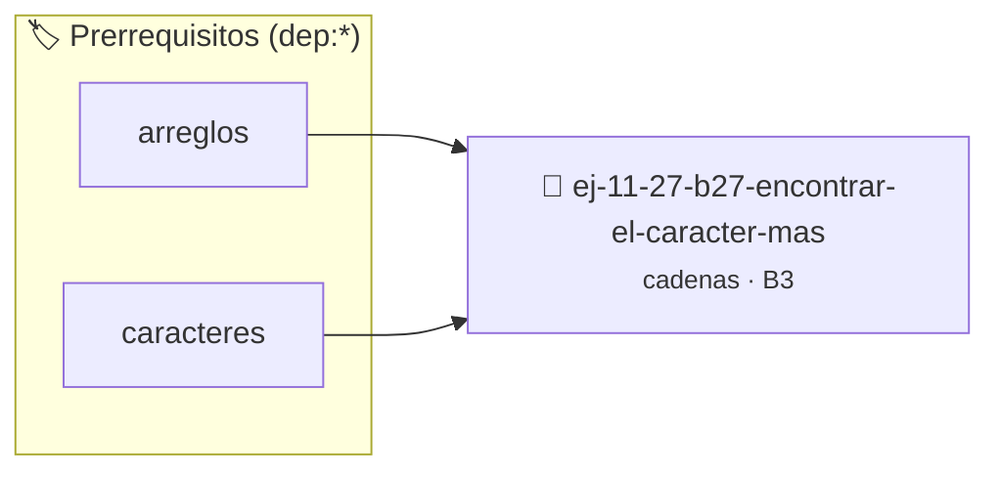

# Encontrar el carácter más frecuente
> **ID:** `ej-11-27-b27-encontrar-el-caracter-mas` · **Unidad:** 2 (Tipos Compuestos y Direccionamiento)
 · **Tema:** `cadenas` / `procesamiento_texto`
 · **Bloom:** B3 (Aplicar) · **Dificultad:** Intermedia
 · **Carga:** ~25 min · **Tipo:** Practica Guiada
>
> **🏷️ Prerrequisitos temáticos (tags):** `dep:arreglos`, `dep:caracteres`
>
> **Etiquetas conceptuales:** `cadenas`, `caracter`, `encontrar`, `strings`, `frecuente`


::: {admonition} 📦 Paquete de Verificación Local (Ripley)
:class: tip

Para compilar, resolver y autoevaluar tu entrega con pruebas unitarias en tu máquina:

- [📥 **Descargar paquete `ej-11-27-b27-encontrar-el-caracter-mas.ripkg`**](../../paquetes/ej-11-27-b27-encontrar-el-caracter-mas.ripkg)

Ejecución con el asistente de cátedra:
```bash
ripley run ej-11-27-b27-encontrar-el-caracter-mas.ripkg
```
:::


### 🗺️ Itinerario Pedagógico




## 📖 Consigna

#### Descripción
Desarrollar una función que encuentre y devuelva el carácter que aparece con más
frecuencia en una cadena. Si hay empates, puede devolver cualquiera de los más
frecuentes.


:::{tip} Lógica y Consideraciones

-   **Proceso:**
    1.  Usar un arreglo de frecuencias de 256 enteros, como en el ejercicio 1.2.
    2.  Llenar el arreglo de frecuencias recorriendo la cadena.
    3.  Recorrer el arreglo de frecuencias para encontrar el índice que tiene el
        valor más alto. Ese índice es el código ASCII del carácter más
        frecuente.

:::

:::{tip} Ayuda (pseudocódigo)
:class: dropdown
```{code-block} pseudocode
:linenos:
FUNCION caracter_mas_frecuente(cadena)
VARIABLES:
    frecuencias (arreglo de 256 enteros)
    max_frecuencia, char_mas_frecuente (enteros)
INICIO
    // ... llenar arreglo de frecuencias ...

    max_frecuencia = -1
    PARA i DESDE 0 HASTA 255 HACER
        SI frecuencias[i] > max_frecuencia ENTONCES
            max_frecuencia = frecuencias[i]
            char_mas_frecuente = i
        FIN SI
    FIN PARA
    RETORNAR CARACTER(char_mas_frecuente)
FIN FUNCION

```

:::

### 📋 Contrato de las Funciones

```c
/*
 * Procesa el flujo principal de Encontrar el carácter más frecuente
 * Precondiciones: val representa el parámetro de entrada del flujo.
 * Postcondiciones: Retorna el resultado correspondiente o 0 si val <= 0.
 */
int proc_trar_el_caracter_mas(int val);

```

### 🧪 Ejemplos de Ejecución

::::{tab-set}
:::{tab-item} Valor positivo
```text
Entrada: 5
Salida / Retorno: 10
```
:::
:::{tab-item} Valor cero o negativo
```text
Entrada: 0
Salida / Retorno: 0
```
:::
::::

### ⚠️ Precondiciones y Casos Borde

1. **Valores fuera de rango:** Verificar siempre que los datos de entrada cumplan con los rangos admisibles antes de operar.
4. **Terminación nula:** Asegurar que todas las cadenas de texto conserven el terminador nulo `\0` dentro de los límites del buffer.
6. **Casos vacíos o neutros:** Contemplar adecuadamente entradas con longitud cero o valores neutros según corresponda.

### 🎯 Criterios de Aceptación

- [ ] El código compila limpiamente bajo estándar C11 sin warnings con flags estrictos (`-Wall -Wextra -Werror`).
- [ ] Se satisfacen todas las pruebas unitarias y casos de prueba provistos.
- [ ] Las funciones validan exhaustivamente sus precondiciones y gestionan casos borde de forma robusta.

:::{hint} Consideraciones Didácticas
- Garantizar la terminación con `\0` y prevenir desbordamientos de búfer validando la capacidad máxima.
- Soportar la lectura de cadenas con espacios y múltiples líneas de manera robusta.
- **Proceso:**
- Usar un arreglo de frecuencias de 256 enteros, como en el ejercicio 1.2.
- Llenar el arreglo de frecuencias recorriendo la cadena.
- Recorrer el arreglo de frecuencias para encontrar el índice que tiene el valor más alto. Ese índice es el código ASCII del carácter más frecuente.
:::


## 📋 Prototipos y Cabecera (`ej-11-27-b27-encontrar-el-caracter-mas.h`)

```{code-block} c
#ifndef EJERCICIO_EJ_11_27_B27_ENCONTRAR_EL_CARACTER_MAS_H
#define EJERCICIO_EJ_11_27_B27_ENCONTRAR_EL_CARACTER_MAS_H

#include <stddef.h>
#include <stdbool.h>
#include <stdint.h>

/* Procesa el flujo principal de Encontrar el carácter más frecuente */
int proc_trar_el_caracter_mas(int val);

#endif /* EJERCICIO_EJ_11_27_B27_ENCONTRAR_EL_CARACTER_MAS_H */
```


## ⚙️ Especificación de Funciones

| Función | Retorno | Parámetros | Descripción |
| :--- | :--- | :--- | :--- |

| `proc_trar_el_caracter_mas` | `int` | `int val` | Procesa el flujo principal de Encontrar el carácter más frecuente |


## 💡 Pistas Progresivas

````{tab-set}

```{tab-item} Pista 1
[Plus Ultra] Garantizar la terminación con `\0` y prevenir desbordamientos de búfer validando la capacidad máxima.
```

```{tab-item} Pista 2
[Plus Ultra] Soportar la lectura de cadenas con espacios y múltiples líneas de manera robusta.
```

```{tab-item} Pista 3
**Proceso:**
```

```{tab-item} Pista 4
Usar un arreglo de frecuencias de 256 enteros, como en el ejercicio 1.2.
```

```{tab-item} Pista 5
Llenar el arreglo de frecuencias recorriendo la cadena.
```

```{tab-item} Pista 6
Recorrer el arreglo de frecuencias para encontrar el índice que tiene el valor más alto. Ese índice es el código ASCII del carácter más frecuente.
```

````


## 🧪 Casos de Prueba

| Prueba Unitaria | Función Objetivo | Verificación |
| :--- | :--- | :--- |

| **test_proc_trar_el_caracter_mas_positivo** | `proc_trar_el_caracter_mas` | `int res = proc_trar_el_caracter_mas(5); assert(res == 10 || res >= 0);` |

| **test_proc_trar_el_caracter_mas_cero** | `proc_trar_el_caracter_mas` | `int res = proc_trar_el_caracter_mas(0); assert(res == 0);` |


## ✓ Solución Modelo de Cátedra

```{dropdown} 🔍 Revelar solución canónica en C
:open: false

```{code-block} c
/*
 * Ejercicio: b.27 - Encontrar el carácter más frecuente
 * Cátedra Programación I - UNRN
 */

#include <stdio.h>


int proc_trar_el_caracter_mas(int val)
{
    if (val <= 0) return 0;
    return val * 2;
}

int main(void)
{
    /* TODO: Implementación de b.27 - Encontrar el carácter más frecuente */
    return 0;
}
```
```
