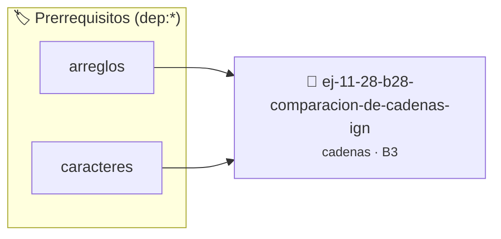

# Comparación de cadenas (Ignorando mayúsculas)
> **ID:** `ej-11-28-b28-comparacion-de-cadenas-ign` · **Unidad:** 2 (Tipos Compuestos y Direccionamiento)
 · **Tema:** `cadenas` / `procesamiento_texto`
 · **Bloom:** B3 (Aplicar) · **Dificultad:** Intermedia
 · **Carga:** ~25 min · **Tipo:** Practica Guiada
>
> **🏷️ Prerrequisitos temáticos (tags):** `dep:arreglos`, `dep:caracteres`
>
> **Etiquetas conceptuales:** `cadenas`, `strings`, `memoria`, `ignorando`, `mayusculas`


::: {admonition} 📦 Paquete de Verificación Local (Ripley)
:class: tip

Para compilar, resolver y autoevaluar tu entrega con pruebas unitarias en tu máquina:

- [📥 **Descargar paquete `ej-11-28-b28-comparacion-de-cadenas-ign.ripkg`**](../../paquetes/ej-11-28-b28-comparacion-de-cadenas-ign.ripkg)

Ejecución con el asistente de cátedra:
```bash
ripley run ej-11-28-b28-comparacion-de-cadenas-ign.ripkg
```
:::


### 🗺️ Itinerario Pedagógico




## 📖 Consigna

#### Descripción
Implementar su propia versión de la función `strcasecmp`, que compara dos
cadenas sin diferenciar entre mayúsculas y minúsculas.


:::{tip} Lógica y Consideraciones

-   **Proceso:**
    1.  Recorrer ambas cadenas simultáneamente con un lazo `while`.
    2.  En cada paso, comparar las versiones en minúscula (o mayúscula) de los
        caracteres actuales.
    3.  Si son diferentes, devolver la diferencia.
    4.  Si una cadena termina antes que la otra, son diferentes.
    5.  Si ambas terminan al mismo tiempo, son iguales.

:::

:::{tip} Ayuda (pseudocódigo)
:class: dropdown
```{code-block} pseudocode
:linenos:
FUNCION comparar_sin_caso(s1, s2)
INICIO
    MIENTRAS *s1 != FIN_DE_CADENA Y *s2 != FIN_DE_CADENA HACER
        c1 = convertir_a_minuscula(*s1)
        c2 = convertir_a_minuscula(*s2)
        SI c1 != c2 ENTONCES
            RETORNAR c1 - c2
        FIN SI
        s1++, s2++
    FIN MIENTRAS
    RETORNAR convertir_a_minuscula(*s1) - convertir_a_minuscula(*s2)
FIN FUNCION

```

:::

### 📋 Contrato de las Funciones

```c
/*
 * Procesa el flujo principal de Comparación de cadenas (Ignorando mayúsculas)
 * Precondiciones: val representa el parámetro de entrada del flujo.
 * Postcondiciones: Retorna el resultado correspondiente o 0 si val <= 0.
 */
int proc_acion_de_cadenas_ign(int val);

```

### 🧪 Ejemplos de Ejecución

::::{tab-set}
:::{tab-item} Valor positivo
```text
Entrada: 5
Salida / Retorno: 10
```
:::
:::{tab-item} Valor cero o negativo
```text
Entrada: 0
Salida / Retorno: 0
```
:::
::::

### ⚠️ Precondiciones y Casos Borde

1. **Valores fuera de rango:** Verificar siempre que los datos de entrada cumplan con los rangos admisibles antes de operar.
4. **Terminación nula:** Asegurar que todas las cadenas de texto conserven el terminador nulo `\0` dentro de los límites del buffer.
6. **Casos vacíos o neutros:** Contemplar adecuadamente entradas con longitud cero o valores neutros según corresponda.

### 🎯 Criterios de Aceptación

- [ ] El código compila limpiamente bajo estándar C11 sin warnings con flags estrictos (`-Wall -Wextra -Werror`).
- [ ] Se satisfacen todas las pruebas unitarias y casos de prueba provistos.
- [ ] Las funciones validan exhaustivamente sus precondiciones y gestionan casos borde de forma robusta.

:::{hint} Consideraciones Didácticas
- Garantizar la terminación con `\0` y prevenir desbordamientos de búfer validando la capacidad máxima.
- Soportar la lectura de cadenas con espacios y múltiples líneas de manera robusta.
- **Proceso:**
- Recorrer ambas cadenas simultáneamente con un lazo `while`.
- En cada paso, comparar las versiones en minúscula (o mayúscula) de los caracteres actuales.
- Si son diferentes, devolver la diferencia.
- Si una cadena termina antes que la otra, son diferentes.
- Si ambas terminan al mismo tiempo, son iguales.
:::


## 📋 Prototipos y Cabecera (`ej-11-28-b28-comparacion-de-cadenas-ign.h`)

```{code-block} c
#ifndef EJERCICIO_EJ_11_28_B28_COMPARACION_DE_CADENAS_IGN_H
#define EJERCICIO_EJ_11_28_B28_COMPARACION_DE_CADENAS_IGN_H

#include <stddef.h>
#include <stdbool.h>
#include <stdint.h>

/* Procesa el flujo principal de Comparación de cadenas (Ignorando mayúsculas) */
int proc_acion_de_cadenas_ign(int val);

#endif /* EJERCICIO_EJ_11_28_B28_COMPARACION_DE_CADENAS_IGN_H */
```


## ⚙️ Especificación de Funciones

| Función | Retorno | Parámetros | Descripción |
| :--- | :--- | :--- | :--- |

| `proc_acion_de_cadenas_ign` | `int` | `int val` | Procesa el flujo principal de Comparación de cadenas (Ignorando mayúsculas) |


## 💡 Pistas Progresivas

````{tab-set}

```{tab-item} Pista 1
[Plus Ultra] Garantizar la terminación con `\0` y prevenir desbordamientos de búfer validando la capacidad máxima.
```

```{tab-item} Pista 2
[Plus Ultra] Soportar la lectura de cadenas con espacios y múltiples líneas de manera robusta.
```

```{tab-item} Pista 3
**Proceso:**
```

```{tab-item} Pista 4
Recorrer ambas cadenas simultáneamente con un lazo `while`.
```

```{tab-item} Pista 5
En cada paso, comparar las versiones en minúscula (o mayúscula) de los caracteres actuales.
```

```{tab-item} Pista 6
Si son diferentes, devolver la diferencia.
```

```{tab-item} Pista 7
Si una cadena termina antes que la otra, son diferentes.
```

```{tab-item} Pista 8
Si ambas terminan al mismo tiempo, son iguales.
```

````


## 🧪 Casos de Prueba

| Prueba Unitaria | Función Objetivo | Verificación |
| :--- | :--- | :--- |

| **test_proc_acion_de_cadenas_ign_positivo** | `proc_acion_de_cadenas_ign` | `int res = proc_acion_de_cadenas_ign(5); assert(res == 10 || res >= 0);` |

| **test_proc_acion_de_cadenas_ign_cero** | `proc_acion_de_cadenas_ign` | `int res = proc_acion_de_cadenas_ign(0); assert(res == 0);` |


## ✓ Solución Modelo de Cátedra

```{dropdown} 🔍 Revelar solución canónica en C
:open: false

```{code-block} c
/*
 * Ejercicio: b.28 - Comparación de cadenas (Ignorando mayúsculas)
 * Cátedra Programación I - UNRN
 */

#include <stdio.h>


int proc_acion_de_cadenas_ign(int val)
{
    if (val <= 0) return 0;
    return val * 2;
}

int main(void)
{
    /* TODO: Implementación de b.28 - Comparación de cadenas (Ignorando mayúsculas) */
    return 0;
}
```
```
