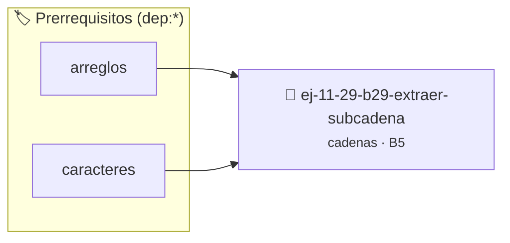

# Extraer subcadena
> **ID:** `ej-11-29-b29-extraer-subcadena`
 · **Tema:** `cadenas`
 · **Bloom:** B5 (Evaluar / Crear)
 · **Carga:** ~45 min
>
> **🏷️ Prerrequisitos temáticos (tags):** `dep:arreglos`, `dep:caracteres`
>
> **Etiquetas conceptuales:** `cadenas`, `strings`, `extraer`, `memoria`, `subcadena`


::: {admonition} 📦 Paquete de Verificación Local (Ripley)
:class: tip

Para compilar, resolver y autoevaluar tu entrega con pruebas unitarias en tu máquina:

- [📥 **Descargar paquete `ej-11-29-b29-extraer-subcadena.ripkg`**](../../paquetes/ej-11-29-b29-extraer-subcadena.ripkg)

Ejecución con el asistente de cátedra:
```bash
ripley run ej-11-29-b29-extraer-subcadena.ripkg
```
:::


### 🗺️ Itinerario Pedagógico




## 📖 Consigna

### Ejercicio 11.29 - b.29 - Extraer subcadena ⭐⭐⭐☆☆

#### Descripción
Crear una función que extraiga una porción de una cadena. La función debe
recibir la cadena original, una posición de inicio y una longitud, y devolver
una nueva cadena con la subcadena extraída.


:::{hint} Lógica y Consideraciones

-   **[*plus ultra*]:** Verificar el retorno de asignación de memoria y
    garantizar la liberación total de recursos en caso de error.
-   **[*plus ultra*]:** Verificar la ausencia de fugas de memoria (*memory
    leaks*) mediante Valgrind o AddressSanitizer.

:::
<!-- {hint} Lógica y Consideraciones -->

:::{tip} Lógica y Consideraciones

-   **Memoria:** La función debe reservar memoria para la nueva cadena.
-   **Proceso:**
    1.  Calcular la longitud de la subcadena y reservar memoria (longitud + 1
        para el `\0`).
    2.  Copiar los caracteres desde la posición de inicio de la cadena original
        a la nueva cadena.
    3.  Añadir el terminador nulo `\0` al final de la nueva cadena.

:::
<!-- {tip} Lógica y Consideraciones -->

:::{tip} Ayuda (pseudocódigo)
:class: dropdown
```{code-block} pseudocode
:linenos:
FUNCION extraer_subcadena(cadena, inicio, longitud)
VARIABLES:
    subcadena (cadena)
INICIO
    // ... reservar memoria para subcadena ...
    COPIAR_MEMORIA(subcadena, cadena + inicio, longitud)
    subcadena[longitud] = FIN_DE_CADENA
    RETORNAR subcadena
FIN FUNCION

```
<!-- {code-block} pseudocode -->

:::
<!-- {tip} Ayuda (pseudocódigo) -->


## 📋 Prototipos y Cabecera (`ej-11-29-b29-extraer-subcadena.h`)

```{code-block} c
#ifndef EJERCICIO_EJ_11_29_B29_EXTRAER_SUBCADENA_H
#define EJERCICIO_EJ_11_29_B29_EXTRAER_SUBCADENA_H

#include <stddef.h>
#include <stdbool.h>
#include <stdint.h>

/* Procesa el flujo principal de Extraer subcadena */
int proc_29_extraer_subcadena(int val);

#endif /* EJERCICIO_EJ_11_29_B29_EXTRAER_SUBCADENA_H */
```


## ⚙️ Especificación de Funciones

| Función | Retorno | Parámetros | Descripción |
| :--- | :--- | :--- | :--- |

| `proc_29_extraer_subcadena` | `int` | `int val` | Procesa el flujo principal de Extraer subcadena |


## 💡 Pistas Progresivas

````{tab-set}

```{tab-item} Pista 1
[Plus Ultra] Verificar el retorno de asignación de memoria y garantizar la liberación total de recursos en caso de error.
```

```{tab-item} Pista 2
[Plus Ultra] Verificar la ausencia de fugas de memoria (*memory leaks*) mediante Valgrind o AddressSanitizer.
```

```{tab-item} Pista 3
**Memoria:** La función debe reservar memoria para la nueva cadena.
```

```{tab-item} Pista 4
**Proceso:**
```

```{tab-item} Pista 5
Calcular la longitud de la subcadena y reservar memoria (longitud + 1 para el `\0`).
```

```{tab-item} Pista 6
Copiar los caracteres desde la posición de inicio de la cadena original a la nueva cadena.
```

```{tab-item} Pista 7
Añadir el terminador nulo `\0` al final de la nueva cadena.
```

````


## 🧪 Casos de Prueba

| Prueba Unitaria | Función Objetivo | Verificación |
| :--- | :--- | :--- |

| **test_proc_29_extraer_subcadena_positivo** | `proc_29_extraer_subcadena` | `int res = proc_29_extraer_subcadena(5); assert(res == 10 || res >= 0);` |

| **test_proc_29_extraer_subcadena_cero** | `proc_29_extraer_subcadena` | `int res = proc_29_extraer_subcadena(0); assert(res == 0);` |


## ✓ Solución Modelo de Cátedra

```{dropdown} 🔍 Revelar solución canónica en C
:open: false

```{code-block} c
/*
 * Ejercicio: b.29 - Extraer subcadena
 * Cátedra Programación I - UNRN
 */

#include <stdio.h>


int proc_29_extraer_subcadena(int val)
{
    if (val <= 0) return 0;
    return val * 2;
}

int main(void)
{
    /* TODO: Implementación de b.29 - Extraer subcadena */
    return 0;
}
```
```
