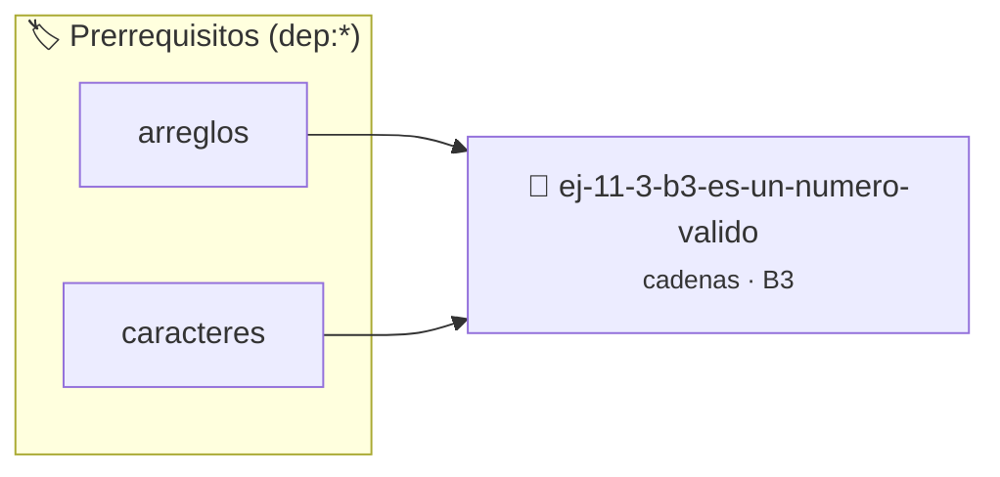

# ¿Es un número válido?
> **ID:** `ej-11-3-b3-es-un-numero-valido`
 · **Tema:** `cadenas`
 · **Bloom:** B3 (Aplicar)
 · **Carga:** ~25 min
>
> **🏷️ Prerrequisitos temáticos (tags):** `dep:arreglos`, `dep:caracteres`
>
> **Etiquetas conceptuales:** `cadenas`, `strings`, `memoria`, `numero`, `valido`


::: {admonition} 📦 Paquete de Verificación Local (Ripley)
:class: tip

Para compilar, resolver y autoevaluar tu entrega con pruebas unitarias en tu máquina:

- [📥 **Descargar paquete `ej-11-3-b3-es-un-numero-valido.ripkg`**](../../paquetes/ej-11-3-b3-es-un-numero-valido.ripkg)

Ejecución con el asistente de cátedra:
```bash
ripley run ej-11-3-b3-es-un-numero-valido.ripkg
```
:::


### 🗺️ Itinerario Pedagógico




## 📖 Consigna

### Ejercicio 11.3 - b.3 - ¿Es un número válido? ⭐⭐☆☆☆

#### Descripción
Desarrollar una función que verifique si una cadena de texto representa un
número de punto flotante válido. La validación debe seguir un conjunto de reglas
específicas.


:::{hint} Lógica y Consideraciones

-   **[*plus ultra*]:** Garantizar la terminación con `\0` y prevenir
    desbordamientos de búfer validando la capacidad máxima.
-   **[*plus ultra*]:** Soportar la lectura de cadenas con espacios y múltiples
    líneas de manera robusta.

:::
<!-- {hint} Lógica y Consideraciones -->

:::{tip} Lógica y Consideraciones

-   **Reglas de Validación:**
    1.  Puede tener un signo opcional (`+` o `-`) únicamente al principio.
    2.  Debe contener al menos un dígito.
    3.  Puede contener como máximo un punto decimal (`.`).
    4.  Todos los demás caracteres deben ser dígitos (`0`-`9`).
-   **Proceso:**
    1.  Recorrer la cadena carácter por carácter.
    2.  Usar banderas (variables booleanas) para llevar un registro de si ya se
        encontró un punto decimal.
    3.  Manejar el signo solo en la primera posición.
    4.  Verificar que cada carácter sea un dígito o un punto (en la posición
        correcta).

:::
<!-- {tip} Lógica y Consideraciones -->

:::{tip} Ayuda (pseudocódigo)
:class: dropdown
```{code-block} pseudocode
:linenos:
FUNCION es_numero_valido(cadena)
VARIABLES:
    tiene_punto (booleano)
    tiene_digito (booleano)
    i (entero)
INICIO
    tiene_punto = FALSO, tiene_digito = FALSO
    i = 0

    // Comprobar signo opcional
    SI cadena[0] == '+' O cadena[0] == '-' ENTONCES
        i = 1
    FIN SI

    // Recorrer el resto de la cadena
    MIENTRAS cadena[i] != FIN_DE_CADENA HACER
        SI es_digito(cadena[i]) ENTONCES
            tiene_digito = VERDADERO
        SINO SI cadena[i] == '.' ENTONCES
            SI tiene_punto ENTONCES RETORNAR FALSO // Más de un punto
            tiene_punto = VERDADERO
        SINO
            RETORNAR FALSO // Carácter no válido
        FIN SI
        i = i + 1
    FIN MIENTRAS

    RETORNAR tiene_digito // Debe tener al menos un dígito
FIN FUNCION

```
<!-- {code-block} pseudocode -->

:::
<!-- {tip} Ayuda (pseudocódigo) -->


## 📋 Prototipos y Cabecera (`ej-11-3-b3-es-un-numero-valido.h`)

```{code-block} c
#ifndef EJERCICIO_EJ_11_3_B3_ES_UN_NUMERO_VALIDO_H
#define EJERCICIO_EJ_11_3_B3_ES_UN_NUMERO_VALIDO_H

#include <stddef.h>
#include <stdbool.h>
#include <stdint.h>

/* Procesa el flujo principal de ¿Es un número válido? */
int proc__es_un_numero_valido(int val);

#endif /* EJERCICIO_EJ_11_3_B3_ES_UN_NUMERO_VALIDO_H */
```


## ⚙️ Especificación de Funciones

| Función | Retorno | Parámetros | Descripción |
| :--- | :--- | :--- | :--- |

| `proc__es_un_numero_valido` | `int` | `int val` | Procesa el flujo principal de ¿Es un número válido? |


## 💡 Pistas Progresivas

````{tab-set}

```{tab-item} Pista 1
[Plus Ultra] Garantizar la terminación con `\0` y prevenir desbordamientos de búfer validando la capacidad máxima.
```

```{tab-item} Pista 2
[Plus Ultra] Soportar la lectura de cadenas con espacios y múltiples líneas de manera robusta.
```

```{tab-item} Pista 3
**Reglas de Validación:**
```

```{tab-item} Pista 4
Puede tener un signo opcional (`+` o `-`) únicamente al principio.
```

```{tab-item} Pista 5
Debe contener al menos un dígito.
```

```{tab-item} Pista 6
Puede contener como máximo un punto decimal (`.`).
```

```{tab-item} Pista 7
Todos los demás caracteres deben ser dígitos (`0`-`9`).
```

```{tab-item} Pista 8
**Proceso:**
```

```{tab-item} Pista 9
Recorrer la cadena carácter por carácter.
```

```{tab-item} Pista 10
Usar banderas (variables booleanas) para llevar un registro de si ya se encontró un punto decimal.
```

```{tab-item} Pista 11
Manejar el signo solo en la primera posición.
```

```{tab-item} Pista 12
Verificar que cada carácter sea un dígito o un punto (en la posición correcta).
```

````


## 🧪 Casos de Prueba

| Prueba Unitaria | Función Objetivo | Verificación |
| :--- | :--- | :--- |

| **test_proc__es_un_numero_valido_positivo** | `proc__es_un_numero_valido` | `int res = proc__es_un_numero_valido(5); assert(res == 10 || res >= 0);` |

| **test_proc__es_un_numero_valido_cero** | `proc__es_un_numero_valido` | `int res = proc__es_un_numero_valido(0); assert(res == 0);` |


## ✓ Solución Modelo de Cátedra

```{dropdown} 🔍 Revelar solución canónica en C
:open: false

```{code-block} c
/*
 * Ejercicio: b.3 - ¿Es un número válido?
 * Cátedra Programación I - UNRN
 */

#include <stdio.h>


int proc__es_un_numero_valido(int val)
{
    if (val <= 0) return 0;
    return val * 2;
}

int main(void)
{
    /* TODO: Implementación de b.3 - ¿Es un número válido? */
    return 0;
}
```
```
