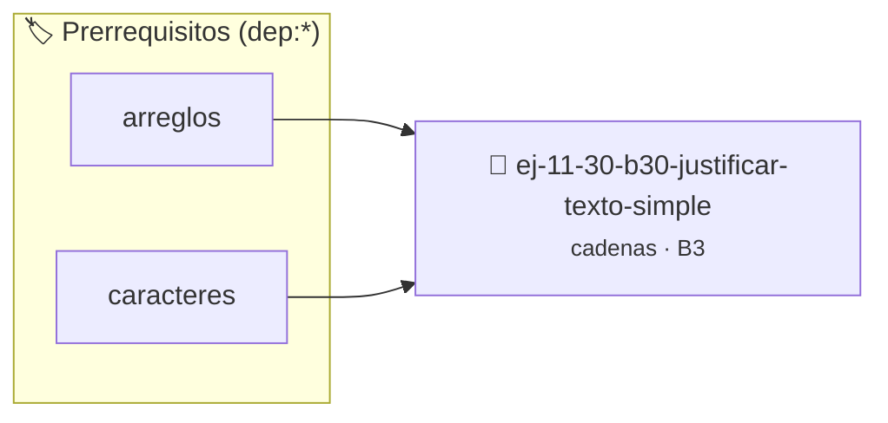

# Justificar texto (Simple)
> **ID:** `ej-11-30-b30-justificar-texto-simple` · **Unidad:** 2 (Tipos Compuestos y Direccionamiento)
 · **Tema:** `cadenas` / `procesamiento_texto`
 · **Bloom:** B3 (Aplicar) · **Dificultad:** Intermedia
 · **Carga:** ~25 min · **Tipo:** Practica Guiada
>
> **🏷️ Prerrequisitos temáticos (tags):** `dep:arreglos`, `dep:caracteres`
>
> **Etiquetas conceptuales:** `cadenas`, `texto`, `strings`, `justificar`, `memoria`


::: {admonition} 📦 Paquete de Verificación Local (Ripley)
:class: tip

Para compilar, resolver y autoevaluar tu entrega con pruebas unitarias en tu máquina:

- [📥 **Descargar paquete `ej-11-30-b30-justificar-texto-simple.ripkg`**](../../paquetes/ej-11-30-b30-justificar-texto-simple.ripkg)

Ejecución con el asistente de cátedra:
```bash
ripley run ej-11-30-b30-justificar-texto-simple.ripkg
```
:::


### 🗺️ Itinerario Pedagógico




## 📖 Consigna

### Ejercicio 11.30 - b.30 - Justificar texto (Simple) ⭐☆☆☆☆

#### Descripción
Implementar una función que justifique una línea de texto a un ancho específico,
insertando espacios adicionales entre las palabras de la manera más uniforme
posible.


:::{hint} Lógica y Consideraciones

-   **[*plus ultra*]:** Garantizar la terminación con `\0` y prevenir
    desbordamientos de búfer validando la capacidad máxima.
-   **[*plus ultra*]:** Soportar la lectura de cadenas con espacios y múltiples
    líneas de manera robusta.

:::
<!-- {hint} Lógica y Consideraciones -->

:::{tip} Lógica y Consideraciones

-   **Proceso:**
    1.  Contar el número de palabras y el número total de caracteres (sin
        espacios).
    2.  Calcular el número total de espacios a insertar: `ancho_total -
        num_caracteres`.
    3.  Calcular el número de espacios a poner en cada hueco entre palabras.
    4.  Construir la nueva cadena añadiendo las palabras y el número calculado
        de espacios entre ellas.

:::
<!-- {tip} Lógica y Consideraciones -->

:::{tip} Ayuda (pseudocódigo)
:class: dropdown
```{code-block} pseudocode
:linenos:
FUNCION justificar_texto(linea, ancho)
VARIABLES:
    num_palabras, num_espacios, espacios_por_hueco, espacios_extra
INICIO
    // ... contar palabras y caracteres ...
    // ... calcular espacios a insertar ...

    // ... construir la nueva cadena ...
    RETORNAR cadena_justificada
FIN FUNCION

```
<!-- {code-block} pseudocode -->

:::
<!-- {tip} Ayuda (pseudocódigo) -->


## 📋 Prototipos y Cabecera (`ej-11-30-b30-justificar-texto-simple.h`)

```{code-block} c
#ifndef EJERCICIO_EJ_11_30_B30_JUSTIFICAR_TEXTO_SIMPLE_H
#define EJERCICIO_EJ_11_30_B30_JUSTIFICAR_TEXTO_SIMPLE_H

#include <stddef.h>
#include <stdbool.h>
#include <stdint.h>

/* Procesa el flujo principal de Justificar texto (Simple) */
int proc_tificar_texto_simple(int val);

#endif /* EJERCICIO_EJ_11_30_B30_JUSTIFICAR_TEXTO_SIMPLE_H */
```


## ⚙️ Especificación de Funciones

| Función | Retorno | Parámetros | Descripción |
| :--- | :--- | :--- | :--- |

| `proc_tificar_texto_simple` | `int` | `int val` | Procesa el flujo principal de Justificar texto (Simple) |


## 💡 Pistas Progresivas

````{tab-set}

```{tab-item} Pista 1
[Plus Ultra] Garantizar la terminación con `\0` y prevenir desbordamientos de búfer validando la capacidad máxima.
```

```{tab-item} Pista 2
[Plus Ultra] Soportar la lectura de cadenas con espacios y múltiples líneas de manera robusta.
```

```{tab-item} Pista 3
**Proceso:**
```

```{tab-item} Pista 4
Contar el número de palabras y el número total de caracteres (sin espacios).
```

```{tab-item} Pista 5
Calcular el número total de espacios a insertar: `ancho_total - num_caracteres`.
```

```{tab-item} Pista 6
Calcular el número de espacios a poner en cada hueco entre palabras.
```

```{tab-item} Pista 7
Construir la nueva cadena añadiendo las palabras y el número calculado de espacios entre ellas.
```

````


## 🧪 Casos de Prueba

| Prueba Unitaria | Función Objetivo | Verificación |
| :--- | :--- | :--- |

| **test_proc_tificar_texto_simple_positivo** | `proc_tificar_texto_simple` | `int res = proc_tificar_texto_simple(5); assert(res == 10 || res >= 0);` |

| **test_proc_tificar_texto_simple_cero** | `proc_tificar_texto_simple` | `int res = proc_tificar_texto_simple(0); assert(res == 0);` |


## ✓ Solución Modelo de Cátedra

```{dropdown} 🔍 Revelar solución canónica en C
:open: false

```{code-block} c
/*
 * Ejercicio: b.30 - Justificar texto (Simple)
 * Cátedra Programación I - UNRN
 */

#include <stdio.h>


int proc_tificar_texto_simple(int val)
{
    if (val <= 0) return 0;
    return val * 2;
}

int main(void)
{
    /* TODO: Implementación de b.30 - Justificar texto (Simple) */
    return 0;
}
```
```
