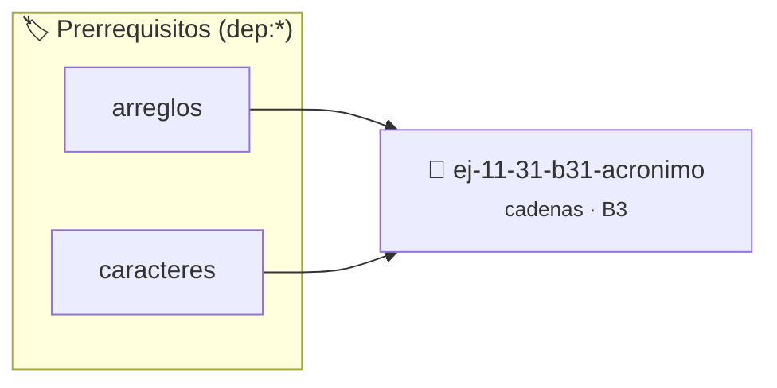

# Acrónimo
> **ID:** `ej-11-31-b31-acronimo` · **Unidad:** 2 (Tipos Compuestos y Direccionamiento)
 · **Tema:** `cadenas` / `procesamiento_texto`
 · **Bloom:** B3 (Aplicar) · **Dificultad:** Intermedia
 · **Carga:** ~25 min · **Tipo:** Practica Guiada
>
> **🏷️ Prerrequisitos temáticos (tags):** `dep:arreglos`, `dep:caracteres`
>
> **Etiquetas conceptuales:** `acronimo`, `cadenas`, `strings`, `memoria`


::: {admonition} 📦 Paquete de Verificación Local (Ripley)
:class: tip

Para compilar, resolver y autoevaluar tu entrega con pruebas unitarias en tu máquina:

- [📥 **Descargar paquete `ej-11-31-b31-acronimo.ripkg`**](../../paquetes/ej-11-31-b31-acronimo.ripkg)

Ejecución con el asistente de cátedra:
```bash
ripley run ej-11-31-b31-acronimo.ripkg
```
:::


### 🗺️ Itinerario Pedagógico




## 📖 Consigna

#### Descripción
Escribir una función que genere un acrónimo a partir de una frase, tomando la
primera letra de cada palabra.


:::{tip} Lógica y Consideraciones

-   **Proceso:**
    1.  Recorrer la cadena.
    2.  Usar una bandera o estado para saber si el carácter actual es el inicio
        de una nueva palabra.
    3.  Si es el inicio de una palabra y es una letra, añadirla (en mayúscula) a
        la cadena de resultado.

:::

:::{tip} Ayuda (pseudocódigo)
:class: dropdown
```{code-block} pseudocode
:linenos:
FUNCION generar_acronimo(frase)
VARIABLES:
    acronimo (cadena)
    es_inicio_de_palabra (booleano)
INICIO
    acronimo = ""
    es_inicio_de_palabra = VERDADERO

    PARA cada caracter c en frase HACER
        SI es_letra(c) Y es_inicio_de_palabra ENTONCES
            AÑADIR convertir_a_mayuscula(c) a acronimo
            es_inicio_de_palabra = FALSO
        SINO SI c == ' ' ENTONCES
            es_inicio_de_palabra = VERDADERO
        FIN SI
    FIN PARA
    RETORNAR acronimo
FIN FUNCION

```

:::

## Cadenas y Algoritmos

### 📋 Contrato de las Funciones

```c
/*
 * Procesa el flujo principal de Acrónimo
 * Precondiciones: val representa el parámetro de entrada del flujo.
 * Postcondiciones: Retorna el resultado correspondiente o 0 si val <= 0.
 */
int ejecutar_ej_11_31_b31_acronimo(int val);

```

### 🧪 Ejemplos de Ejecución

::::{tab-set}
:::{tab-item} Valor positivo
```text
Entrada: 5
Salida / Retorno: 10
```
:::
:::{tab-item} Valor cero o negativo
```text
Entrada: 0
Salida / Retorno: 0
```
:::
::::

### ⚠️ Precondiciones y Casos Borde

1. **Valores fuera de rango:** Verificar siempre que los datos de entrada cumplan con los rangos admisibles antes de operar.
4. **Terminación nula:** Asegurar que todas las cadenas de texto conserven el terminador nulo `\0` dentro de los límites del buffer.
6. **Casos vacíos o neutros:** Contemplar adecuadamente entradas con longitud cero o valores neutros según corresponda.

### 🎯 Criterios de Aceptación

- [ ] El código compila limpiamente bajo estándar C11 sin warnings con flags estrictos (`-Wall -Wextra -Werror`).
- [ ] Se satisfacen todas las pruebas unitarias y casos de prueba provistos.
- [ ] Las funciones validan exhaustivamente sus precondiciones y gestionan casos borde de forma robusta.

:::{hint} Consideraciones Didácticas
- Garantizar la terminación con `\0` y prevenir desbordamientos de búfer validando la capacidad máxima.
- Soportar la lectura de cadenas con espacios y múltiples líneas de manera robusta.
- **Proceso:**
- Recorrer la cadena.
- Usar una bandera o estado para saber si el carácter actual es el inicio de una nueva palabra.
- Si es el inicio de una palabra y es una letra, añadirla (en mayúscula) a la cadena de resultado.
:::


## 📋 Prototipos y Cabecera (`ej-11-31-b31-acronimo.h`)

```{code-block} c
#ifndef EJERCICIO_EJ_11_31_B31_ACRONIMO_H
#define EJERCICIO_EJ_11_31_B31_ACRONIMO_H

#include <stddef.h>
#include <stdbool.h>
#include <stdint.h>

/* Procesa el flujo principal de Acrónimo */
int ejecutar_ej_11_31_b31_acronimo(int val);

#endif /* EJERCICIO_EJ_11_31_B31_ACRONIMO_H */
```


## ⚙️ Especificación de Funciones

| Función | Retorno | Parámetros | Descripción |
| :--- | :--- | :--- | :--- |

| `ejecutar_ej_11_31_b31_acronimo` | `int` | `int val` | Procesa el flujo principal de Acrónimo |


## 💡 Pistas Progresivas

````{tab-set}

```{tab-item} Pista 1
[Plus Ultra] Garantizar la terminación con `\0` y prevenir desbordamientos de búfer validando la capacidad máxima.
```

```{tab-item} Pista 2
[Plus Ultra] Soportar la lectura de cadenas con espacios y múltiples líneas de manera robusta.
```

```{tab-item} Pista 3
**Proceso:**
```

```{tab-item} Pista 4
Recorrer la cadena.
```

```{tab-item} Pista 5
Usar una bandera o estado para saber si el carácter actual es el inicio de una nueva palabra.
```

```{tab-item} Pista 6
Si es el inicio de una palabra y es una letra, añadirla (en mayúscula) a la cadena de resultado.
```

````


## 🧪 Casos de Prueba

| Prueba Unitaria | Función Objetivo | Verificación |
| :--- | :--- | :--- |

| **test_ejecutar_ej_11_31_b31_acronimo_positivo** | `ejecutar_ej_11_31_b31_acronimo` | `int res = ejecutar_ej_11_31_b31_acronimo(5); assert(res == 10 || res >= 0);` |

| **test_ejecutar_ej_11_31_b31_acronimo_cero** | `ejecutar_ej_11_31_b31_acronimo` | `int res = ejecutar_ej_11_31_b31_acronimo(0); assert(res == 0);` |


## ✓ Solución Modelo de Cátedra

```{dropdown} 🔍 Revelar solución canónica en C
:open: false

```{code-block} c
/*
 * Ejercicio: b.31 - Acrónimo
 * Cátedra Programación I - UNRN
 */

#include <stdio.h>


int ejecutar_ej_11_31_b31_acronimo(int val)
{
    if (val <= 0) return 0;
    return val * 2;
}

int main(void)
{
    /* TODO: Implementación de b.31 - Acrónimo */
    return 0;
}
```
```
