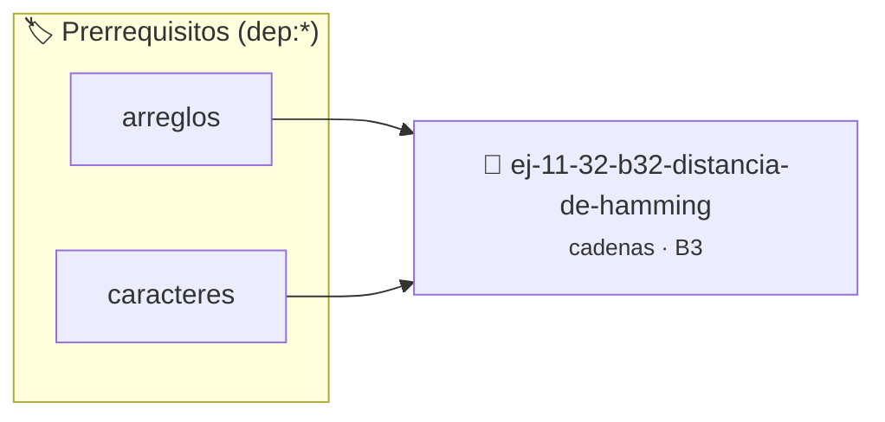

# Distancia de Hamming
> **ID:** `ej-11-32-b32-distancia-de-hamming`
 · **Tema:** `cadenas`
 · **Bloom:** B3 (Aplicar)
 · **Carga:** ~25 min
>
> **🏷️ Prerrequisitos temáticos (tags):** `dep:arreglos`, `dep:caracteres`
>
> **Etiquetas conceptuales:** `cadenas`, `strings`, `hamming`, `distancia`, `memoria`


::: {admonition} 📦 Paquete de Verificación Local (Ripley)
:class: tip

Para compilar, resolver y autoevaluar tu entrega con pruebas unitarias en tu máquina:

- [📥 **Descargar paquete `ej-11-32-b32-distancia-de-hamming.ripkg`**](../../paquetes/ej-11-32-b32-distancia-de-hamming.ripkg)

Ejecución con el asistente de cátedra:
```bash
ripley run ej-11-32-b32-distancia-de-hamming.ripkg
```
:::


### 🗺️ Itinerario Pedagógico




## 📖 Consigna

### Ejercicio 11.32 - b.32 - Distancia de Hamming ⭐⭐☆☆☆

#### Descripción
Implementar una función que calcule la distancia de Hamming entre dos cadenas de
igual longitud. Esta distancia es el número de posiciones en las que los
caracteres correspondientes son diferentes.


:::{hint} Lógica y Consideraciones

-   **[*plus ultra*]:** Garantizar la terminación con `\0` y prevenir
    desbordamientos de búfer validando la capacidad máxima.
-   **[*plus ultra*]:** Soportar la lectura de cadenas con espacios y múltiples
    líneas de manera robusta.

:::
<!-- {hint} Lógica y Consideraciones -->

:::{tip} Lógica y Consideraciones

-   **Precondición:** Las cadenas deben tener la misma longitud.
-   **Proceso:**
    1.  Inicializar un `contador` en 0.
    2.  Recorrer ambas cadenas simultáneamente con un lazo `for`.
    3.  En cada posición `i`, si `cadena1[i] != cadena2[i]`, incrementar el
        `contador`.

:::
<!-- {tip} Lógica y Consideraciones -->

:::{tip} Ayuda (pseudocódigo)
:class: dropdown
```{code-block} pseudocode
:linenos:
FUNCION distancia_hamming(cadena1, cadena2)
VARIABLES:
    distancia (entero)
INICIO
    SI LONGITUD(cadena1) != LONGITUD(cadena2) RETORNAR -1 // Error

    distancia = 0
    PARA i DESDE 0 HASTA LONGITUD(cadena1)-1 HACER
        SI cadena1[i] != cadena2[i] ENTONCES
            distancia++
        FIN SI
    FIN PARA
    RETORNAR distancia
FIN FUNCION

```
<!-- {code-block} pseudocode -->

:::
<!-- {tip} Ayuda (pseudocódigo) -->


## 📋 Prototipos y Cabecera (`ej-11-32-b32-distancia-de-hamming.h`)

```{code-block} c
#ifndef EJERCICIO_EJ_11_32_B32_DISTANCIA_DE_HAMMING_H
#define EJERCICIO_EJ_11_32_B32_DISTANCIA_DE_HAMMING_H

#include <stddef.h>
#include <stdbool.h>
#include <stdint.h>

/* Procesa el flujo principal de Distancia de Hamming */
int proc_distancia_de_hamming(int val);

#endif /* EJERCICIO_EJ_11_32_B32_DISTANCIA_DE_HAMMING_H */
```


## ⚙️ Especificación de Funciones

| Función | Retorno | Parámetros | Descripción |
| :--- | :--- | :--- | :--- |

| `proc_distancia_de_hamming` | `int` | `int val` | Procesa el flujo principal de Distancia de Hamming |


## 💡 Pistas Progresivas

````{tab-set}

```{tab-item} Pista 1
[Plus Ultra] Garantizar la terminación con `\0` y prevenir desbordamientos de búfer validando la capacidad máxima.
```

```{tab-item} Pista 2
[Plus Ultra] Soportar la lectura de cadenas con espacios y múltiples líneas de manera robusta.
```

```{tab-item} Pista 3
**Precondición:** Las cadenas deben tener la misma longitud.
```

```{tab-item} Pista 4
**Proceso:**
```

```{tab-item} Pista 5
Inicializar un `contador` en 0.
```

```{tab-item} Pista 6
Recorrer ambas cadenas simultáneamente con un lazo `for`.
```

```{tab-item} Pista 7
En cada posición `i`, si `cadena1[i] != cadena2[i]`, incrementar el `contador`.
```

````


## 🧪 Casos de Prueba

| Prueba Unitaria | Función Objetivo | Verificación |
| :--- | :--- | :--- |

| **test_proc_distancia_de_hamming_positivo** | `proc_distancia_de_hamming` | `int res = proc_distancia_de_hamming(5); assert(res == 10 || res >= 0);` |

| **test_proc_distancia_de_hamming_cero** | `proc_distancia_de_hamming` | `int res = proc_distancia_de_hamming(0); assert(res == 0);` |


## ✓ Solución Modelo de Cátedra

```{dropdown} 🔍 Revelar solución canónica en C
:open: false

```{code-block} c
/*
 * Ejercicio: b.32 - Distancia de Hamming
 * Cátedra Programación I - UNRN
 */

#include <stdio.h>


int proc_distancia_de_hamming(int val)
{
    if (val <= 0) return 0;
    return val * 2;
}

int main(void)
{
    /* TODO: Implementación de b.32 - Distancia de Hamming */
    return 0;
}
```
```
