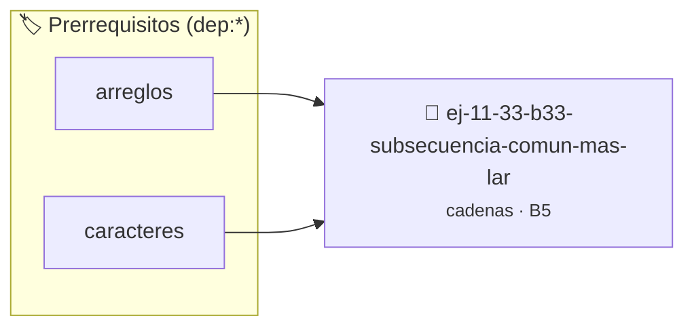

# Subsecuencia común más larga (LCS)
> **ID:** `ej-11-33-b33-subsecuencia-comun-mas-lar` · **Unidad:** 2 (Tipos Compuestos y Direccionamiento)
 · **Tema:** `cadenas` / `procesamiento_texto`
 · **Bloom:** B5 (Evaluar / Crear) · **Dificultad:** Desafio
 · **Carga:** ~45 min · **Tipo:** Desafio
>
> **🏷️ Prerrequisitos temáticos (tags):** `dep:arreglos`, `dep:caracteres`
>
> **Etiquetas conceptuales:** `comun`, `cadenas`, `larga`, `strings`, `lcs`


::: {admonition} 📦 Paquete de Verificación Local (Ripley)
:class: tip

Para compilar, resolver y autoevaluar tu entrega con pruebas unitarias en tu máquina:

- [📥 **Descargar paquete `ej-11-33-b33-subsecuencia-comun-mas-lar.ripkg`**](../../paquetes/ej-11-33-b33-subsecuencia-comun-mas-lar.ripkg)

Ejecución con el asistente de cátedra:
```bash
ripley run ej-11-33-b33-subsecuencia-comun-mas-lar.ripkg
```
:::


### 🗺️ Itinerario Pedagógico




## 📖 Consigna

### Ejercicio 11.33 - b.33 - Subsecuencia común más larga (LCS) ⭐⭐☆☆☆

#### Descripción
Escribir una función que encuentre la longitud de la subsecuencia común más
larga (LCS) entre dos cadenas. Una subsecuencia no tiene por qué ser contigua.


:::{hint} Lógica y Consideraciones

-   **[*plus ultra*]:** Verificar el retorno de asignación de memoria y
    garantizar la liberación total de recursos en caso de error.
-   **[*plus ultra*]:** Verificar la ausencia de fugas de memoria (*memory
    leaks*) mediante Valgrind o AddressSanitizer.

:::
<!-- {hint} Lógica y Consideraciones -->

:::{tip} Lógica y Consideraciones

-   **Algoritmo:** Este es un problema clásico de programación dinámica.
-   **Proceso:**
    1.  Crear una matriz 2D `dp` de tamaño `(longitud1+1) x (longitud2+1)`.
    2.  `dp[i][j]` almacenará la longitud de la LCS de `cadena1[0..i-1]` y
        `cadena2[0..j-1]`.
    3.  Llenar la matriz usando la recurrencia:
        -   Si `cadena1[i-1] == cadena2[j-1]`, entonces `dp[i][j] = 1 +
            dp[i-1][j-1]`.
        -   Si no, `dp[i][j] = MAXIMO(dp[i-1][j], dp[i][j-1])`.
-   **Salida:** El resultado es el valor en `dp[longitud1][longitud2]`.

:::
<!-- {tip} Lógica y Consideraciones -->

:::{tip} Ayuda (pseudocódigo)
:class: dropdown
```{code-block} pseudocode
:linenos:
FUNCION lcs(cadena1, cadena2)
VARIABLES:
    dp (matriz 2D)
INICIO
    // ... inicializar y llenar la matriz dp ...
    RETORNAR dp[LONGITUD(cadena1)][LONGITUD(cadena2)]
FIN FUNCION

```
<!-- {code-block} pseudocode -->

:::
<!-- {tip} Ayuda (pseudocódigo) -->


## 📋 Prototipos y Cabecera (`ej-11-33-b33-subsecuencia-comun-mas-lar.h`)

```{code-block} c
#ifndef EJERCICIO_EJ_11_33_B33_SUBSECUENCIA_COMUN_MAS_LAR_H
#define EJERCICIO_EJ_11_33_B33_SUBSECUENCIA_COMUN_MAS_LAR_H

#include <stddef.h>
#include <stdbool.h>
#include <stdint.h>

/* Procesa el flujo principal de Subsecuencia común más larga (LCS) */
int proc_uencia_comun_mas_lar(int val);

#endif /* EJERCICIO_EJ_11_33_B33_SUBSECUENCIA_COMUN_MAS_LAR_H */
```


## ⚙️ Especificación de Funciones

| Función | Retorno | Parámetros | Descripción |
| :--- | :--- | :--- | :--- |

| `proc_uencia_comun_mas_lar` | `int` | `int val` | Procesa el flujo principal de Subsecuencia común más larga (LCS) |


## 💡 Pistas Progresivas

````{tab-set}

```{tab-item} Pista 1
[Plus Ultra] Verificar el retorno de asignación de memoria y garantizar la liberación total de recursos en caso de error.
```

```{tab-item} Pista 2
[Plus Ultra] Verificar la ausencia de fugas de memoria (*memory leaks*) mediante Valgrind o AddressSanitizer.
```

```{tab-item} Pista 3
**Algoritmo:** Este es un problema clásico de programación dinámica.
```

```{tab-item} Pista 4
**Proceso:**
```

```{tab-item} Pista 5
Crear una matriz 2D `dp` de tamaño `(longitud1+1) x (longitud2+1)`.
```

```{tab-item} Pista 6
`dp[i][j]` almacenará la longitud de la LCS de `cadena1[0..i-1]` y `cadena2[0..j-1]`.
```

```{tab-item} Pista 7
Llenar la matriz usando la recurrencia:
```

```{tab-item} Pista 8
Si `cadena1[i-1] == cadena2[j-1]`, entonces `dp[i][j] = 1 + dp[i-1][j-1]`.
```

```{tab-item} Pista 9
Si no, `dp[i][j] = MAXIMO(dp[i-1][j], dp[i][j-1])`.
```

```{tab-item} Pista 10
**Salida:** El resultado es el valor en `dp[longitud1][longitud2]`.
```

````


## 🧪 Casos de Prueba

| Prueba Unitaria | Función Objetivo | Verificación |
| :--- | :--- | :--- |

| **test_proc_uencia_comun_mas_lar_positivo** | `proc_uencia_comun_mas_lar` | `int res = proc_uencia_comun_mas_lar(5); assert(res == 10 || res >= 0);` |

| **test_proc_uencia_comun_mas_lar_cero** | `proc_uencia_comun_mas_lar` | `int res = proc_uencia_comun_mas_lar(0); assert(res == 0);` |


## ✓ Solución Modelo de Cátedra

```{dropdown} 🔍 Revelar solución canónica en C
:open: false

```{code-block} c
/*
 * Ejercicio: b.33 - Subsecuencia común más larga (LCS)
 * Cátedra Programación I - UNRN
 */

#include <stdio.h>


int proc_uencia_comun_mas_lar(int val)
{
    if (val <= 0) return 0;
    return val * 2;
}

int main(void)
{
    /* TODO: Implementación de b.33 - Subsecuencia común más larga (LCS) */
    return 0;
}
```
```
