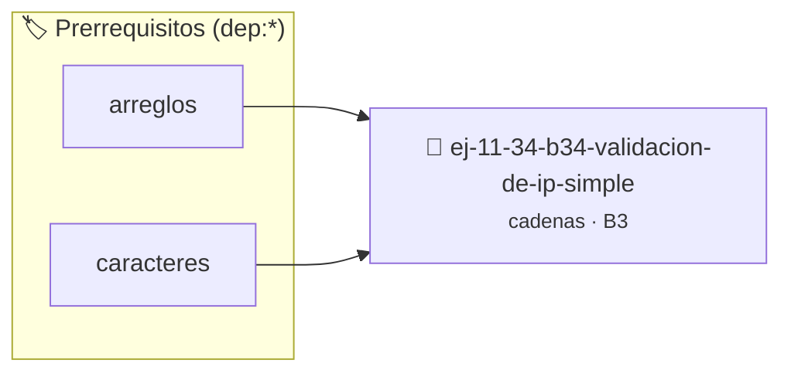

# Validación de IP simple
> **ID:** `ej-11-34-b34-validacion-de-ip-simple` · **Unidad:** 2 (Tipos Compuestos y Direccionamiento)
 · **Tema:** `cadenas` / `procesamiento_texto`
 · **Bloom:** B3 (Aplicar) · **Dificultad:** Intermedia
 · **Carga:** ~25 min · **Tipo:** Practica Guiada
>
> **🏷️ Prerrequisitos temáticos (tags):** `dep:arreglos`, `dep:caracteres`
>
> **Etiquetas conceptuales:** `cadenas`, `strings`, `memoria`, `validacion`, `simple`


::: {admonition} 📦 Paquete de Verificación Local (Ripley)
:class: tip

Para compilar, resolver y autoevaluar tu entrega con pruebas unitarias en tu máquina:

- [📥 **Descargar paquete `ej-11-34-b34-validacion-de-ip-simple.ripkg`**](../../paquetes/ej-11-34-b34-validacion-de-ip-simple.ripkg)

Ejecución con el asistente de cátedra:
```bash
ripley run ej-11-34-b34-validacion-de-ip-simple.ripkg
```
:::


### 🗺️ Itinerario Pedagógico




## 📖 Consigna

#### Descripción
Crear una función que verifique si una cadena representa una dirección IPv4
válida. Debe consistir en cuatro números entre 0 y 255, separados por puntos.


:::{tip} Lógica y Consideraciones

-   **Proceso:**
    1.  Usar `strtok` o una función similar para dividir la cadena por el
        delimitador `.`.
    2.  Contar el número de tokens. Deben ser exactamente 4.
    3.  Para cada token, convertirlo a entero (usando `atoi` o `sscanf`).
    4.  Verificar que el número esté en el rango [0, 255].

:::

:::{tip} Ayuda (pseudocódigo)
:class: dropdown
```{code-block} pseudocode
:linenos:
FUNCION es_ipv4_valida(cadena)
VARIABLES:
    tokens (arreglo de cadenas)
    num (entero)
INICIO
    tokens = dividir_cadena(cadena, '.')
    SI LONGITUD(tokens) != 4 RETORNAR FALSO

    PARA cada token en tokens HACER
        SI token está vacío O NO es_numero(token) RETORNAR FALSO
        num = convertir_a_entero(token)
        SI num < 0 O num > 255 RETORNAR FALSO
    FIN PARA

    RETORNAR VERDADERO
FIN FUNCION

```

:::

### 📋 Contrato de las Funciones

```c
/*
 * Procesa el flujo principal de Validación de IP simple
 * Precondiciones: val representa el parámetro de entrada del flujo.
 * Postcondiciones: Retorna el resultado correspondiente o 0 si val <= 0.
 */
int proc_idacion_de_ip_simple(int val);

```

### 🧪 Ejemplos de Ejecución

::::{tab-set}
:::{tab-item} Valor positivo
```text
Entrada: 5
Salida / Retorno: 10
```
:::
:::{tab-item} Valor cero o negativo
```text
Entrada: 0
Salida / Retorno: 0
```
:::
::::

### ⚠️ Precondiciones y Casos Borde

1. **Valores fuera de rango:** Verificar siempre que los datos de entrada cumplan con los rangos admisibles antes de operar.
4. **Terminación nula:** Asegurar que todas las cadenas de texto conserven el terminador nulo `\0` dentro de los límites del buffer.
6. **Casos vacíos o neutros:** Contemplar adecuadamente entradas con longitud cero o valores neutros según corresponda.

### 🎯 Criterios de Aceptación

- [ ] El código compila limpiamente bajo estándar C11 sin warnings con flags estrictos (`-Wall -Wextra -Werror`).
- [ ] Se satisfacen todas las pruebas unitarias y casos de prueba provistos.
- [ ] Las funciones validan exhaustivamente sus precondiciones y gestionan casos borde de forma robusta.

:::{hint} Consideraciones Didácticas
- Garantizar la terminación con `\0` y prevenir desbordamientos de búfer validando la capacidad máxima.
- Soportar la lectura de cadenas con espacios y múltiples líneas de manera robusta.
- **Proceso:**
- Usar `strtok` o una función similar para dividir la cadena por el delimitador `.`.
- Contar el número de tokens. Deben ser exactamente 4.
- Para cada token, convertirlo a entero (usando `atoi` o `sscanf`).
- Verificar que el número esté en el rango [0, 255].
:::


## 📋 Prototipos y Cabecera (`ej-11-34-b34-validacion-de-ip-simple.h`)

```{code-block} c
#ifndef EJERCICIO_EJ_11_34_B34_VALIDACION_DE_IP_SIMPLE_H
#define EJERCICIO_EJ_11_34_B34_VALIDACION_DE_IP_SIMPLE_H

#include <stddef.h>
#include <stdbool.h>
#include <stdint.h>

/* Procesa el flujo principal de Validación de IP simple */
int proc_idacion_de_ip_simple(int val);

#endif /* EJERCICIO_EJ_11_34_B34_VALIDACION_DE_IP_SIMPLE_H */
```


## ⚙️ Especificación de Funciones

| Función | Retorno | Parámetros | Descripción |
| :--- | :--- | :--- | :--- |

| `proc_idacion_de_ip_simple` | `int` | `int val` | Procesa el flujo principal de Validación de IP simple |


## 💡 Pistas Progresivas

````{tab-set}

```{tab-item} Pista 1
[Plus Ultra] Garantizar la terminación con `\0` y prevenir desbordamientos de búfer validando la capacidad máxima.
```

```{tab-item} Pista 2
[Plus Ultra] Soportar la lectura de cadenas con espacios y múltiples líneas de manera robusta.
```

```{tab-item} Pista 3
**Proceso:**
```

```{tab-item} Pista 4
Usar `strtok` o una función similar para dividir la cadena por el delimitador `.`.
```

```{tab-item} Pista 5
Contar el número de tokens. Deben ser exactamente 4.
```

```{tab-item} Pista 6
Para cada token, convertirlo a entero (usando `atoi` o `sscanf`).
```

```{tab-item} Pista 7
Verificar que el número esté en el rango [0, 255].
```

````


## 🧪 Casos de Prueba

| Prueba Unitaria | Función Objetivo | Verificación |
| :--- | :--- | :--- |

| **test_proc_idacion_de_ip_simple_positivo** | `proc_idacion_de_ip_simple` | `int res = proc_idacion_de_ip_simple(5); assert(res == 10 || res >= 0);` |

| **test_proc_idacion_de_ip_simple_cero** | `proc_idacion_de_ip_simple` | `int res = proc_idacion_de_ip_simple(0); assert(res == 0);` |


## ✓ Solución Modelo de Cátedra

```{dropdown} 🔍 Revelar solución canónica en C
:open: false

```{code-block} c
/*
 * Ejercicio: b.34 - Validación de IP simple
 * Cátedra Programación I - UNRN
 */

#include <stdio.h>


int proc_idacion_de_ip_simple(int val)
{
    if (val <= 0) return 0;
    return val * 2;
}

int main(void)
{
    /* TODO: Implementación de b.34 - Validación de IP simple */
    return 0;
}
```
```
