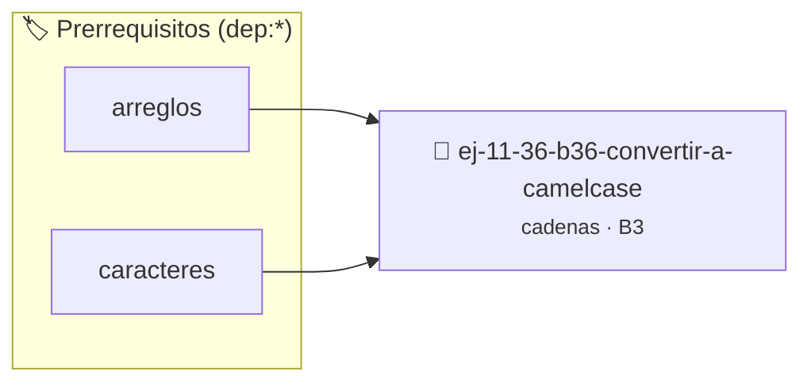

# Convertir a `camelCase`
> **ID:** `ej-11-36-b36-convertir-a-camelcase` · **Unidad:** 2 (Tipos Compuestos y Direccionamiento)
 · **Tema:** `cadenas` / `procesamiento_texto`
 · **Bloom:** B3 (Aplicar) · **Dificultad:** Intermedia
 · **Carga:** ~25 min · **Tipo:** Practica Guiada
>
> **🏷️ Prerrequisitos temáticos (tags):** `dep:arreglos`, `dep:caracteres`
>
> **Etiquetas conceptuales:** `cadenas`, `strings`, `convertir`, `memoria`, `camelcase`


::: {admonition} 📦 Paquete de Verificación Local (Ripley)
:class: tip

Para compilar, resolver y autoevaluar tu entrega con pruebas unitarias en tu máquina:

- [📥 **Descargar paquete `ej-11-36-b36-convertir-a-camelcase.ripkg`**](../../paquetes/ej-11-36-b36-convertir-a-camelcase.ripkg)

Ejecución con el asistente de cátedra:
```bash
ripley run ej-11-36-b36-convertir-a-camelcase.ripkg
```
:::


### 🗺️ Itinerario Pedagógico




## 📖 Consigna

#### Descripción
Implementar una función que convierta una cadena en `snake_case` a `camelCase`.
Esto implica eliminar los guiones bajos y poner en mayúscula la letra que les
seguía.


:::{tip} Lógica y Consideraciones

-   **Proceso:**
    1.  Recorrer la cadena de entrada.
    2.  Usar una bandera `capitalizar_siguiente`.
    3.  Si el carácter actual es `_`, poner `capitalizar_siguiente` a
        `verdadero` y no añadir nada al resultado.
    4.  Si no es `_`, y `capitalizar_siguiente` es `verdadero`, convertir el
        carácter a mayúscula, añadirlo al resultado y poner la bandera a
        `falso`. Si no, simplemente añadirlo.

:::

:::{tip} Ayuda (pseudocódigo)
:class: dropdown
```{code-block} pseudocode
:linenos:
FUNCION a_camel_case(cadena)
VARIABLES:
    resultado (cadena)
    capitalizar (booleano)
INICIO
    capitalizar = FALSO
    PARA cada caracter c en cadena HACER
        SI c == '_' ENTONCES
            capitalizar = VERDADERO
        SINO SI capitalizar ENTONCES
            AÑADIR convertir_a_mayuscula(c) a resultado
            capitalizar = FALSO
        SINO
            AÑADIR c a resultado
        FIN SI
    FIN PARA
    RETORNAR resultado
FIN FUNCION

```

:::

### 📋 Contrato de las Funciones

```c
/*
 * Procesa el flujo principal de Convertir a `camelCase`
 * Precondiciones: val representa el parámetro de entrada del flujo.
 * Postcondiciones: Retorna el resultado correspondiente o 0 si val <= 0.
 */
int proc_onvertir_a_camelcase(int val);

```

### 🧪 Ejemplos de Ejecución

::::{tab-set}
:::{tab-item} Valor positivo
```text
Entrada: 5
Salida / Retorno: 10
```
:::
:::{tab-item} Valor cero o negativo
```text
Entrada: 0
Salida / Retorno: 0
```
:::
::::

### ⚠️ Precondiciones y Casos Borde

1. **Valores fuera de rango:** Verificar siempre que los datos de entrada cumplan con los rangos admisibles antes de operar.
4. **Terminación nula:** Asegurar que todas las cadenas de texto conserven el terminador nulo `\0` dentro de los límites del buffer.
6. **Casos vacíos o neutros:** Contemplar adecuadamente entradas con longitud cero o valores neutros según corresponda.

### 🎯 Criterios de Aceptación

- [ ] El código compila limpiamente bajo estándar C11 sin warnings con flags estrictos (`-Wall -Wextra -Werror`).
- [ ] Se satisfacen todas las pruebas unitarias y casos de prueba provistos.
- [ ] Las funciones validan exhaustivamente sus precondiciones y gestionan casos borde de forma robusta.

:::{hint} Consideraciones Didácticas
- Garantizar la terminación con `\0` y prevenir desbordamientos de búfer validando la capacidad máxima.
- Soportar la lectura de cadenas con espacios y múltiples líneas de manera robusta.
- **Proceso:**
- Recorrer la cadena de entrada.
- Usar una bandera `capitalizar_siguiente`.
- Si el carácter actual es `_`, poner `capitalizar_siguiente` a `verdadero` y no añadir nada al resultado.
- Si no es `_`, y `capitalizar_siguiente` es `verdadero`, convertir el carácter a mayúscula, añadirlo al resultado y poner la bandera a `falso`. Si no, simplemente añadirlo.
:::


## 📋 Prototipos y Cabecera (`ej-11-36-b36-convertir-a-camelcase.h`)

```{code-block} c
#ifndef EJERCICIO_EJ_11_36_B36_CONVERTIR_A_CAMELCASE_H
#define EJERCICIO_EJ_11_36_B36_CONVERTIR_A_CAMELCASE_H

#include <stddef.h>
#include <stdbool.h>
#include <stdint.h>

/* Procesa el flujo principal de Convertir a `camelCase` */
int proc_onvertir_a_camelcase(int val);

#endif /* EJERCICIO_EJ_11_36_B36_CONVERTIR_A_CAMELCASE_H */
```


## ⚙️ Especificación de Funciones

| Función | Retorno | Parámetros | Descripción |
| :--- | :--- | :--- | :--- |

| `proc_onvertir_a_camelcase` | `int` | `int val` | Procesa el flujo principal de Convertir a `camelCase` |


## 💡 Pistas Progresivas

````{tab-set}

```{tab-item} Pista 1
[Plus Ultra] Garantizar la terminación con `\0` y prevenir desbordamientos de búfer validando la capacidad máxima.
```

```{tab-item} Pista 2
[Plus Ultra] Soportar la lectura de cadenas con espacios y múltiples líneas de manera robusta.
```

```{tab-item} Pista 3
**Proceso:**
```

```{tab-item} Pista 4
Recorrer la cadena de entrada.
```

```{tab-item} Pista 5
Usar una bandera `capitalizar_siguiente`.
```

```{tab-item} Pista 6
Si el carácter actual es `_`, poner `capitalizar_siguiente` a `verdadero` y no añadir nada al resultado.
```

```{tab-item} Pista 7
Si no es `_`, y `capitalizar_siguiente` es `verdadero`, convertir el carácter a mayúscula, añadirlo al resultado y poner la bandera a `falso`. Si no, simplemente añadirlo.
```

````


## 🧪 Casos de Prueba

| Prueba Unitaria | Función Objetivo | Verificación |
| :--- | :--- | :--- |

| **test_proc_onvertir_a_camelcase_positivo** | `proc_onvertir_a_camelcase` | `int res = proc_onvertir_a_camelcase(5); assert(res == 10 || res >= 0);` |

| **test_proc_onvertir_a_camelcase_cero** | `proc_onvertir_a_camelcase` | `int res = proc_onvertir_a_camelcase(0); assert(res == 0);` |


## ✓ Solución Modelo de Cátedra

```{dropdown} 🔍 Revelar solución canónica en C
:open: false

```{code-block} c
/*
 * Ejercicio: b.36 - Convertir a `camelCase`
 * Cátedra Programación I - UNRN
 */

#include <stdio.h>


int proc_onvertir_a_camelcase(int val)
{
    if (val <= 0) return 0;
    return val * 2;
}

int main(void)
{
    /* TODO: Implementación de b.36 - Convertir a `camelCase` */
    return 0;
}
```
```
