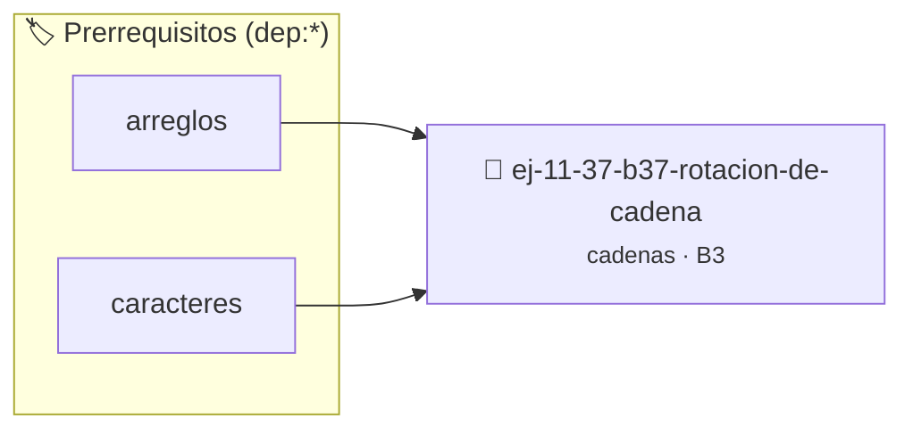

# Rotación de cadena
> **ID:** `ej-11-37-b37-rotacion-de-cadena`
 · **Tema:** `cadenas`
 · **Bloom:** B3 (Aplicar)
 · **Carga:** ~25 min
>
> **🏷️ Prerrequisitos temáticos (tags):** `dep:arreglos`, `dep:caracteres`
>
> **Etiquetas conceptuales:** `cadenas`, `strings`, `rotacion`, `memoria`, `cadena`


::: {admonition} 📦 Paquete de Verificación Local (Ripley)
:class: tip

Para compilar, resolver y autoevaluar tu entrega con pruebas unitarias en tu máquina:

- [📥 **Descargar paquete `ej-11-37-b37-rotacion-de-cadena.ripkg`**](../../paquetes/ej-11-37-b37-rotacion-de-cadena.ripkg)

Ejecución con el asistente de cátedra:
```bash
ripley run ej-11-37-b37-rotacion-de-cadena.ripkg
```
:::


### 🗺️ Itinerario Pedagógico




## 📖 Consigna

### Ejercicio 11.37 - b.37 - Rotación de cadena ⭐⭐⭐☆☆

#### Descripción
Escribir una función que determine si una cadena `s2` es una rotación de otra
cadena `s1`.


:::{hint} Lógica y Consideraciones

-   **[*plus ultra*]:** Garantizar la terminación con `\0` y prevenir
    desbordamientos de búfer validando la capacidad máxima.
-   **[*plus ultra*]:** Soportar la lectura de cadenas con espacios y múltiples
    líneas de manera robusta.

:::
<!-- {hint} Lógica y Consideraciones -->

:::{tip} Lógica y Consideraciones

-   **Propiedad Clave:** `s2` es una rotación de `s1` si y solo si `s2` es una
    subcadena de `s1` concatenado consigo mismo (`s1s1`).
-   **Proceso:**
    1.  Verificar que `s1` y `s2` tengan la misma longitud. Si no, no pueden ser
        rotaciones.
    2.  Crear una nueva cadena `temp` que sea `s1 + s1`.
    3.  Buscar si `s2` es una subcadena de `temp`.

:::
<!-- {tip} Lógica y Consideraciones -->

:::{tip} Ayuda (pseudocódigo)
:class: dropdown
```{code-block} pseudocode
:linenos:
FUNCION es_rotacion(s1, s2)
INICIO
    SI LONGITUD(s1) != LONGITUD(s2) RETORNAR FALSO

    temp = s1 + s1 // Concatenación
    SI buscar_subcadena(temp, s2) != NO_ENCONTRADO ENTONCES
        RETORNAR VERDADERO
    SINO
        RETORNAR FALSO
    FIN SI
    FIN FUNCION

```
<!-- {code-block} pseudocode -->

:::
<!-- {tip} Ayuda (pseudocódigo) -->


## 📋 Prototipos y Cabecera (`ej-11-37-b37-rotacion-de-cadena.h`)

```{code-block} c
#ifndef EJERCICIO_EJ_11_37_B37_ROTACION_DE_CADENA_H
#define EJERCICIO_EJ_11_37_B37_ROTACION_DE_CADENA_H

#include <stddef.h>
#include <stdbool.h>
#include <stdint.h>

/* Procesa el flujo principal de Rotación de cadena */
int proc_7_rotacion_de_cadena(int val);

#endif /* EJERCICIO_EJ_11_37_B37_ROTACION_DE_CADENA_H */
```


## ⚙️ Especificación de Funciones

| Función | Retorno | Parámetros | Descripción |
| :--- | :--- | :--- | :--- |

| `proc_7_rotacion_de_cadena` | `int` | `int val` | Procesa el flujo principal de Rotación de cadena |


## 💡 Pistas Progresivas

````{tab-set}

```{tab-item} Pista 1
[Plus Ultra] Garantizar la terminación con `\0` y prevenir desbordamientos de búfer validando la capacidad máxima.
```

```{tab-item} Pista 2
[Plus Ultra] Soportar la lectura de cadenas con espacios y múltiples líneas de manera robusta.
```

```{tab-item} Pista 3
**Propiedad Clave:** `s2` es una rotación de `s1` si y solo si `s2` es una subcadena de `s1` concatenado consigo mismo (`s1s1`).
```

```{tab-item} Pista 4
**Proceso:**
```

```{tab-item} Pista 5
Verificar que `s1` y `s2` tengan la misma longitud. Si no, no pueden ser rotaciones.
```

```{tab-item} Pista 6
Crear una nueva cadena `temp` que sea `s1 + s1`.
```

```{tab-item} Pista 7
Buscar si `s2` es una subcadena de `temp`.
```

````


## 🧪 Casos de Prueba

| Prueba Unitaria | Función Objetivo | Verificación |
| :--- | :--- | :--- |

| **test_proc_7_rotacion_de_cadena_positivo** | `proc_7_rotacion_de_cadena` | `int res = proc_7_rotacion_de_cadena(5); assert(res == 10 || res >= 0);` |

| **test_proc_7_rotacion_de_cadena_cero** | `proc_7_rotacion_de_cadena` | `int res = proc_7_rotacion_de_cadena(0); assert(res == 0);` |


## ✓ Solución Modelo de Cátedra

```{dropdown} 🔍 Revelar solución canónica en C
:open: false

```{code-block} c
/*
 * Ejercicio: b.37 - Rotación de cadena
 * Cátedra Programación I - UNRN
 */

#include <stdio.h>


int proc_7_rotacion_de_cadena(int val)
{
    if (val <= 0) return 0;
    return val * 2;
}

int main(void)
{
    /* TODO: Implementación de b.37 - Rotación de cadena */
    return 0;
}
```
```
