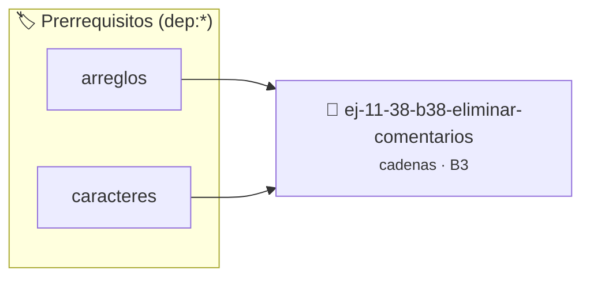

# Eliminar comentarios
> **ID:** `ej-11-38-b38-eliminar-comentarios` · **Unidad:** 2 (Tipos Compuestos y Direccionamiento)
 · **Tema:** `cadenas` / `procesamiento_texto`
 · **Bloom:** B3 (Aplicar) · **Dificultad:** Intermedia
 · **Carga:** ~25 min · **Tipo:** Practica Guiada
>
> **🏷️ Prerrequisitos temáticos (tags):** `dep:arreglos`, `dep:caracteres`
>
> **Etiquetas conceptuales:** `cadenas`, `strings`, `memoria`, `comentarios`, `eliminar`


::: {admonition} 📦 Paquete de Verificación Local (Ripley)
:class: tip

Para compilar, resolver y autoevaluar tu entrega con pruebas unitarias en tu máquina:

- [📥 **Descargar paquete `ej-11-38-b38-eliminar-comentarios.ripkg`**](../../paquetes/ej-11-38-b38-eliminar-comentarios.ripkg)

Ejecución con el asistente de cátedra:
```bash
ripley run ej-11-38-b38-eliminar-comentarios.ripkg
```
:::


### 🗺️ Itinerario Pedagógico




## 📖 Consigna

### Ejercicio 11.38 - b.38 - Eliminar comentarios ⭐⭐☆☆☆

#### Descripción
Crear una función que reciba una cadena (que puede representar una o más líneas
de código) y elimine los comentarios de estilo C (`//...` hasta el final de la
línea y `/*...*/` incluyendo el contenido).


:::{hint} Lógica y Consideraciones

-   **[*plus ultra*]:** Garantizar la terminación con `\0` y prevenir
    desbordamientos de búfer validando la capacidad máxima.
-   **[*plus ultra*]:** Soportar la lectura de cadenas con espacios y múltiples
    líneas de manera robusta.

:::
<!-- {hint} Lógica y Consideraciones -->

:::{tip} Lógica y Consideraciones

-   **Máquina de Estados:** Este problema se resuelve mejor con una máquina de
    estados para rastrear si el procesador está en modo `NORMAL`,
    `DENTRO_DE_COMENTARIO_LINEA`, o `DENTRO_DE_COMENTARIO_BLOQUE`.

:::
<!-- {tip} Lógica y Consideraciones -->

:::{tip} Ayuda (pseudocódigo)
:class: dropdown
```{code-block} pseudocode
:linenos:
FUNCION eliminar_comentarios(codigo)
VARIABLES:
    resultado (cadena)
    estado (entero)
INICIO
    estado = NORMAL
    PARA i DESDE 0 HASTA LONGITUD(codigo)-1 HACER
        SI estado == NORMAL Y codigo[i] == '/' Y codigo[i+1] == '/' ENTONCES
            estado = DENTRO_DE_COMENTARIO_LINEA
        SINO SI estado == NORMAL Y codigo[i] == '/' Y codigo[i+1] == '*' ENTONCES
            estado = DENTRO_DE_COMENTARIO_BLOQUE
        SINO SI estado == DENTRO_DE_COMENTARIO_LINEA Y codigo[i] == '\n' ENTONCES
            estado = NORMAL
            AÑADIR '\n' a resultado
        SINO SI estado == DENTRO_DE_COMENTARIO_BLOQUE Y codigo[i] == '*' Y codigo[i+1] == '/' ENTONCES
            estado = NORMAL
            i++ // Saltar el '/'
        SINO SI estado == NORMAL ENTONCES
            AÑADIR codigo[i] a resultado
        FIN SI
    FIN PARA
    RETORNAR resultado
FIN FUNCION

```
<!-- {code-block} pseudocode -->

:::
<!-- {tip} Ayuda (pseudocódigo) -->


## 📋 Prototipos y Cabecera (`ej-11-38-b38-eliminar-comentarios.h`)

```{code-block} c
#ifndef EJERCICIO_EJ_11_38_B38_ELIMINAR_COMENTARIOS_H
#define EJERCICIO_EJ_11_38_B38_ELIMINAR_COMENTARIOS_H

#include <stddef.h>
#include <stdbool.h>
#include <stdint.h>

/* Procesa el flujo principal de Eliminar comentarios */
int proc_eliminar_comentarios(int val);

#endif /* EJERCICIO_EJ_11_38_B38_ELIMINAR_COMENTARIOS_H */
```


## ⚙️ Especificación de Funciones

| Función | Retorno | Parámetros | Descripción |
| :--- | :--- | :--- | :--- |

| `proc_eliminar_comentarios` | `int` | `int val` | Procesa el flujo principal de Eliminar comentarios |


## 💡 Pistas Progresivas

````{tab-set}

```{tab-item} Pista 1
[Plus Ultra] Garantizar la terminación con `\0` y prevenir desbordamientos de búfer validando la capacidad máxima.
```

```{tab-item} Pista 2
[Plus Ultra] Soportar la lectura de cadenas con espacios y múltiples líneas de manera robusta.
```

```{tab-item} Pista 3
**Máquina de Estados:** Este problema se resuelve mejor con una máquina de estados para rastrear si el procesador está en modo `NORMAL`, `DENTRO_DE_COMENTARIO_LINEA`, o `DENTRO_DE_COMENTARIO_BLOQUE`.
```

````


## 🧪 Casos de Prueba

| Prueba Unitaria | Función Objetivo | Verificación |
| :--- | :--- | :--- |

| **test_proc_eliminar_comentarios_positivo** | `proc_eliminar_comentarios` | `int res = proc_eliminar_comentarios(5); assert(res == 10 || res >= 0);` |

| **test_proc_eliminar_comentarios_cero** | `proc_eliminar_comentarios` | `int res = proc_eliminar_comentarios(0); assert(res == 0);` |


## ✓ Solución Modelo de Cátedra

```{dropdown} 🔍 Revelar solución canónica en C
:open: false

```{code-block} c
/*
 * Ejercicio: b.38 - Eliminar comentarios
 * Cátedra Programación I - UNRN
 */

#include <stdio.h>


int proc_eliminar_comentarios(int val)
{
    if (val <= 0) return 0;
    return val * 2;
}

int main(void)
{
    /* TODO: Implementación de b.38 - Eliminar comentarios */
    return 0;
}
```
```
