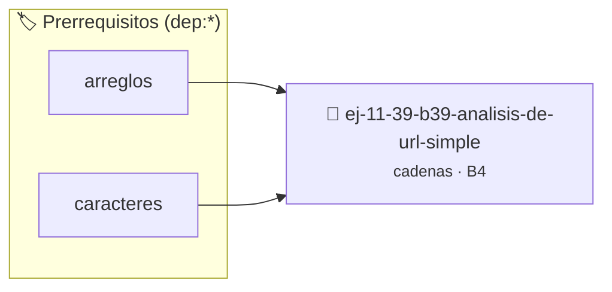

# Análisis de URL simple
> **ID:** `ej-11-39-b39-analisis-de-url-simple` · **Unidad:** 2 (Tipos Compuestos y Direccionamiento)
 · **Tema:** `cadenas` / `procesamiento_texto`
 · **Bloom:** B4 (Analizar) · **Dificultad:** Avanzada
 · **Carga:** ~35 min · **Tipo:** Practica Guiada
>
> **🏷️ Prerrequisitos temáticos (tags):** `dep:arreglos`, `dep:caracteres`
>
> **Etiquetas conceptuales:** `cadenas`, `strings`, `analisis`, `memoria`, `simple`


::: {admonition} 📦 Paquete de Verificación Local (Ripley)
:class: tip

Para compilar, resolver y autoevaluar tu entrega con pruebas unitarias en tu máquina:

- [📥 **Descargar paquete `ej-11-39-b39-analisis-de-url-simple.ripkg`**](../../paquetes/ej-11-39-b39-analisis-de-url-simple.ripkg)

Ejecución con el asistente de cátedra:
```bash
ripley run ej-11-39-b39-analisis-de-url-simple.ripkg
```
:::


### 🗺️ Itinerario Pedagógico




## 📖 Consigna

### Ejercicio 11.39 - b.39 - Análisis de URL simple ⭐☆☆☆☆

#### Descripción
Dada una URL en formato de cadena, escribir una función que la analice y
extraiga sus componentes principales: protocolo, host y ruta.


:::{hint} Lógica y Consideraciones

-   **[*plus ultra*]:** Garantizar la terminación con `\0` y prevenir
    desbordamientos de búfer validando la capacidad máxima.
-   **[*plus ultra*]:** Soportar la lectura de cadenas con espacios y múltiples
    líneas de manera robusta.

:::
<!-- {hint} Lógica y Consideraciones -->

:::{tip} Lógica y Consideraciones

-   **Proceso:** Usar funciones de búsqueda de caracteres (`:`, `/`) para
    encontrar los delimitadores y luego extraer las subcadenas correspondientes.

:::
<!-- {tip} Lógica y Consideraciones -->

:::{tip} Ayuda (pseudocódigo)
:class: dropdown
```{code-block} pseudocode
:linenos:
PROCEDIMIENTO analizar_url(url, REF protocolo, REF host, REF ruta)
VARIABLES:
    pos_protocolo, pos_host_inicio, pos_ruta_inicio (enteros)
INICIO
    pos_protocolo = encontrar_caracter(url, ':')
    protocolo = extraer_subcadena(url, 0, pos_protocolo)

    // ... lógica similar para host y ruta ...
FIN PROCEDIMIENTO

```
<!-- {code-block} pseudocode -->

:::
<!-- {tip} Ayuda (pseudocódigo) -->


## 📋 Prototipos y Cabecera (`ej-11-39-b39-analisis-de-url-simple.h`)

```{code-block} c
#ifndef EJERCICIO_EJ_11_39_B39_ANALISIS_DE_URL_SIMPLE_H
#define EJERCICIO_EJ_11_39_B39_ANALISIS_DE_URL_SIMPLE_H

#include <stddef.h>
#include <stdbool.h>
#include <stdint.h>

/* Procesa el flujo principal de Análisis de URL simple */
int proc_alisis_de_url_simple(int val);

#endif /* EJERCICIO_EJ_11_39_B39_ANALISIS_DE_URL_SIMPLE_H */
```


## ⚙️ Especificación de Funciones

| Función | Retorno | Parámetros | Descripción |
| :--- | :--- | :--- | :--- |

| `proc_alisis_de_url_simple` | `int` | `int val` | Procesa el flujo principal de Análisis de URL simple |


## 💡 Pistas Progresivas

````{tab-set}

```{tab-item} Pista 1
[Plus Ultra] Garantizar la terminación con `\0` y prevenir desbordamientos de búfer validando la capacidad máxima.
```

```{tab-item} Pista 2
[Plus Ultra] Soportar la lectura de cadenas con espacios y múltiples líneas de manera robusta.
```

```{tab-item} Pista 3
**Proceso:** Usar funciones de búsqueda de caracteres (`:`, `/`) para encontrar los delimitadores y luego extraer las subcadenas correspondientes.
```

````


## 🧪 Casos de Prueba

| Prueba Unitaria | Función Objetivo | Verificación |
| :--- | :--- | :--- |

| **test_proc_alisis_de_url_simple_positivo** | `proc_alisis_de_url_simple` | `int res = proc_alisis_de_url_simple(5); assert(res == 10 || res >= 0);` |

| **test_proc_alisis_de_url_simple_cero** | `proc_alisis_de_url_simple` | `int res = proc_alisis_de_url_simple(0); assert(res == 0);` |


## ✓ Solución Modelo de Cátedra

```{dropdown} 🔍 Revelar solución canónica en C
:open: false

```{code-block} c
/*
 * Ejercicio: b.39 - Análisis de URL simple
 * Cátedra Programación I - UNRN
 */

#include <stdio.h>


int proc_alisis_de_url_simple(int val)
{
    if (val <= 0) return 0;
    return val * 2;
}

int main(void)
{
    /* TODO: Implementación de b.39 - Análisis de URL simple */
    return 0;
}
```
```
