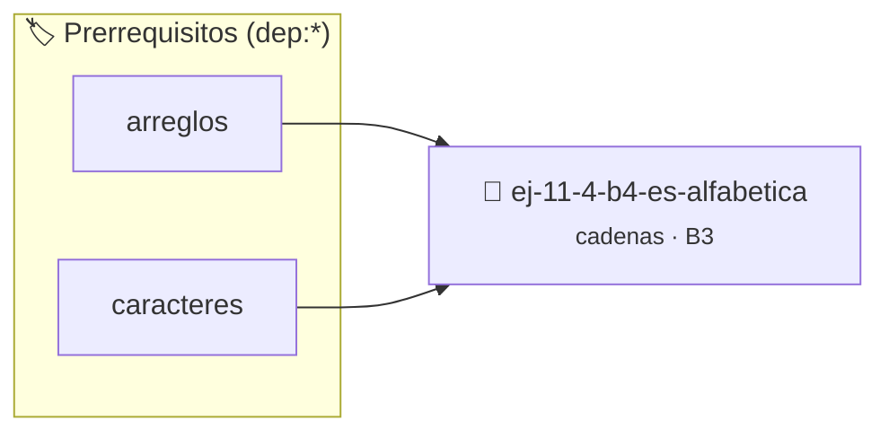

# ¿Es alfabética?
> **ID:** `ej-11-4-b4-es-alfabetica` · **Unidad:** 2 (Tipos Compuestos y Direccionamiento)
 · **Tema:** `cadenas` / `procesamiento_texto`
 · **Bloom:** B3 (Aplicar) · **Dificultad:** Intermedia
 · **Carga:** ~25 min · **Tipo:** Practica Guiada
>
> **🏷️ Prerrequisitos temáticos (tags):** `dep:arreglos`, `dep:caracteres`
>
> **Etiquetas conceptuales:** `cadenas`, `alfabetica`, `strings`, `memoria`


::: {admonition} 📦 Paquete de Verificación Local (Ripley)
:class: tip

Para compilar, resolver y autoevaluar tu entrega con pruebas unitarias en tu máquina:

- [📥 **Descargar paquete `ej-11-4-b4-es-alfabetica.ripkg`**](../../paquetes/ej-11-4-b4-es-alfabetica.ripkg)

Ejecución con el asistente de cátedra:
```bash
ripley run ej-11-4-b4-es-alfabetica.ripkg
```
:::


### 🗺️ Itinerario Pedagógico




## 📖 Consigna

### Ejercicio 11.4 - b.4 - ¿Es alfabética? ⭐⭐☆☆☆

#### Descripción
Crear una función que determine si una cadena contiene únicamente caracteres
alfabéticos (de la 'a' a la 'z', mayúsculas o minúsculas).


:::{hint} Lógica y Consideraciones

-   **[*plus ultra*]:** Garantizar la terminación con `\0` y prevenir
    desbordamientos de búfer validando la capacidad máxima.
-   **[*plus ultra*]:** Soportar la lectura de cadenas con espacios y múltiples
    líneas de manera robusta.

:::
<!-- {hint} Lógica y Consideraciones -->

:::{tip} Lógica y Consideraciones

-   **Proceso:** Recorrer la cadena. Para cada carácter, verificar si está
    dentro del rango de 'a' a 'z' o de 'A' a 'Z'.
-   **Funciones de Biblioteca:** La biblioteca `ctype.h` proporciona la función
    `isalpha()`, que simplifica enormemente esta comprobación.
-   **Condición de Salida:** Si se encuentra un carácter que no es alfabético,
    la función puede retornar `falso` inmediatamente. Si el lazo termina,
    significa que todos los caracteres son alfabéticos.

:::
<!-- {tip} Lógica y Consideraciones -->

:::{tip} Ayuda (pseudocódigo)
:class: dropdown
```{code-block} pseudocode
:linenos:
FUNCION es_alfabetica(cadena)
INICIO
    PARA cada caracter c en cadena HACER
        SI NO es_letra(c) ENTONCES
            RETORNAR FALSO
        FIN SI
    FIN PARA
    RETORNAR VERDADERO
FIN FUNCION

```
<!-- {code-block} pseudocode -->

:::
<!-- {tip} Ayuda (pseudocódigo) -->

## Propiedades de Cadenas


## 📋 Prototipos y Cabecera (`ej-11-4-b4-es-alfabetica.h`)

```{code-block} c
#ifndef EJERCICIO_EJ_11_4_B4_ES_ALFABETICA_H
#define EJERCICIO_EJ_11_4_B4_ES_ALFABETICA_H

#include <stddef.h>
#include <stdbool.h>
#include <stdint.h>

/* Procesa el flujo principal de ¿Es alfabética? */
int proc_1_4_b4_es_alfabetica(int val);

#endif /* EJERCICIO_EJ_11_4_B4_ES_ALFABETICA_H */
```


## ⚙️ Especificación de Funciones

| Función | Retorno | Parámetros | Descripción |
| :--- | :--- | :--- | :--- |

| `proc_1_4_b4_es_alfabetica` | `int` | `int val` | Procesa el flujo principal de ¿Es alfabética? |


## 💡 Pistas Progresivas

````{tab-set}

```{tab-item} Pista 1
[Plus Ultra] Garantizar la terminación con `\0` y prevenir desbordamientos de búfer validando la capacidad máxima.
```

```{tab-item} Pista 2
[Plus Ultra] Soportar la lectura de cadenas con espacios y múltiples líneas de manera robusta.
```

```{tab-item} Pista 3
**Proceso:** Recorrer la cadena. Para cada carácter, verificar si está dentro del rango de 'a' a 'z' o de 'A' a 'Z'.
```

```{tab-item} Pista 4
**Funciones de Biblioteca:** La biblioteca `ctype.h` proporciona la función `isalpha()`, que simplifica enormemente esta comprobación.
```

```{tab-item} Pista 5
**Condición de Salida:** Si se encuentra un carácter que no es alfabético, la función puede retornar `falso` inmediatamente. Si el lazo termina, significa que todos los caracteres son alfabéticos.
```

````


## 🧪 Casos de Prueba

| Prueba Unitaria | Función Objetivo | Verificación |
| :--- | :--- | :--- |

| **test_proc_1_4_b4_es_alfabetica_positivo** | `proc_1_4_b4_es_alfabetica` | `int res = proc_1_4_b4_es_alfabetica(5); assert(res == 10 || res >= 0);` |

| **test_proc_1_4_b4_es_alfabetica_cero** | `proc_1_4_b4_es_alfabetica` | `int res = proc_1_4_b4_es_alfabetica(0); assert(res == 0);` |


## ✓ Solución Modelo de Cátedra

```{dropdown} 🔍 Revelar solución canónica en C
:open: false

```{code-block} c
/*
 * Ejercicio: b.4 - ¿Es alfabética?
 * Cátedra Programación I - UNRN
 */

#include <stdio.h>


int proc_1_4_b4_es_alfabetica(int val)
{
    if (val <= 0) return 0;
    return val * 2;
}

int main(void)
{
    /* TODO: Implementación de b.4 - ¿Es alfabética? */
    return 0;
}
```
```
