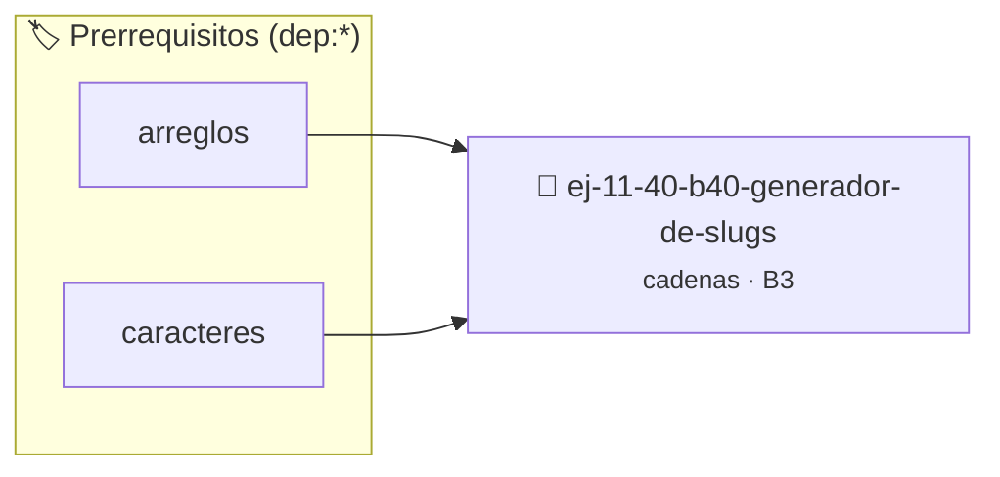

# Generador de "Slugs"
> **ID:** `ej-11-40-b40-generador-de-slugs`
 · **Tema:** `cadenas`
 · **Bloom:** B3 (Aplicar)
 · **Carga:** ~25 min
>
> **🏷️ Prerrequisitos temáticos (tags):** `dep:arreglos`, `dep:caracteres`
>
> **Etiquetas conceptuales:** `cadenas`, `strings`, `slugs`, `memoria`, `generador`


::: {admonition} 📦 Paquete de Verificación Local (Ripley)
:class: tip

Para compilar, resolver y autoevaluar tu entrega con pruebas unitarias en tu máquina:

- [📥 **Descargar paquete `ej-11-40-b40-generador-de-slugs.ripkg`**](../../paquetes/ej-11-40-b40-generador-de-slugs.ripkg)

Ejecución con el asistente de cátedra:
```bash
ripley run ej-11-40-b40-generador-de-slugs.ripkg
```
:::


### 🗺️ Itinerario Pedagógico




## 📖 Consigna

### Ejercicio 11.40 - b.40 - Generador de "Slugs" ⭐⭐☆☆☆

#### Descripción
Un "slug" es una versión de una cadena amigable para URLs. Escribir una función
que convierta un título en un slug: debe estar en minúsculas, los espacios deben
ser reemplazados por guiones y se deben eliminar todos los caracteres no
alfanuméricos.


:::{hint} Lógica y Consideraciones

-   **[*plus ultra*]:** Garantizar la terminación con `\0` y prevenir
    desbordamientos de búfer validando la capacidad máxima.
-   **[*plus ultra*]:** Soportar la lectura de cadenas con espacios y múltiples
    líneas de manera robusta.

:::
<!-- {hint} Lógica y Consideraciones -->

:::{tip} Lógica y Consideraciones

-   **Proceso:**
    1.  Recorrer la cadena de entrada.
    2.  Para cada carácter, convertirlo a minúscula.
    3.  Si es una letra o un número, añadirlo a la cadena de resultado.
    4.  Si es un espacio, y el último carácter añadido al resultado no fue un
        guion, añadir un guion.
    5.  Ignorar todos los demás caracteres.

:::
<!-- {tip} Lógica y Consideraciones -->

:::{tip} Ayuda (pseudocódigo)
:class: dropdown
```{code-block} pseudocode
:linenos:
FUNCION generar_slug(titulo)
VARIABLES:
    slug (cadena)
INICIO
    PARA cada caracter c en titulo HACER
        c_min = convertir_a_minuscula(c)
        SI es_alfanumerico(c_min) ENTONCES
            AÑADIR c_min a slug
        SINO SI es_espacio(c_min) Y ultimo_char(slug) != '-' ENTONCES
            AÑADIR '-' a slug
        FIN SI
    FIN PARA
    RETORNAR slug
FIN FUNCION

```
<!-- {code-block} pseudocode -->

:::
<!-- {tip} Ayuda (pseudocódigo) -->


## 📋 Prototipos y Cabecera (`ej-11-40-b40-generador-de-slugs.h`)

```{code-block} c
#ifndef EJERCICIO_EJ_11_40_B40_GENERADOR_DE_SLUGS_H
#define EJERCICIO_EJ_11_40_B40_GENERADOR_DE_SLUGS_H

#include <stddef.h>
#include <stdbool.h>
#include <stdint.h>

/* Procesa el flujo principal de Generador de "Slugs" */
int proc_0_generador_de_slugs(int val);

#endif /* EJERCICIO_EJ_11_40_B40_GENERADOR_DE_SLUGS_H */
```


## ⚙️ Especificación de Funciones

| Función | Retorno | Parámetros | Descripción |
| :--- | :--- | :--- | :--- |

| `proc_0_generador_de_slugs` | `int` | `int val` | Procesa el flujo principal de Generador de "Slugs" |


## 💡 Pistas Progresivas

````{tab-set}

```{tab-item} Pista 1
[Plus Ultra] Garantizar la terminación con `\0` y prevenir desbordamientos de búfer validando la capacidad máxima.
```

```{tab-item} Pista 2
[Plus Ultra] Soportar la lectura de cadenas con espacios y múltiples líneas de manera robusta.
```

```{tab-item} Pista 3
**Proceso:**
```

```{tab-item} Pista 4
Recorrer la cadena de entrada.
```

```{tab-item} Pista 5
Para cada carácter, convertirlo a minúscula.
```

```{tab-item} Pista 6
Si es una letra o un número, añadirlo a la cadena de resultado.
```

```{tab-item} Pista 7
Si es un espacio, y el último carácter añadido al resultado no fue un guion, añadir un guion.
```

```{tab-item} Pista 8
Ignorar todos los demás caracteres.
```

````


## 🧪 Casos de Prueba

| Prueba Unitaria | Función Objetivo | Verificación |
| :--- | :--- | :--- |

| **test_proc_0_generador_de_slugs_positivo** | `proc_0_generador_de_slugs` | `int res = proc_0_generador_de_slugs(5); assert(res == 10 || res >= 0);` |

| **test_proc_0_generador_de_slugs_cero** | `proc_0_generador_de_slugs` | `int res = proc_0_generador_de_slugs(0); assert(res == 0);` |


## ✓ Solución Modelo de Cátedra

```{dropdown} 🔍 Revelar solución canónica en C
:open: false

```{code-block} c
/*
 * Ejercicio: b.40 - Generador de "Slugs"
 * Cátedra Programación I - UNRN
 */

#include <stdio.h>


int proc_0_generador_de_slugs(int val)
{
    if (val <= 0) return 0;
    return val * 2;
}

int main(void)
{
    /* TODO: Implementación de b.40 - Generador de "Slugs" */
    return 0;
}
```
```
