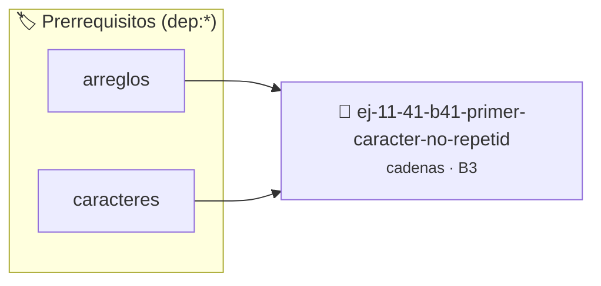

# Primer carácter no repetido
> **ID:** `ej-11-41-b41-primer-caracter-no-repetid` · **Unidad:** 2 (Tipos Compuestos y Direccionamiento)
 · **Tema:** `cadenas` / `procesamiento_texto`
 · **Bloom:** B3 (Aplicar) · **Dificultad:** Intermedia
 · **Carga:** ~25 min · **Tipo:** Practica Guiada
>
> **🏷️ Prerrequisitos temáticos (tags):** `dep:arreglos`, `dep:caracteres`
>
> **Etiquetas conceptuales:** `cadenas`, `caracter`, `strings`, `memoria`, `primer`


::: {admonition} 📦 Paquete de Verificación Local (Ripley)
:class: tip

Para compilar, resolver y autoevaluar tu entrega con pruebas unitarias en tu máquina:

- [📥 **Descargar paquete `ej-11-41-b41-primer-caracter-no-repetid.ripkg`**](../../paquetes/ej-11-41-b41-primer-caracter-no-repetid.ripkg)

Ejecución con el asistente de cátedra:
```bash
ripley run ej-11-41-b41-primer-caracter-no-repetid.ripkg
```
:::


### 🗺️ Itinerario Pedagógico




## 📖 Consigna

### Ejercicio 11.41 - b.41 - Primer carácter no repetido ⭐⭐☆☆☆

#### Descripción
Implementar una función que encuentre y devuelva el primer carácter en una
cadena que no se repite en el resto de la cadena.


:::{hint} Lógica y Consideraciones

-   **[*plus ultra*]:** Garantizar la terminación con `\0` y prevenir
    desbordamientos de búfer validando la capacidad máxima.
-   **[*plus ultra*]:** Soportar la lectura de cadenas con espacios y múltiples
    líneas de manera robusta.

:::
<!-- {hint} Lógica y Consideraciones -->

:::{tip} Lógica y Consideraciones

-   **Proceso (dos pasadas):**
    1.  **Primera pasada:** Usar un arreglo de frecuencias para contar las
        apariciones de cada carácter (como en el ejercicio 1.2).
    2.  **Segunda pasada:** Recorrer la cadena de entrada original. El primer
        carácter para el cual su contador en el arreglo de frecuencias sea 1, es
        el resultado.

:::
<!-- {tip} Lógica y Consideraciones -->

:::{tip} Ayuda (pseudocódigo)
:class: dropdown
```{code-block} pseudocode
:linenos:
FUNCION primer_no_repetido(cadena)
VARIABLES:
    frecuencias (arreglo de 256 enteros)
INICIO
    // ... llenar arreglo de frecuencias ...

    PARA cada caracter c en cadena HACER
        SI frecuencias[CODIGO_ASCII(c)] == 1 ENTONCES
            RETORNAR c
        FIN SI
    FIN PARA

    RETORNAR CARACTER_NULO // No se encontró ninguno
FIN FUNCION

```
<!-- {code-block} pseudocode -->

:::
<!-- {tip} Ayuda (pseudocódigo) -->


## 📋 Prototipos y Cabecera (`ej-11-41-b41-primer-caracter-no-repetid.h`)

```{code-block} c
#ifndef EJERCICIO_EJ_11_41_B41_PRIMER_CARACTER_NO_REPETID_H
#define EJERCICIO_EJ_11_41_B41_PRIMER_CARACTER_NO_REPETID_H

#include <stddef.h>
#include <stdbool.h>
#include <stdint.h>

/* Procesa el flujo principal de Primer carácter no repetido */
int proc__caracter_no_repetid(int val);

#endif /* EJERCICIO_EJ_11_41_B41_PRIMER_CARACTER_NO_REPETID_H */
```


## ⚙️ Especificación de Funciones

| Función | Retorno | Parámetros | Descripción |
| :--- | :--- | :--- | :--- |

| `proc__caracter_no_repetid` | `int` | `int val` | Procesa el flujo principal de Primer carácter no repetido |


## 💡 Pistas Progresivas

````{tab-set}

```{tab-item} Pista 1
[Plus Ultra] Garantizar la terminación con `\0` y prevenir desbordamientos de búfer validando la capacidad máxima.
```

```{tab-item} Pista 2
[Plus Ultra] Soportar la lectura de cadenas con espacios y múltiples líneas de manera robusta.
```

```{tab-item} Pista 3
**Proceso (dos pasadas):**
```

```{tab-item} Pista 4
**Primera pasada:** Usar un arreglo de frecuencias para contar las apariciones de cada carácter (como en el ejercicio 1.2).
```

```{tab-item} Pista 5
**Segunda pasada:** Recorrer la cadena de entrada original. El primer carácter para el cual su contador en el arreglo de frecuencias sea 1, es el resultado.
```

````


## 🧪 Casos de Prueba

| Prueba Unitaria | Función Objetivo | Verificación |
| :--- | :--- | :--- |

| **test_proc__caracter_no_repetid_positivo** | `proc__caracter_no_repetid` | `int res = proc__caracter_no_repetid(5); assert(res == 10 || res >= 0);` |

| **test_proc__caracter_no_repetid_cero** | `proc__caracter_no_repetid` | `int res = proc__caracter_no_repetid(0); assert(res == 0);` |


## ✓ Solución Modelo de Cátedra

```{dropdown} 🔍 Revelar solución canónica en C
:open: false

```{code-block} c
/*
 * Ejercicio: b.41 - Primer carácter no repetido
 * Cátedra Programación I - UNRN
 */

#include <stdio.h>


int proc__caracter_no_repetid(int val)
{
    if (val <= 0) return 0;
    return val * 2;
}

int main(void)
{
    /* TODO: Implementación de b.41 - Primer carácter no repetido */
    return 0;
}
```
```
