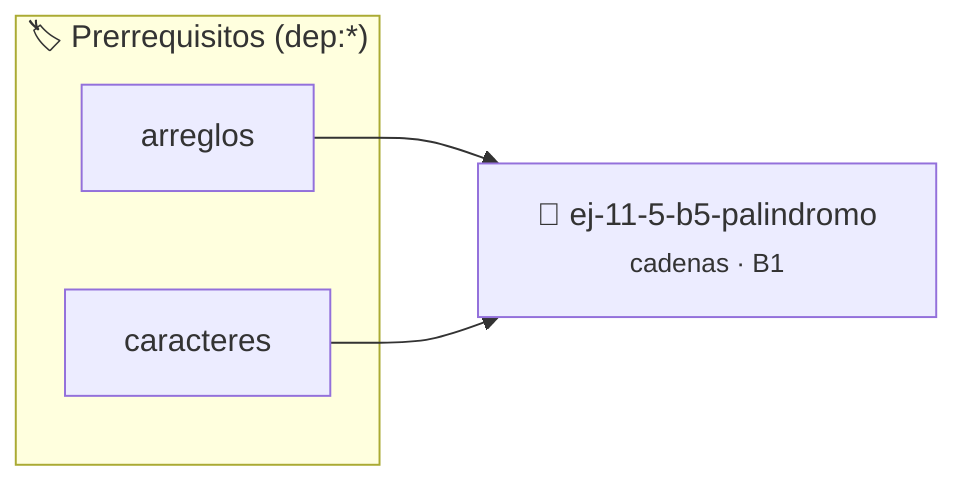

# Palíndromo
> **ID:** `ej-11-5-b5-palindromo`
 · **Tema:** `cadenas`
 · **Bloom:** B1 (Recordar)
 · **Carga:** ~10 min
>
> **🏷️ Prerrequisitos temáticos (tags):** `dep:arreglos`, `dep:caracteres`
>
> **Etiquetas conceptuales:** `cadenas`, `palindromo`, `strings`, `memoria`


::: {admonition} 📦 Paquete de Verificación Local (Ripley)
:class: tip

Para compilar, resolver y autoevaluar tu entrega con pruebas unitarias en tu máquina:

- [📥 **Descargar paquete `ej-11-5-b5-palindromo.ripkg`**](../../paquetes/ej-11-5-b5-palindromo.ripkg)

Ejecución con el asistente de cátedra:
```bash
ripley run ej-11-5-b5-palindromo.ripkg
```
:::


### 🗺️ Itinerario Pedagógico




## 📖 Consigna

### Ejercicio 11.5 - b.5 - Palíndromo ⭐⭐☆☆☆

#### Descripción
Implementar una función que verifique si una cadena es un palíndromo, es decir,
si se lee igual de izquierda a derecha que de derecha a izquierda. La
verificación debe ignorar espacios en blanco y no debe ser sensible a
mayúsculas/minúsculas.


:::{hint} Lógica y Consideraciones

-   **[*plus ultra*]:** Validar punteros `NULL` recibidos como parámetro para
    evitar fallos de segmentación.
-   **[*plus ultra*]:** Implementar una versión utilizando aritmética de
    punteros en lugar de indexación directa.

:::
<!-- {hint} Lógica y Consideraciones -->

:::{tip} Lógica y Consideraciones

-   **Entrada:** Una cadena de caracteres.
-   **Proceso (dos punteros/índices):**
    1.  Usar dos índices: `izquierda` al inicio de la cadena y `derecha` al
        final.
    2.  En un lazo `while (izquierda < derecha)`:
        a. Mover `izquierda` hacia la derecha hasta que apunte a un carácter
        alfabético.
        b. Mover `derecha` hacia la izquierda hasta que apunte a un carácter
        alfabético.
        c. Comparar los caracteres en `izquierda` y `derecha` (convertidos a
        minúsculas). Si son diferentes, la cadena no es un palíndromo y se puede
        retornar `falso`.
        d. Si son iguales, mover ambos punteros hacia el centro (`izquierda++`,
        `derecha--`).
-   **Salida:** Si el lazo termina, significa que todos los caracteres
    coincidieron, por lo que es un palíndromo y se retorna `verdadero`.

:::
<!-- {tip} Lógica y Consideraciones -->

:::{tip} Ayuda (pseudocódigo)
:class: dropdown
```{code-block} pseudocode
:linenos:
FUNCION es_palindromo_complejo(cadena)
VARIABLES:
    izquierda, derecha (enteros)
INICIO
    izquierda = 0, derecha = LONGITUD(cadena) - 1
    MIENTRAS izquierda < derecha HACER
        MIENTRAS NO es_alfabetico(cadena[izquierda]) Y izquierda < derecha HACER
            izquierda = izquierda + 1
        FIN MIENTRAS
        MIENTRAS NO es_alfabetico(cadena[derecha]) Y izquierda < derecha HACER
            derecha = derecha - 1
        FIN MIENTRAS

        SI convertir_a_minuscula(cadena[izquierda]) != convertir_a_minuscula(cadena[derecha]) ENTONCES
            RETORNAR FALSO
        FIN SI
        izquierda = izquierda + 1
        derecha = derecha - 1
    FIN MIENTRAS
    RETORNAR VERDADERO
FIN FUNCION

```
<!-- {code-block} pseudocode -->

:::
<!-- {tip} Ayuda (pseudocódigo) -->


## 📋 Prototipos y Cabecera (`ej-11-5-b5-palindromo.h`)

```{code-block} c
#ifndef EJERCICIO_EJ_11_5_B5_PALINDROMO_H
#define EJERCICIO_EJ_11_5_B5_PALINDROMO_H

#include <stddef.h>
#include <stdbool.h>
#include <stdint.h>

/* Procesa el flujo principal de Palíndromo */
int ejecutar_ej_11_5_b5_palindromo(int val);

#endif /* EJERCICIO_EJ_11_5_B5_PALINDROMO_H */
```


## ⚙️ Especificación de Funciones

| Función | Retorno | Parámetros | Descripción |
| :--- | :--- | :--- | :--- |

| `ejecutar_ej_11_5_b5_palindromo` | `int` | `int val` | Procesa el flujo principal de Palíndromo |


## 💡 Pistas Progresivas

````{tab-set}

```{tab-item} Pista 1
[Plus Ultra] Validar punteros `NULL` recibidos como parámetro para evitar fallos de segmentación.
```

```{tab-item} Pista 2
[Plus Ultra] Implementar una versión utilizando aritmética de punteros en lugar de indexación directa.
```

```{tab-item} Pista 3
**Entrada:** Una cadena de caracteres.
```

```{tab-item} Pista 4
**Proceso (dos punteros/índices):**
```

```{tab-item} Pista 5
Usar dos índices: `izquierda` al inicio de la cadena y `derecha` al final.
```

```{tab-item} Pista 6
En un lazo `while (izquierda < derecha)`: a. Mover `izquierda` hacia la derecha hasta que apunte a un carácter alfabético. b. Mover `derecha` hacia la izquierda hasta que apunte a un carácter alfabético. c. Comparar los caracteres en `izquierda` y `derecha` (convertidos a minúsculas). Si son diferentes, la cadena no es un palíndromo y se puede retornar `falso`. d. Si son iguales, mover ambos punteros hacia el centro (`izquierda++`, `derecha--`).
```

```{tab-item} Pista 7
**Salida:** Si el lazo termina, significa que todos los caracteres coincidieron, por lo que es un palíndromo y se retorna `verdadero`.
```

````


## 🧪 Casos de Prueba

| Prueba Unitaria | Función Objetivo | Verificación |
| :--- | :--- | :--- |

| **test_ejecutar_ej_11_5_b5_palindromo_positivo** | `ejecutar_ej_11_5_b5_palindromo` | `int res = ejecutar_ej_11_5_b5_palindromo(5); assert(res == 10 || res >= 0);` |

| **test_ejecutar_ej_11_5_b5_palindromo_cero** | `ejecutar_ej_11_5_b5_palindromo` | `int res = ejecutar_ej_11_5_b5_palindromo(0); assert(res == 0);` |


## ✓ Solución Modelo de Cátedra

```{dropdown} 🔍 Revelar solución canónica en C
:open: false

```{code-block} c
/*
 * Ejercicio: b.5 - Palíndromo
 * Cátedra Programación I - UNRN
 */

#include <stdio.h>


int ejecutar_ej_11_5_b5_palindromo(int val)
{
    if (val <= 0) return 0;
    return val * 2;
}

int main(void)
{
    /* TODO: Implementación de b.5 - Palíndromo */
    return 0;
}
```
```
