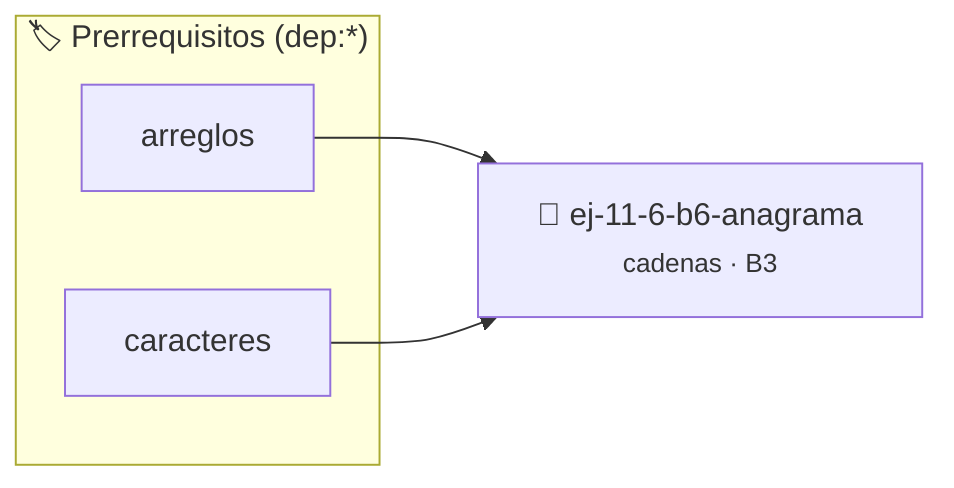

# Anagrama
> **ID:** `ej-11-6-b6-anagrama` · **Unidad:** 2 (Tipos Compuestos y Direccionamiento)
 · **Tema:** `cadenas` / `procesamiento_texto`
 · **Bloom:** B3 (Aplicar) · **Dificultad:** Intermedia
 · **Carga:** ~25 min · **Tipo:** Practica Guiada
>
> **🏷️ Prerrequisitos temáticos (tags):** `dep:arreglos`, `dep:caracteres`
>
> **Etiquetas conceptuales:** `cadenas`, `anagrama`, `strings`, `memoria`


::: {admonition} 📦 Paquete de Verificación Local (Ripley)
:class: tip

Para compilar, resolver y autoevaluar tu entrega con pruebas unitarias en tu máquina:

- [📥 **Descargar paquete `ej-11-6-b6-anagrama.ripkg`**](../../paquetes/ej-11-6-b6-anagrama.ripkg)

Ejecución con el asistente de cátedra:
```bash
ripley run ej-11-6-b6-anagrama.ripkg
```
:::


### 🗺️ Itinerario Pedagógico




## 📖 Consigna

### Ejercicio 11.6 - b.6 - Anagrama ⭐⭐☆☆☆

#### Descripción
Escribir una función que determine si una cadena es un anagrama de otra (es
decir, si ambas tienen los mismos caracteres con la misma frecuencia), ignorando
mayúsculas/minúsculas y espacios.


:::{hint} Lógica y Consideraciones

-   **[*plus ultra*]:** Garantizar la terminación con `\0` y prevenir
    desbordamientos de búfer validando la capacidad máxima.
-   **[*plus ultra*]:** Soportar la lectura de cadenas con espacios y múltiples
    líneas de manera robusta.

:::
<!-- {hint} Lógica y Consideraciones -->

:::{tip} Lógica y Consideraciones

-   **Proceso (Arreglo de Frecuencias):**
    1.  Crear un arreglo de contadores de 26 posiciones (para el alfabeto),
        inicializado en cero.
    2.  Recorrer la primera cadena. Para cada carácter alfabético, incrementar
        el contador correspondiente (ej. para 'c', `contadores[2]++`).
    3.  Recorrer la segunda cadena. Para cada carácter alfabético, decrementar
        el contador correspondiente.
    4.  Finalmente, recorrer el arreglo de contadores. Si todos los contadores
        son cero, las cadenas son anagramas.

:::
<!-- {tip} Lógica y Consideraciones -->

:::{tip} Ayuda (pseudocódigo)
:class: dropdown
```{code-block} pseudocode
:linenos:
FUNCION son_anagramas(cadena1, cadena2)
VARIABLES:
    frecuencias (arreglo de 26 enteros)
INICIO
    INICIALIZAR frecuencias con ceros

    PARA cada caracter c en cadena1 HACER
        SI es_alfabetico(c) ENTONCES
            frecuencias[posicion_alfabeto(c)]++
        FIN SI
    FIN PARA

    PARA cada caracter c en cadena2 HACER
        SI es_alfabetico(c) ENTONCES
            frecuencias[posicion_alfabeto(c)]--
        FIN SI
    FIN PARA

    PARA i DESDE 0 HASTA 25 HACER
        SI frecuencias[i] != 0 RETORNAR FALSO
    FIN PARA

    RETORNAR VERDADERO
FIN FUNCION

```
<!-- {code-block} pseudocode -->

:::
<!-- {tip} Ayuda (pseudocódigo) -->


## 📋 Prototipos y Cabecera (`ej-11-6-b6-anagrama.h`)

```{code-block} c
#ifndef EJERCICIO_EJ_11_6_B6_ANAGRAMA_H
#define EJERCICIO_EJ_11_6_B6_ANAGRAMA_H

#include <stddef.h>
#include <stdbool.h>
#include <stdint.h>

/* Procesa el flujo principal de Anagrama */
int ejecutar_ej_11_6_b6_anagrama(int val);

#endif /* EJERCICIO_EJ_11_6_B6_ANAGRAMA_H */
```


## ⚙️ Especificación de Funciones

| Función | Retorno | Parámetros | Descripción |
| :--- | :--- | :--- | :--- |

| `ejecutar_ej_11_6_b6_anagrama` | `int` | `int val` | Procesa el flujo principal de Anagrama |


## 💡 Pistas Progresivas

````{tab-set}

```{tab-item} Pista 1
[Plus Ultra] Garantizar la terminación con `\0` y prevenir desbordamientos de búfer validando la capacidad máxima.
```

```{tab-item} Pista 2
[Plus Ultra] Soportar la lectura de cadenas con espacios y múltiples líneas de manera robusta.
```

```{tab-item} Pista 3
**Proceso (Arreglo de Frecuencias):**
```

```{tab-item} Pista 4
Crear un arreglo de contadores de 26 posiciones (para el alfabeto), inicializado en cero.
```

```{tab-item} Pista 5
Recorrer la primera cadena. Para cada carácter alfabético, incrementar el contador correspondiente (ej. para 'c', `contadores[2]++`).
```

```{tab-item} Pista 6
Recorrer la segunda cadena. Para cada carácter alfabético, decrementar el contador correspondiente.
```

```{tab-item} Pista 7
Finalmente, recorrer el arreglo de contadores. Si todos los contadores son cero, las cadenas son anagramas.
```

````


## 🧪 Casos de Prueba

| Prueba Unitaria | Función Objetivo | Verificación |
| :--- | :--- | :--- |

| **test_ejecutar_ej_11_6_b6_anagrama_positivo** | `ejecutar_ej_11_6_b6_anagrama` | `int res = ejecutar_ej_11_6_b6_anagrama(5); assert(res == 10 || res >= 0);` |

| **test_ejecutar_ej_11_6_b6_anagrama_cero** | `ejecutar_ej_11_6_b6_anagrama` | `int res = ejecutar_ej_11_6_b6_anagrama(0); assert(res == 0);` |


## ✓ Solución Modelo de Cátedra

```{dropdown} 🔍 Revelar solución canónica en C
:open: false

```{code-block} c
/*
 * Ejercicio: b.6 - Anagrama
 * Cátedra Programación I - UNRN
 */

#include <stdio.h>


int ejecutar_ej_11_6_b6_anagrama(int val)
{
    if (val <= 0) return 0;
    return val * 2;
}

int main(void)
{
    /* TODO: Implementación de b.6 - Anagrama */
    return 0;
}
```
```
