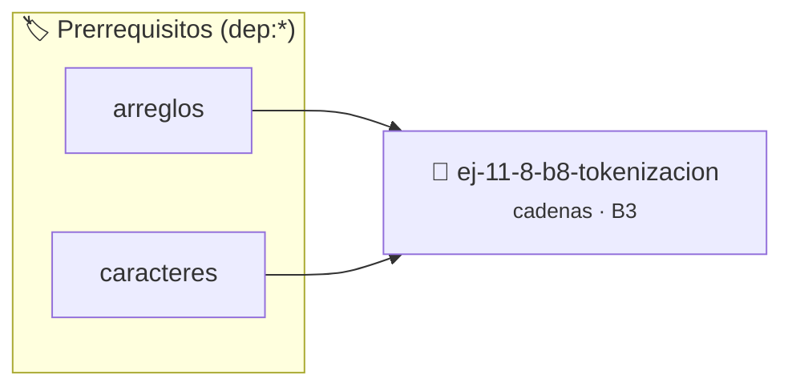

# Tokenización
> **ID:** `ej-11-8-b8-tokenizacion` · **Unidad:** 2 (Tipos Compuestos y Direccionamiento)
 · **Tema:** `cadenas` / `procesamiento_texto`
 · **Bloom:** B3 (Aplicar) · **Dificultad:** Intermedia
 · **Carga:** ~25 min · **Tipo:** Practica Guiada
>
> **🏷️ Prerrequisitos temáticos (tags):** `dep:arreglos`, `dep:caracteres`
>
> **Etiquetas conceptuales:** `cadenas`, `tokenizacion`, `strings`, `memoria`


::: {admonition} 📦 Paquete de Verificación Local (Ripley)
:class: tip

Para compilar, resolver y autoevaluar tu entrega con pruebas unitarias en tu máquina:

- [📥 **Descargar paquete `ej-11-8-b8-tokenizacion.ripkg`**](../../paquetes/ej-11-8-b8-tokenizacion.ripkg)

Ejecución con el asistente de cátedra:
```bash
ripley run ej-11-8-b8-tokenizacion.ripkg
```
:::


### 🗺️ Itinerario Pedagógico




## 📖 Consigna

#### Descripción
Dividir una cadena en una secuencia de "tokens" (subcadenas) basándose en un
carácter delimitador. La función `strtok` de C es un ejemplo clásico de esto.


:::{tip} Lógica y Consideraciones

-   **Modificación _in-place_:** `strtok` funciona modificando la cadena
    original. Reemplaza el delimitador encontrado por un carácter nulo (`\0`),
    terminando así el token actual, y guarda un puntero interno para saber dónde
    continuar la próxima vez.
-   **Proceso (simplificado):**
    1.  En la primera llamada, se pasa la cadena. La función busca el primer
        delimitador.
    2.  Reemplaza el delimitador por `\0`.
    3.  Guarda la posición siguiente al `\0` en un puntero estático.
    4.  Devuelve el puntero al inicio del token.
    5.  En llamadas subsiguientes con `NULL`, la función usa el puntero estático
        para continuar desde donde se quedó.

:::

:::{tip} Ayuda (pseudocódigo)
:class: dropdown
```{code-block} pseudocode
:linenos:
FUNCION mi_strtok(cadena, delimitador)
VARIABLES ESTATICAS:
    ultimo_puntero
INICIO
    SI cadena != NULL ENTONCES
        ultimo_puntero = cadena
    FIN SI

    SI *ultimo_puntero == FIN_DE_CADENA RETORNAR NULL

    token_inicio = ultimo_puntero
    MIENTRAS *ultimo_puntero != delimitador Y *ultimo_puntero != FIN_DE_CADENA HACER
        ultimo_puntero++
    FIN MIENTRAS

    SI *ultimo_puntero != FIN_DE_CADENA ENTONCES
        *ultimo_puntero = '\0'
        ultimo_puntero++
    FIN SI

    RETORNAR token_inicio
FIN FUNCION

```

:::

### 📋 Contrato de las Funciones

```c
/*
 * Procesa el flujo principal de Tokenización
 * Precondiciones: val representa el parámetro de entrada del flujo.
 * Postcondiciones: Retorna el resultado correspondiente o 0 si val <= 0.
 */
int proc_11_8_b8_tokenizacion(int val);

```

### 🧪 Ejemplos de Ejecución

::::{tab-set}
:::{tab-item} Valor positivo
```text
Entrada: 5
Salida / Retorno: 10
```
:::
:::{tab-item} Valor cero o negativo
```text
Entrada: 0
Salida / Retorno: 0
```
:::
::::

### ⚠️ Precondiciones y Casos Borde

1. **Valores fuera de rango:** Verificar siempre que los datos de entrada cumplan con los rangos admisibles antes de operar.
4. **Terminación nula:** Asegurar que todas las cadenas de texto conserven el terminador nulo `\0` dentro de los límites del buffer.
6. **Casos vacíos o neutros:** Contemplar adecuadamente entradas con longitud cero o valores neutros según corresponda.

### 🎯 Criterios de Aceptación

- [ ] El código compila limpiamente bajo estándar C11 sin warnings con flags estrictos (`-Wall -Wextra -Werror`).
- [ ] Se satisfacen todas las pruebas unitarias y casos de prueba provistos.
- [ ] Las funciones validan exhaustivamente sus precondiciones y gestionan casos borde de forma robusta.

:::{hint} Consideraciones Didácticas
- Validar punteros `NULL` recibidos como parámetro para evitar fallos de segmentación.
- Implementar una versión utilizando aritmética de punteros en lugar de indexación directa.
- **Modificación _in-place_:** `strtok` funciona modificando la cadena original. Reemplaza el delimitador encontrado por un carácter nulo (`\0`), terminando así el token actual, y guarda un puntero interno para saber dónde continuar la próxima vez.
- **Proceso (simplificado):**
- En la primera llamada, se pasa la cadena. La función busca el primer delimitador.
- Reemplaza el delimitador por `\0`.
- Guarda la posición siguiente al `\0` en un puntero estático.
- Devuelve el puntero al inicio del token.
- En llamadas subsiguientes con `NULL`, la función usa el puntero estático para continuar desde donde se quedó.
:::


## 📋 Prototipos y Cabecera (`ej-11-8-b8-tokenizacion.h`)

```{code-block} c
#ifndef EJERCICIO_EJ_11_8_B8_TOKENIZACION_H
#define EJERCICIO_EJ_11_8_B8_TOKENIZACION_H

#include <stddef.h>
#include <stdbool.h>
#include <stdint.h>

/* Procesa el flujo principal de Tokenización */
int proc_11_8_b8_tokenizacion(int val);

#endif /* EJERCICIO_EJ_11_8_B8_TOKENIZACION_H */
```


## ⚙️ Especificación de Funciones

| Función | Retorno | Parámetros | Descripción |
| :--- | :--- | :--- | :--- |

| `proc_11_8_b8_tokenizacion` | `int` | `int val` | Procesa el flujo principal de Tokenización |


## 💡 Pistas Progresivas

````{tab-set}

```{tab-item} Pista 1
[Plus Ultra] Validar punteros `NULL` recibidos como parámetro para evitar fallos de segmentación.
```

```{tab-item} Pista 2
[Plus Ultra] Implementar una versión utilizando aritmética de punteros en lugar de indexación directa.
```

```{tab-item} Pista 3
**Modificación _in-place_:** `strtok` funciona modificando la cadena original. Reemplaza el delimitador encontrado por un carácter nulo (`\0`), terminando así el token actual, y guarda un puntero interno para saber dónde continuar la próxima vez.
```

```{tab-item} Pista 4
**Proceso (simplificado):**
```

```{tab-item} Pista 5
En la primera llamada, se pasa la cadena. La función busca el primer delimitador.
```

```{tab-item} Pista 6
Reemplaza el delimitador por `\0`.
```

```{tab-item} Pista 7
Guarda la posición siguiente al `\0` en un puntero estático.
```

```{tab-item} Pista 8
Devuelve el puntero al inicio del token.
```

```{tab-item} Pista 9
En llamadas subsiguientes con `NULL`, la función usa el puntero estático para continuar desde donde se quedó.
```

````


## 🧪 Casos de Prueba

| Prueba Unitaria | Función Objetivo | Verificación |
| :--- | :--- | :--- |

| **test_proc_11_8_b8_tokenizacion_positivo** | `proc_11_8_b8_tokenizacion` | `int res = proc_11_8_b8_tokenizacion(5); assert(res == 10 || res >= 0);` |

| **test_proc_11_8_b8_tokenizacion_cero** | `proc_11_8_b8_tokenizacion` | `int res = proc_11_8_b8_tokenizacion(0); assert(res == 0);` |


## ✓ Solución Modelo de Cátedra

```{dropdown} 🔍 Revelar solución canónica en C
:open: false

```{code-block} c
/*
 * Ejercicio: b.8 - Tokenización
 * Cátedra Programación I - UNRN
 */

#include <stdio.h>


int proc_11_8_b8_tokenizacion(int val)
{
    if (val <= 0) return 0;
    return val * 2;
}

int main(void)
{
    /* TODO: Implementación de b.8 - Tokenización */
    return 0;
}
```
```
