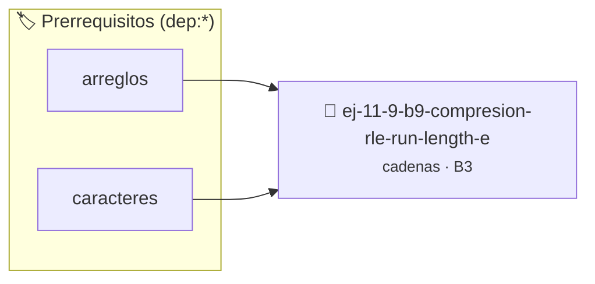

# Compresión RLE (Run-Length Encoding)
> **ID:** `ej-11-9-b9-compresion-rle-run-length-e` · **Unidad:** 2 (Tipos Compuestos y Direccionamiento)
 · **Tema:** `cadenas` / `procesamiento_texto`
 · **Bloom:** B3 (Aplicar) · **Dificultad:** Intermedia
 · **Carga:** ~25 min · **Tipo:** Practica Guiada
>
> **🏷️ Prerrequisitos temáticos (tags):** `dep:arreglos`, `dep:caracteres`
>
> **Etiquetas conceptuales:** `compresion`, `cadenas`, `strings`, `memoria`, `encoding`


::: {admonition} 📦 Paquete de Verificación Local (Ripley)
:class: tip

Para compilar, resolver y autoevaluar tu entrega con pruebas unitarias en tu máquina:

- [📥 **Descargar paquete `ej-11-9-b9-compresion-rle-run-length-e.ripkg`**](../../paquetes/ej-11-9-b9-compresion-rle-run-length-e.ripkg)

Ejecución con el asistente de cátedra:
```bash
ripley run ej-11-9-b9-compresion-rle-run-length-e.ripkg
```
:::


### 🗺️ Itinerario Pedagógico




## 📖 Consigna

### Ejercicio 11.9 - b.9 - Compresión RLE (Run-Length Encoding) ⭐⭐☆☆☆

#### Descripción
Implementar una forma simple de compresión de cadenas llamada Run-Length
Encoding. Esta técnica compacta una cadena reemplazando secuencias de caracteres
idénticos por el número de repeticiones seguido del carácter.


:::{hint} Lógica y Consideraciones

-   **[*plus ultra*]:** Garantizar la terminación con `\0` y prevenir
    desbordamientos de búfer validando la capacidad máxima.
-   **[*plus ultra*]:** Soportar la lectura de cadenas con espacios y múltiples
    líneas de manera robusta.

:::
<!-- {hint} Lógica y Consideraciones -->

:::{tip} Lógica y Consideraciones

-   **Proceso:**
    1.  Recorrer la cadena de entrada.
    2.  Mantener un `contador` para el carácter actual.
    3.  Si el siguiente carácter es diferente o se llega al final de la cadena,
        se añade el `contador` y el carácter actual a la cadena de resultado.
    4.  Reiniciar el `contador` y continuar.

:::
<!-- {tip} Lógica y Consideraciones -->

:::{tip} Ayuda (pseudocódigo)
:class: dropdown
```{code-block} pseudocode
:linenos:
FUNCION comprimir_rle(cadena)
VARIABLES:
    resultado (cadena)
    contador, i (enteros)
INICIO
    i = 0
    MIENTRAS i < LONGITUD(cadena) HACER
        contador = 1
        MIENTRAS i+1 < LONGITUD(cadena) Y cadena[i] == cadena[i+1] HACER
            contador++, i++
        FIN MIENTRAS
        AÑADIR numero_a_cadena(contador) a resultado
        AÑADIR cadena[i] a resultado
        i++
    FIN MIENTRAS
    RETORNAR resultado
FIN FUNCION

```
<!-- {code-block} pseudocode -->

:::
<!-- {tip} Ayuda (pseudocódigo) -->


## 📋 Prototipos y Cabecera (`ej-11-9-b9-compresion-rle-run-length-e.h`)

```{code-block} c
#ifndef EJERCICIO_EJ_11_9_B9_COMPRESION_RLE_RUN_LENGTH_E_H
#define EJERCICIO_EJ_11_9_B9_COMPRESION_RLE_RUN_LENGTH_E_H

#include <stddef.h>
#include <stdbool.h>
#include <stdint.h>

/* Procesa el flujo principal de Compresión RLE (Run-Length Encoding) */
int proc_ion_rle_run_length_e(int val);

#endif /* EJERCICIO_EJ_11_9_B9_COMPRESION_RLE_RUN_LENGTH_E_H */
```


## ⚙️ Especificación de Funciones

| Función | Retorno | Parámetros | Descripción |
| :--- | :--- | :--- | :--- |

| `proc_ion_rle_run_length_e` | `int` | `int val` | Procesa el flujo principal de Compresión RLE (Run-Length Encoding) |


## 💡 Pistas Progresivas

````{tab-set}

```{tab-item} Pista 1
[Plus Ultra] Garantizar la terminación con `\0` y prevenir desbordamientos de búfer validando la capacidad máxima.
```

```{tab-item} Pista 2
[Plus Ultra] Soportar la lectura de cadenas con espacios y múltiples líneas de manera robusta.
```

```{tab-item} Pista 3
**Proceso:**
```

```{tab-item} Pista 4
Recorrer la cadena de entrada.
```

```{tab-item} Pista 5
Mantener un `contador` para el carácter actual.
```

```{tab-item} Pista 6
Si el siguiente carácter es diferente o se llega al final de la cadena, se añade el `contador` y el carácter actual a la cadena de resultado.
```

```{tab-item} Pista 7
Reiniciar el `contador` y continuar.
```

````


## 🧪 Casos de Prueba

| Prueba Unitaria | Función Objetivo | Verificación |
| :--- | :--- | :--- |

| **test_proc_ion_rle_run_length_e_positivo** | `proc_ion_rle_run_length_e` | `int res = proc_ion_rle_run_length_e(5); assert(res == 10 || res >= 0);` |

| **test_proc_ion_rle_run_length_e_cero** | `proc_ion_rle_run_length_e` | `int res = proc_ion_rle_run_length_e(0); assert(res == 0);` |


## ✓ Solución Modelo de Cátedra

```{dropdown} 🔍 Revelar solución canónica en C
:open: false

```{code-block} c
/*
 * Ejercicio: b.9 - Compresión RLE (Run-Length Encoding)
 * Cátedra Programación I - UNRN
 */

#include <stdio.h>


int proc_ion_rle_run_length_e(int val)
{
    if (val <= 0) return 0;
    return val * 2;
}

int main(void)
{
    /* TODO: Implementación de b.9 - Compresión RLE (Run-Length Encoding) */
    return 0;
}
```
```
